# Grind District

**Learn Web3 in a 3D city and leave with proof.** Pass a short lesson at Campus and it goes on your CV with a certificate, which you can mint on Base or NEAR testnet as a soulbound NFT. After the exam, the game also records it on Solana devnet.

Millions of people want to work in Web3, but they learn from scattered videos, get scammed on the way, and end up with nothing that proves what they know. Grind District turns a short lesson into proof you keep.

**New here?** Read the beginner's guide: [How Grind District works](https://www.grinddistrict.app/how-it-works) · [Certificates](https://www.grinddistrict.app/certificates) · [Compared with Web3 courses](https://www.grinddistrict.app/vs-courses)

**Play (phone or desktop, no install):** https://www.grinddistrict.app · [Demo post](https://x.com/0xarewah/status/2119301193100837169) · Made by [Zahra](https://0xzahra.github.io)

## The core loop (about 5 minutes)

1. **Enter the Enter the district: grinddistrict.app** Sign up with Google, X, email or a NEAR wallet. Zahra, the Campus guide, gives a one-minute tour.
2. **Go to Campus.** The gold *Next step* button takes you there. Campus is just north of the plaza.
3. **Finish a short lesson.** Three short cards and two quick checks with Zahra.
4. **See the proof.** The course is on your CV with a certificate: Profile, right under your name.
5. **Optional: mint it on Base or NEAR testnet.** Open the certificate and tap *Mint as NFT*, then Base or NEAR (testnet). First comes a short exam on the course, graded on the server (the device's own record of the lesson is not enough). Then the game mints, reads the token back and marks the course *Verified on NEAR*. Passing the exam also records the certificate on Solana devnet, with no wallet needed.

The rest of the city (jobs, practice trading, shops, the park, the airport) is optional. It stays in the background until you have passed a first lesson.

| Campus | Your CV | Your certificate |
| --- | --- | --- |
| 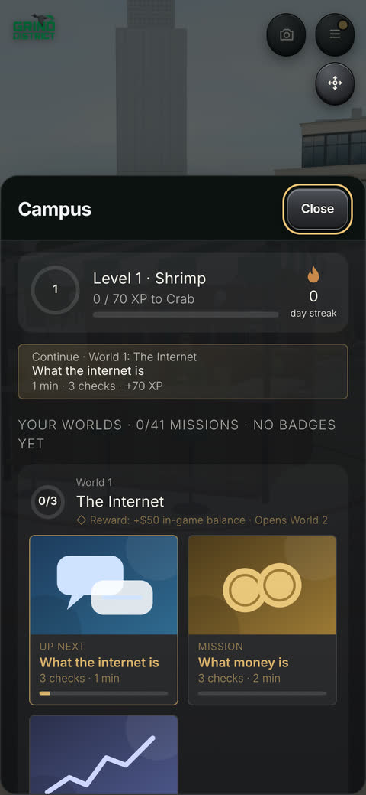 | 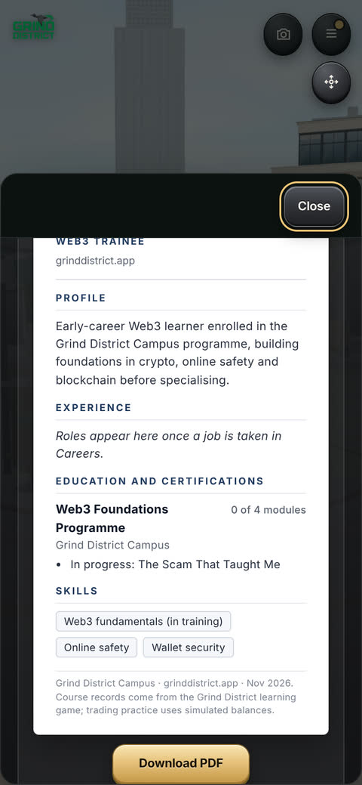 | 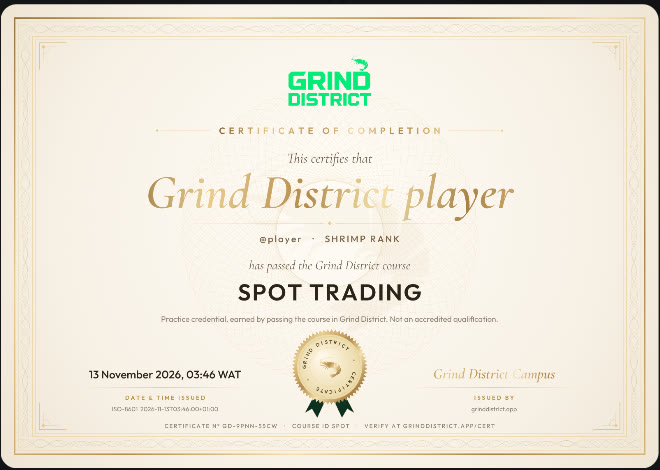 |

## The NEAR mint, step by step (about 3 minutes)

1. **Mint.** On the certificate, tap *Mint as NFT* > NEAR. Pass the short exam (the course's checks, shuffled and timed by the server, which grades them; three in four to pass). Then a soulbound NEP-171 token is minted on [`grinddistrict-cert.testnet`](https://testnet.nearblocks.io/address/grinddistrict-cert.testnet) to your NEAR testnet account (0.05 NEAR attached for storage). You need a NEAR testnet wallet such as [Meteor](https://meteorwallet.app) with a little free testnet NEAR from [near-faucet.io](https://near-faucet.io). No testnet wallet? Tokens [#1](https://testnet.nearblocks.io/nft-token/grinddistrict-cert.testnet/1) and [#2](https://testnet.nearblocks.io/nft-token/grinddistrict-cert.testnet/2) show the same mint already done, and step 3 works without signing in.
2. **See it do something.** The game calls the view method `cert_for({ username, course_id })` and marks that course *Verified on NEAR* on your CV and profile, and the members-only **Holders' room** in the Members' lounge opens.
3. **Check it anywhere.** The certificate's public page reads the chain too: [this certificate](https://www.grinddistrict.app/cert/eyJ2IjoyLCJuIjoiMHh6YXJhIiwidSI6InphcmEiLCJyIjoiQ3JhYiIsImMiOiJpbnRlcm5ldCIsInQiOiJXaGF0IHRoZSBpbnRlcm5ldCBpcyIsImQiOiIyMDI2LTExLTEwIiwiYXQiOjE3OTQzMzc0MjE1NDJ9) shows *Minted on NEAR · [Token #1](https://testnet.nearblocks.io/nft-token/grinddistrict-cert.testnet/1)*.

| Verified on NEAR | Holders' room |
| --- | --- |
| 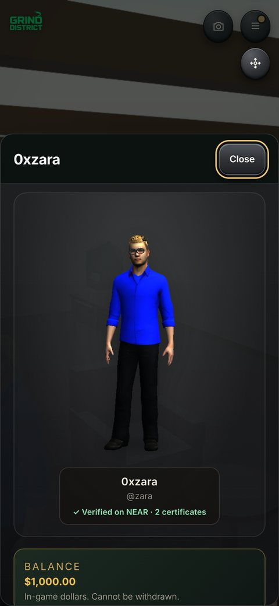 | 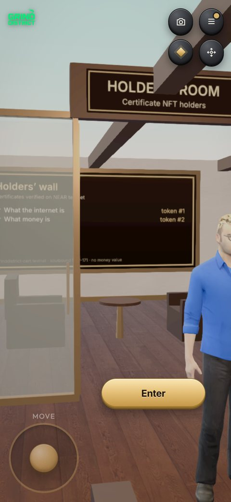 |

## NEAR hackathon entry

| | |
| --- | --- |
| **Tracks** | Games With Real Economies (`games`). The certificate NFTs also fit NFTs That Do Something: they carry a credential and open a members-only room. The game as a whole is also an Open Innovation entry: a school where the lessons pay for a life in a city. |
| **How NEAR fits the game** | Sign in with Google, X, email or a NEAR wallet (NEP-413 signed message). Learning and playing need no wallet. NEAR comes in when a player chooses to mint a certificate, and the game then reads it back with `cert_for` to unlock things. The town economy (resident wallets, wages, the business you own) runs in game dollars inside the game, not on NEAR. |
| **Check it yourself (read-only)** | `near view grinddistrict-cert.testnet nft_total_supply '{}'` → `"2"` · `near view grinddistrict-cert.testnet cert_for '{"username":"zara","course_id":"internet"}'` → token #1 · `node near/skill-passport/check-testnet.mjs` → `OK` |
| **Contracts** | [`grinddistrict-cert.testnet`](https://testnet.nearblocks.io/address/grinddistrict-cert.testnet): soulbound certificate NFTs, 11 tests. [`grinddistrict-passport.testnet`](https://testnet.nearblocks.io/address/grinddistrict-passport.testnet): Skill Passport, 22 tests. Rust, MIT. |
| **Proof it ran** | Tokens [#1](https://testnet.nearblocks.io/nft-token/grinddistrict-cert.testnet/1) and [#2](https://testnet.nearblocks.io/nft-token/grinddistrict-cert.testnet/2), minted 11 Nov 2026, read back by the game |
| **Built in the window** | In numbers, up to the entry commit: 210 of the 326 commits; 24,574 of the 40,185 lines of code (61%) were written in the window (the code base grew from 18,453 lines); and the 20 files of NEAR and certificate-mint code (7,527 lines: both contracts, NEAR sign-in, the mint and the read-back) did not exist before it. Reproduce with `git diff --shortstat pre-hackathon 394ef41`. Everything since baseline commit `39a1707` (1 Nov 2026), tagged `pre-hackathon`: [one diff](https://github.com/0xzahra/Grind-district/compare/pre-hackathon...main). The entry is the last commit on `main` before 14 Nov 2026 23:59 UTC; anything committed later is not part of it. The full list with commits and both contracts is in [`docs/NEAR-ENTRY.md`](docs/NEAR-ENTRY.md). |
| **Disclosure** | An existing project: 116 commits came before 1 Nov. Other chains: the in-game top-up on Base (built before 1 Nov), plus two Base features built in the window, the Base option of the certificate mint ([`GrindCertificate`](https://basescan.org/address/0xBEC44b497b5D4696644A5ad581804476CB20808f)) and the Stockholders' Club. None of the Base work is part of this entry. All NEAR work was built in the window. The submission is the last commit before 14 Nov 2026 23:59 UTC. |

## Dev3pack entry (Solana)

| | |
| --- | --- |
| **What it is** | A free 3D city in the browser where you learn Web3 in short lessons, pass a server-graded exam and leave with a certificate you can prove on-chain. Live: https://www.grinddistrict.app |
| **Solana program (devnet)** | `grind-cert`, Grind District's own Rust program (native `solana-program`, no framework): [`6NJLLRRTkvEwijjSo62HHJF4trQowqJJLWDXxPdMB1Hd`](https://explorer.solana.com/address/6NJLLRRTkvEwijjSo62HHJF4trQowqJJLWDXxPdMB1Hd?cluster=devnet). Source: [`programs/grind-cert/src/lib.rs`](programs/grind-cert/src/lib.rs). Deploy tx: [44YTEs9w…](https://explorer.solana.com/tx/44YTEs9wMkYH7i9CYNsAh2e96cibKc5PbjS8cyDbw2sxrFJLpkkSGbtYbEiDw9nng1ivffKXSRmaRs1ivcnKeNSf?cluster=devnet). Config set up (issuer + project owner): [4hXJqQ3c…](https://explorer.solana.com/tx/4hXJqQ3cMNi6S7xhVTLwjXYFMLZMygsyUEMTCdvwZTcrJHuwXz5MwSaEZ6XtnydNFE76R2YDhVFs9iKyHJvan87t?cluster=devnet). |
| **How Solana is used** | 1) **Certificates:** when a player passes a course and its server-graded exam, the game server (the only issuer) writes a soulbound certificate account on Solana: one PDA per player and course (`["cert", player_id, sha256(course)]`) holding the course id, the sha256 of the certificate id, a serial number and the on-chain timestamp. There is no transfer instruction, so it cannot be moved or sold. No name, email or wallet goes on-chain: `player_id` is an HMAC of the username. The public certificate page reads the record back and shows *Recorded on Solana*. 2) **Top-ups:** an optional Solana Pay top-up (SOL or USDC) for in-game dollars, live since 21 Nov. |
| **Program instructions** | `InitConfig` (issuer + project owner address, once), `Issue` (issuer only, one per player and course), `SetIssuer` (key rotation), `Revoke`, `Close` (issuer only; used to clean up self-tests). Errors: `NotIssuer` 6000, `AlreadyInitialized` 6001, `BadAccount` 6002, `AlreadyIssued` 6003. |
| **Server and game code** | `api/_certSolana.ts` (builds and sends `Issue`, reads records back), `api/profile.ts` (`op=cert-issue` records on Solana after the exam pass), `api/_certMint.ts` (`chain: "solana"`, same gates as Base and NEAR: exam pass ticket, one per course), `src/chains/router.ts` + [`docs/multichain-router.md`](docs/multichain-router.md) (route `solana-devnet`), `tests/chains.check.ts` (Solana checks). |
| **Check it yourself** | `solana account GUgLpSq12rRVBWt1e2mdyAdqJkskJPdo2437iwQg7G1f -u devnet` (the config: issuer, owner, number issued) · `solana program show 6NJLLRRTkvEwijjSo62HHJF4trQowqJJLWDXxPdMB1Hd -u devnet` |
| **Run and test** | `cd programs/grind-cert && cargo build-sbf` builds the program. With `solana-test-validator` running: deploy it, then `CERT_SOLANA_RPC=http://127.0.0.1:8899 GD_SOL_ACTION=init node --experimental-strip-types --import ./scripts/ts-hooks.mjs scripts/solana-cert.mjs` and `GD_SOL_ACTION=selftest …` (issues a record through the server code, checks the on-chain fields, checks that a second issue is refused and a non-issuer is refused, then closes it). `npm run build` runs the TypeScript checks. |
| **Before 27 Nov vs during the hackathon** | **Before:** the game itself (the city, lessons, CV, server-graded exam), certificate NFTs on Base and NEAR testnet, sign-in, and the Solana Pay and NEAR Intents top-ups. **During (27–29 Nov):** the multichain certificate router, the NEAR mainnet certificate contract alongside testnet, the optional EAS attestation on Base, and all of the Solana certificate work: the `grind-cert` Rust program, its devnet deployment, the server issuer, the route, tests and this section. |
| **Devnet self-test (28 Nov)** | A throwaway certificate was issued through the server code and read back, then closed: issue [`5C8z3XqJ…`](https://explorer.solana.com/tx/5C8z3XqJe8XoAT2Em8CRWqxSNrLsDAKH7m6T8LTEvF3YYZmFH3qdcVHmC22sXa1u7tr4vBBhGVgtNex8S53wNHdr?cluster=devnet), close [`2kZyPB5z…`](https://explorer.solana.com/tx/2kZyPB5za4mSWiYudbR8whvpuhzDxQjkx32wBhu7bNcZSXtMFZ9E9b8km8UxECiTcJy13aadkEaLvyg28hgZzHE8?cluster=devnet). |
| **Network** | Solana devnet (test SOL, no money value). The issuer pays the devnet fee, so players need no Solana wallet. A mainnet deploy would need real SOL and is not part of this entry. |
| **Not done yet** | No Solana button in the game's mint dialog (the record is written automatically after the exam pass instead). |

## For reviewers and AI agents

A map from each claim above to the code that does it, and a way to check it without signing in. The hackathon entry is commit [`394ef41`](https://github.com/0xzahra/Grind-district/commit/394ef41), the last commit on `main` before 14 Nov 2026 23:59 UTC. Work after the deadline is listed under *Added after the deadline* and is not part of the entry; the live game and `main` include it.

| Claim | Where it lives | Check it |
| --- | --- | --- |
| A short lesson with checks, filed to a CV | `src/courses.ts`, `src/worldCourses.ts` (lessons and checks), `src/cvPaper.ts` (the CV), `src/objective.ts` (the *Next step* button) | `npm run build` runs `tsc` and the checks in `src/logic.check.ts` |
| Zahra's tour teaches the loop | `src/mentor.ts`, `src/mentorLines.ts` | Open the game in a private window and sign up |
| Minting needs a pass on a server-graded exam, so editing a save cannot produce a certificate | `api/_certExam.ts` (signed exam paper, grading, 30-minute pass ticket), `api/_certExamBank.ts` (answer key generated from the lessons), `api/_certMint.ts` (voucher refused without a ticket), `src/certExam.ts` (the exam screen) | `npm run build` runs `tests/cert.check.ts`: 16 exam checks (no answers on the paper, wrong or late or someone else's paper refused, tampered ticket refused) |
| Certificate NFT, soulbound, minted only with a server voucher for the caller's own account | `near/cert-nft/src/lib.rs` (`nft_mint`, `cert_for`), `api/_certVoucher.ts` (ed25519 voucher), `src/certMint.ts` (client) | `cd near/cert-nft && cargo test` → 11 passed |
| The NFT does something: read back from the chain, never from local state | `src/nftAccess.ts` (*Verified on NEAR*, Holders' room), `api/_certChain.ts` (public certificate page) | `near view grinddistrict-cert.testnet cert_for '{"username":"zara","course_id":"internet"}'` |
| Sign in with a NEAR wallet | `api/_nearAuth.ts` (NEP-413 signed message, server-issued single-use nonce, signing key checked against the account on NEAR, then a short game session) | Read the file, or run `tests/near-auth.check.ts` |
| Learning numbers, live | `api/_stats.ts` (counts only, no names) | `curl -s https://www.grinddistrict.app/api/track?op=stats` → `learners`, `lessonsPassed`, `certificates`, `returning7d` |
| Skill Passport contract | `near/skill-passport/src/lib.rs` | `cd near/skill-passport && cargo test` → 22 passed; `node near/skill-passport/check-testnet.mjs` → `OK` |

Limits, stated plainly: the contracts are on NEAR **testnet**; moving to mainnet is three commands for the owner's wallet, written out in [`docs/NEAR-MAINNET.md`](docs/NEAR-MAINNET.md) (the code already follows whichever contract is configured). Lessons are recorded on the player's device; the on-chain certificate also needs the server-graded exam, which is open-book and timed, not proctored. The in-game economy uses game dollars, not a token. The 3D city needs WebGL; on a machine without a GPU, the steps in *Run from source* still build and test everything.

## Beyond the core loop (optional)

Everything below is real and playable, but secondary: none of it is needed to learn, earn a certificate or mint it.

- **Campus:** six worlds of one-minute lessons with Zahra, a voiced guide. Each pass is filed to a CV with a certificate.
- **A life in the city:** a home to cook, sleep and shower in, needs that fall while you play, shops, a hospital, jobs and a season with a Grind Pass. Reputation is the only score.
- **A town economy:** every resident has a wallet and a daily wage. Own a business in the Market hall, set your price, and residents buy from their own wallets, so the town can only spend what it earns. Make friends with residents and host events.
- **Practice trading:** Spot, Perps, Convert and P2P on simulated prices, with scam scenarios. Practice money only.
- **Social:** players and residents in one city, nearby chat, messages, and AI agents as labelled citizens.
- **More to do:** the Etiquette House (manners and a steady mind), a Raceway time trial, a Wellness house, 27 collectible District Cards (nothing random), a photo card to share, and a dealership of seven cars from a city saloon to a hypercar.
- **Drive and race:** drive your own car or a free test drive in the city (one stick, one button), race three rival drivers on the Grind Raceway circuit, and cruise the bay in a day cruiser.
- **Tokenized stocks:** the Stockholders' Club opens for players who hold a stock token on Base ([how it works](docs/BASE-STOCKS.md)).
- **14 languages**, phone first, Low, Medium and High graphics.

<b>Added after the deadline (15 Nov onward)</b>: not part of the hackathon entry; the live game and <code>main</code> include it

18 Nov: the title screen is now a sharp still of the whole district rendered from the real city (860×1864 for phones, 1920 and 2560 wide for computers) instead of the 3D fly-over, which lagged on phones; the haze is gone from the city (no depth blur on High, only a faint fade at the far horizon); every work in the gallery links to its OpenSea page next to Etherscan; and the NEAR testnet top-up creates orders again (the order amount is now read as exact text).

17 Nov, later: **Grind Art Gallery** (*ON-CHAIN*), on the promenade: 18 NFTs read live from Ethereum and hung like real art, starting with Beeple (EVERYDAYS: THE FIRST 5000 DAYS and HUMAN ONE), then Bored Apes and Mutant Apes, three alien CryptoPunks drawn from the CryptoPunksData contract, Art Blocks (Chromie Squiggle #0, Fidenza #313, Ringers #879), Azuki, Doodles, Pudgy Penguins, World of Women and Cool Cats. The server (`/api/track?op=gallery`, `api/_gallery.ts`) reads each token's metadata address and current owner over public RPC, cached for six hours; images stay where their creators host them. Each work has a museum label and a *Look closer* card with the contract, the owner and an Etherscan link. **Surfing** at Grind Surf School on the beach. Profile sections fold away under their titles. 17 Nov: **Your Web3 personality** in Profile, read only from how you play, on your device: hand type (diamond, steady or paper, from dips held through or sold at the bottom), trading style (scalper, day, swing or long-term holder, from hold times), risk appetite (conservative to degen, from big caps vs memecoins, position sizes and leverage), rhythm and habit, learning style, people and money habits; every line shows its evidence and a confidence, and says what to play to unlock it instead of guessing. The best-fit **Web3 roles** (trader, research analyst, community manager, content creator, designer, builder, security analyst, founder and partnerships, airdrop explorer) and **niches** (DeFi, memecoins, NFTs, AI agents, ReFi, gaming, infrastructure, security, payments, creator economy, DAOs), each with reasons and a next step. Star signs are shown for fun and only say whether the play agrees; they never change the reading. **Home staff** from the staff intercom in the hall: a house help, a chef, a personal assistant (a daily brief with the next lesson, needs, birthdays, holidays and your best-fit role), a driver, a security guard (scam-safety tips) and a gardener, paid by the week in-game with nothing renewing by itself, standing at their posts in the house. Also: swimming in pools in the swimwear picked at the Boutique, house doors that open as you come near, a daily journal card, and the NEAR top-up on testnet.

A NEAR mainnet top-up for in-game purchases (the player sends NEAR from their own wallet, the server checks the transaction over NEAR RPC and credits the in-game balance once; built, switched off until its account is configured); a short exam graded on the server before any certificate is minted; live learning numbers (learners, courses passed, certificates, returning players) in the city stats and at `/api/track?op=stats`; a step-by-step NEAR mainnet guide; the menu now leads with *Learn* (the first or next lesson), and Boutique, Trade and Seasons wait until the first lesson is passed; the city opens in daytime and the clock and seasons stay put unless the player picks Auto; main keys in the logo's green. Before that, also on 15 Nov: luxury homes at Grind Realty (a duplex, a mansion with an escalator and a glass lift, a penthouse and a sky house with infinity pools, whole-room looks, premium pieces), referral rewards and tracking for invite links, and the Grind Metro train out to Grind Park (a $100 day pass at the gate; a roller coaster, a speed slide, a tube slide, a Ferris wheel and a carousel, all seated rides). Then: Grind International Airport with flight GA 101 in Economy, Business or First over the sea and the city; the Grind One party jet and a party yacht with a DJ and guests; Grind Park's picnic lawn, Grind Zoo with a safari tram, and three holes of golf; Grind Orbital, a rocket trip to orbit and back to a splashdown; the four seasons and a Seasons & climate view of 2050 and 2100 under low and high emissions; the Grind Grand hotel with a rooftop infinity pool, and Grind Mall with the Grind Fresh supermarket, a food court and a cinema; a realistic skyline. Then: eight premium Society Masterclasses at the Etiquette House (the wealth mindset, quiet luxury, signal and larping, fine dining, working the room, presence, first-class travel, negotiation); graduation from Campus with a ceremony and a downloadable diploma; El Niño and La Niña years; a guided sea-cliff climb and a tandem skydive; notifications as 3D buttons with each update. Screenshots: [first set](docs/shots-2026-11-15/), [second set](docs/shots-2026-11-15b/).

## Why onchain

- **Proof you keep.** A certificate kept only on our server proves something only while we exist and say so. The NEAR token sits under your own account on a public chain. Anyone can check it with one read (`cert_for`) without asking us, and it stays if the site goes away.
- **Earned, not bought.** The token is soulbound: it cannot be sold or moved, so it shows what you passed, not what you paid for.
- **The game trusts the chain.** The game reads the token back from NEAR, not from local data, before it marks a course *Verified on NEAR* on your CV and profile and opens the Holders' room.
- **Honest limits.** It is on testnet for now. Certificates are practice credentials, not accredited qualifications, and they have no money value.

## How it makes money without a token

- **Today.** The game is free to play. The only real money that comes in is an optional top-up (USDC or ETH on Base, $1 to $1,000, SOL or USDC on Solana through Solana Pay, or from SOL, USDC and ETH on Solana, Base and Arbitrum through NEAR Intents, $1 to $500, delivered as USDC to grinddistrict.near) that adds in-game dollars for looks, the Grind Pass and paid ranks. A top-up never buys a lesson or a certificate, and in-game dollars cannot be withdrawn. Players pay their own network fees, including the small NEAR storage fee for a mint.
- **Planned, not built yet.** Partner courses from Web3 projects, with their own certificates. A job board that links CVs to real Web3 roles.
- **No token.** There is no Grind District token. The draft in the [GDD](docs/GDD.md) is for discussion only, and any token would need legal review first.

## Who keeps playing and what's next

- **Who it is for.** People who are curious about Web3 and want to learn it without getting scammed, and people looking for Web3 work who need proof of what they know.
- **Reasons to come back today.** A daily streak, needs that drop while you are away, a business that keeps selling to residents while you are gone (up to two hours are caught up), the Grind Pass season, friendships and events with residents, and messages with push and email alerts.
- **Next (plans).** Dec 2026 to Q1 2027: an AI companion run on NEAR AI, sign-in from any chain with NEAR Intents, gas-sponsored certificate mints and alerts for streaks and events. Q1 to Q2 2027: partner courses, guilds and team challenges, and tools for community lessons. H2 2027: mainnet credentials that employers can check, and the job board. The full roadmap is in the [GDD](docs/GDD.md#18-roadmap).

## Screenshots

| Campus | Zahra's tour | CV |
| --- | --- | --- |
|  | 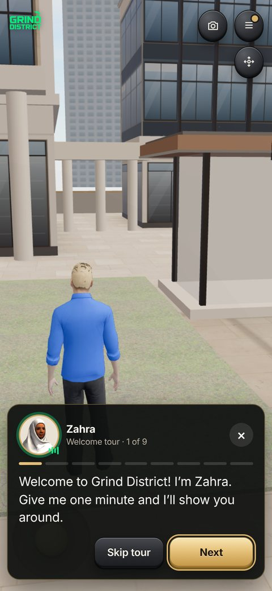 |  |

| Trade | Trading floor | Wallet |
| --- | --- | --- |
| 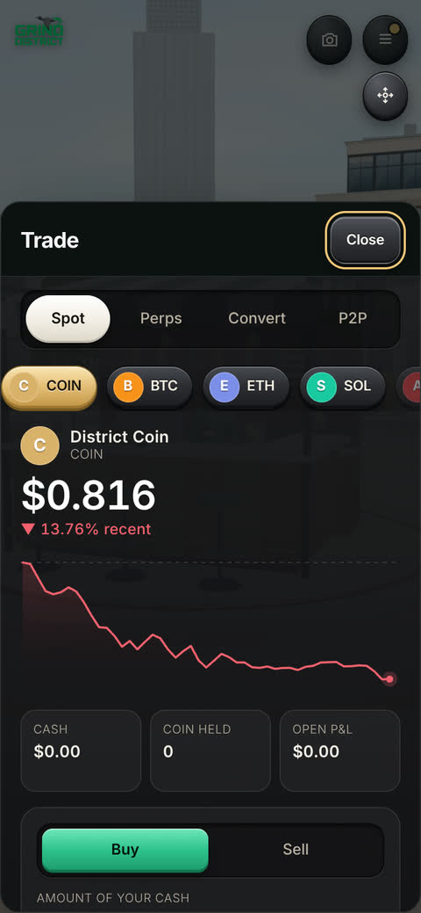 | 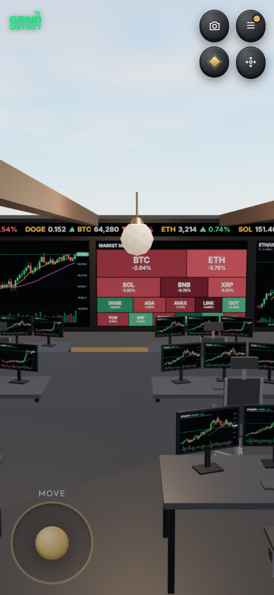 | 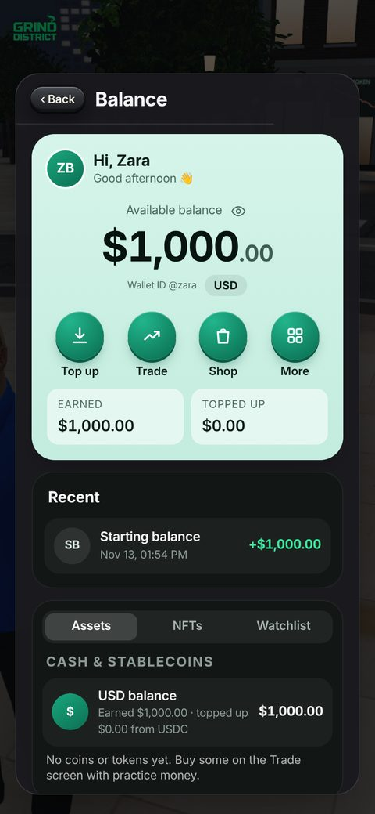 |

| Needs and mood | Grind Pass | Rank road |
| --- | --- | --- |
| 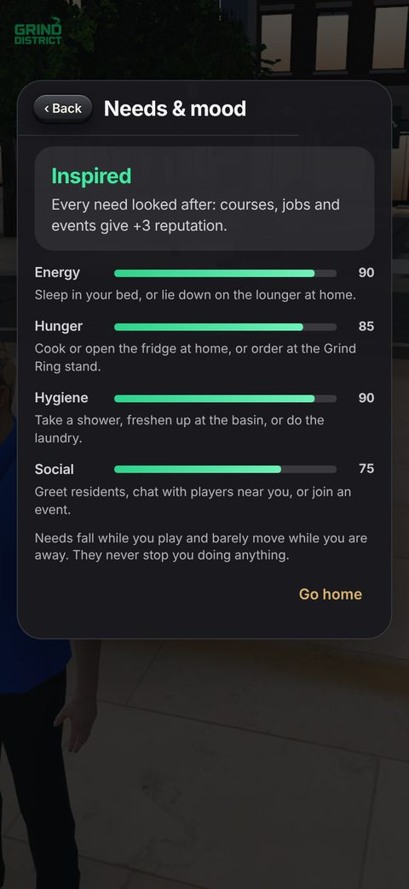 | 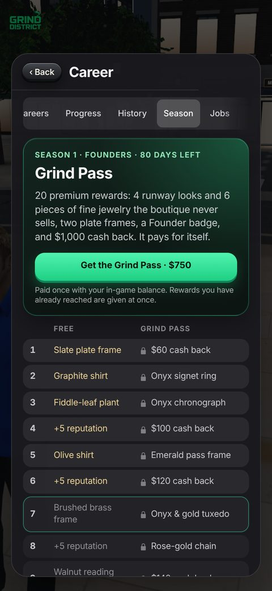 | 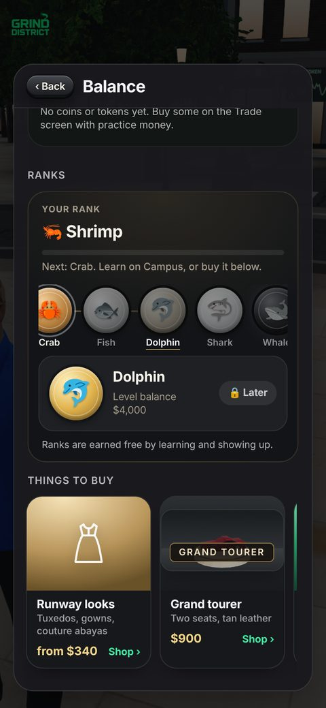 |

| Home | Plaza | Your street |
| --- | --- | --- |
| 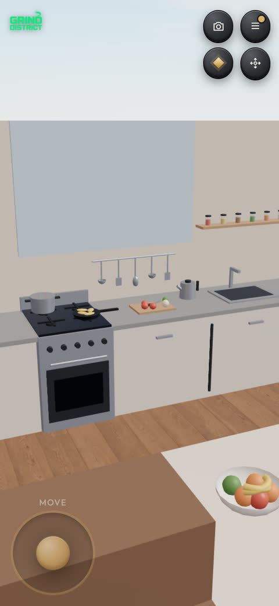 | 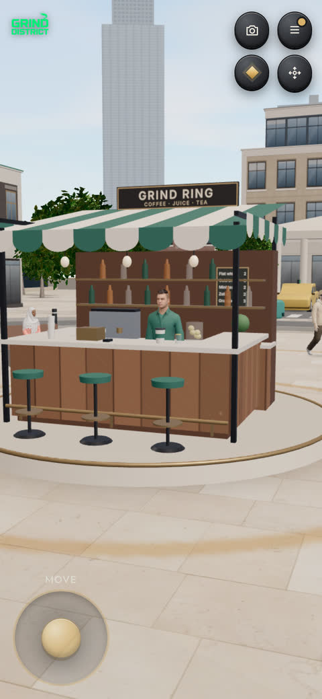 | 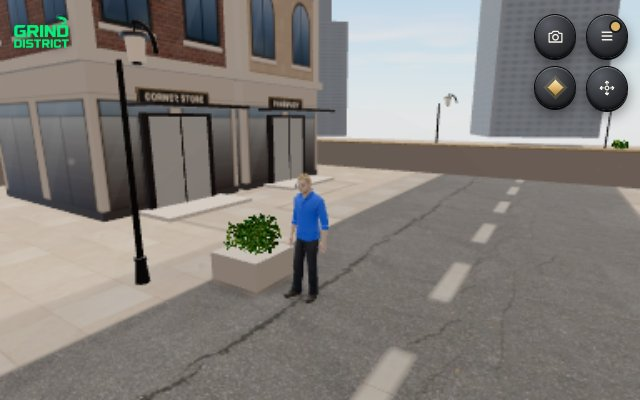 |

| Boutique | Clothes on the rails | Fine jewellery |
| --- | --- | --- |
| 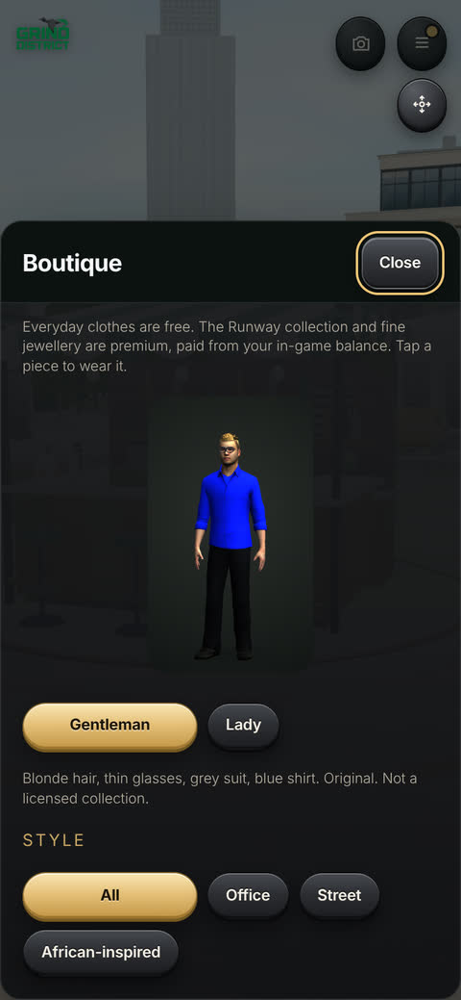 | 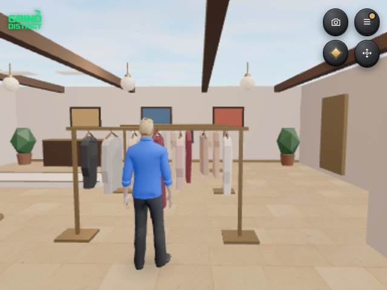 | 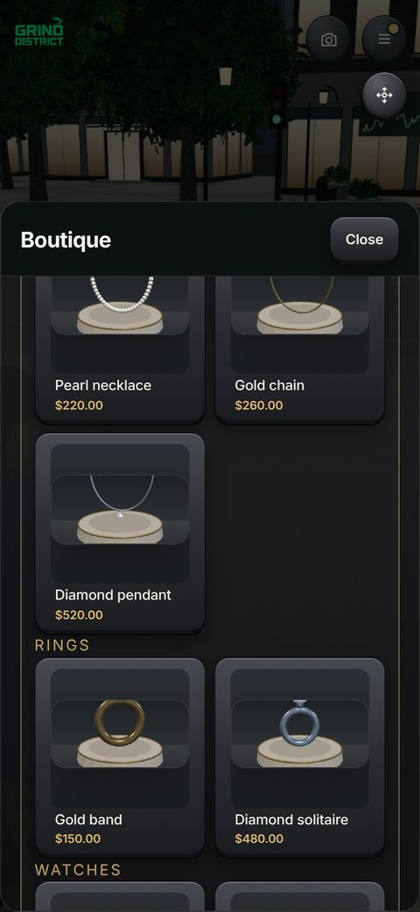 |

| Market hall | Residents and wallets | District Cards |
| --- | --- | --- |
| 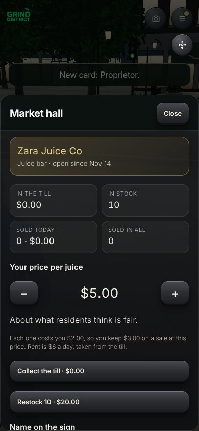 | 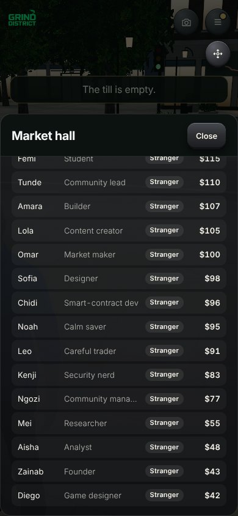 | 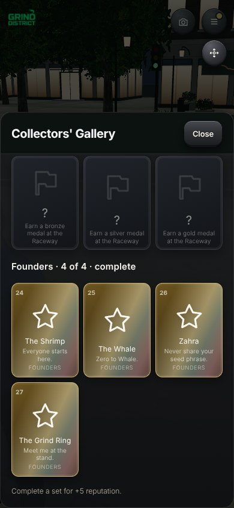 |

| Raceway | Etiquette House | Photo card |
| --- | --- | --- |
| 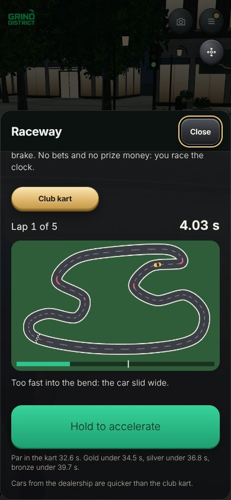 | 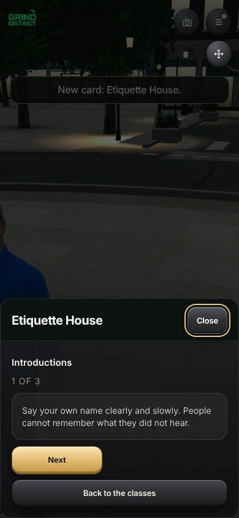 | 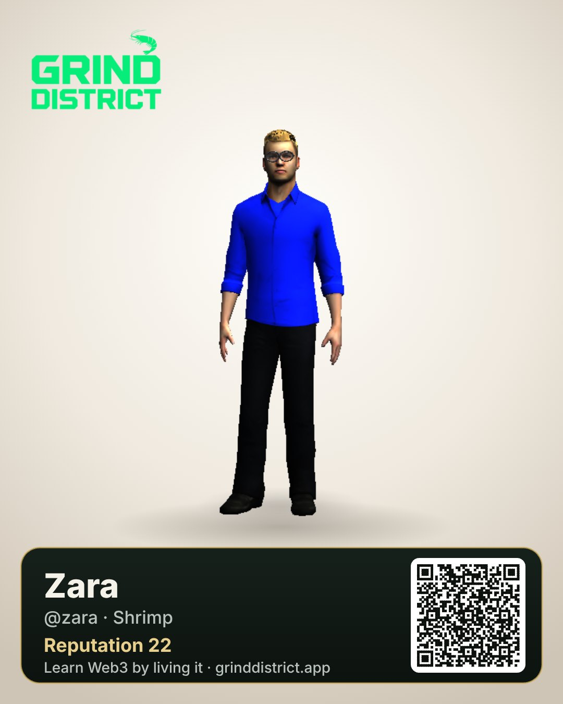 |

| Makeup kit | Zahra at Campus | The casino front |
| --- | --- | --- |
| 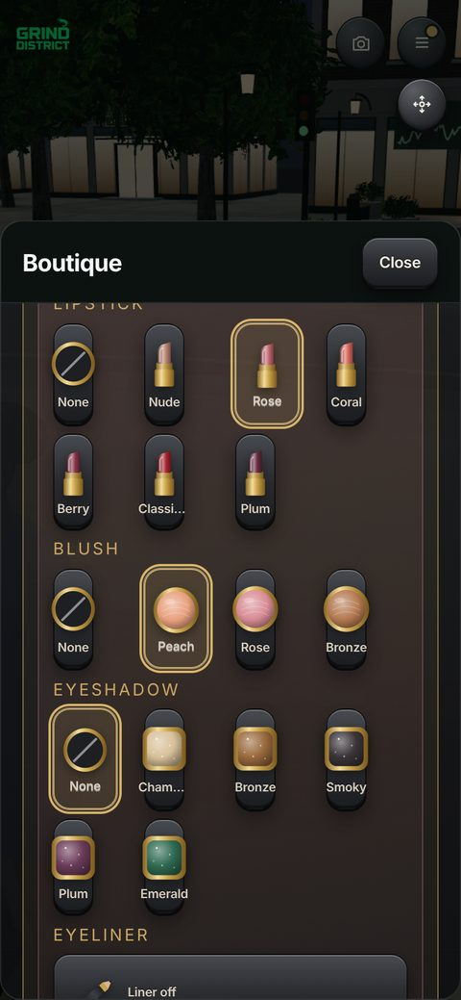 | 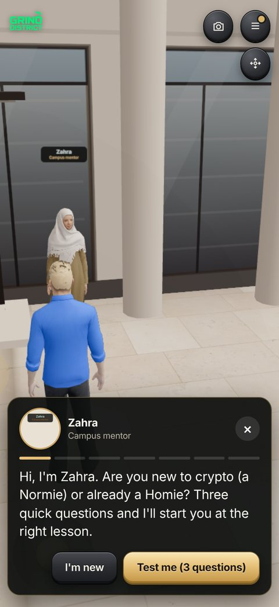 | 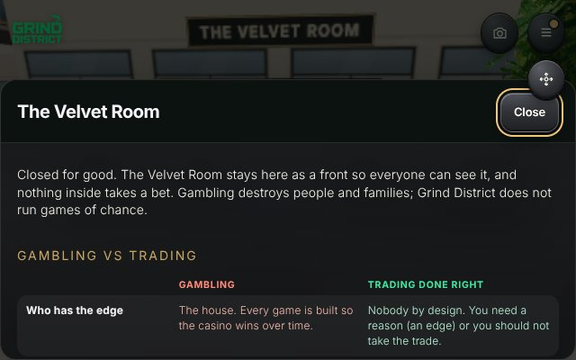 |

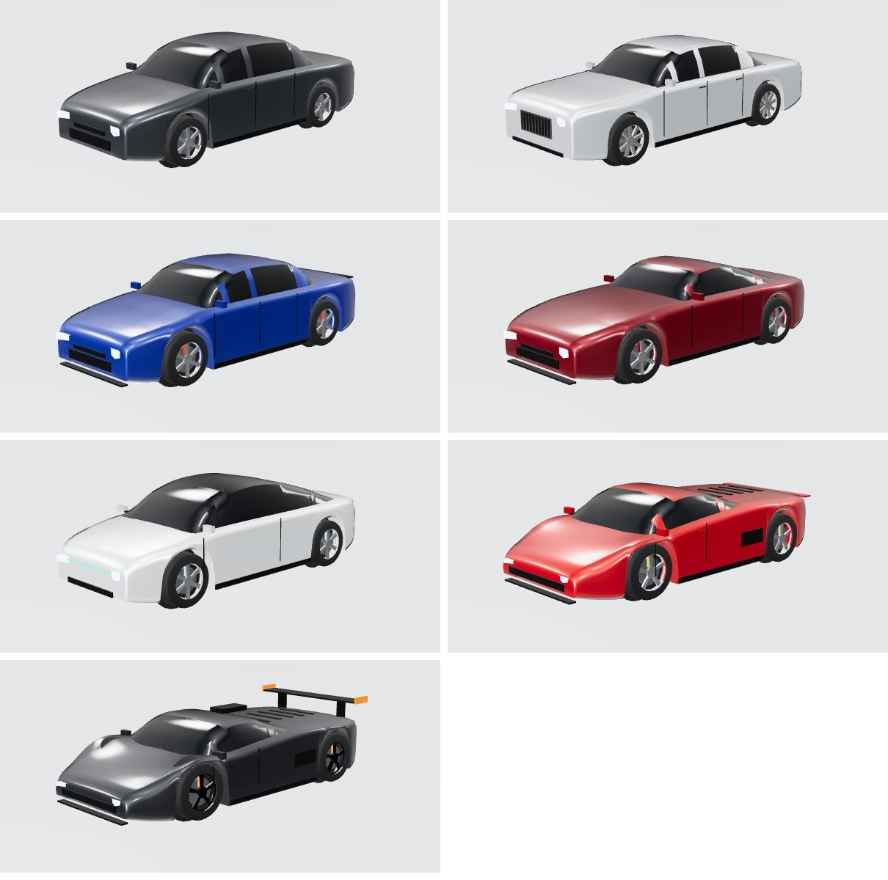

The full design is in the [GDD](docs/GDD.md).

## Run from source

Node 22 or newer. Rust with `cargo` for the contract tests.

| Do | You should see |
| --- | --- |
| `npm ci` then `npm run build` | `tsc` passes, each check script prints `ok` lines, then `✓ built` |
| `node tests/career-lessons.check.mjs` | Two `ok` lines |
| `cd near/skill-passport && cargo test` | `test result: ok. 22 passed` |
| `cd near/cert-nft && cargo test` | `test result: ok. 11 passed` |
| `node near/skill-passport/check-testnet.mjs` | The live contract's info from NEAR testnet, then `OK` |
| `cd programs/grind-cert && cargo build-sbf` (Solana CLI installed) | `target/deploy/grind_cert.so` |
| `npm run dev`, open the local address, then run `window.dispatchEvent(new Event('gd-enter-city'))` in the console | The city opens in about 10 seconds |

Sign-in, cloud save and Messages need Privy and Supabase keys, which are not in the repository (see `.env.example`). Without them, the console line opens the city with a local save. The full game, including minting, is at https://www.grinddistrict.app.

## Libraries and licence

No starter template was used. Libraries: [three](https://threejs.org), [near-sdk](https://crates.io/crates/near-sdk) (Rust), [@hot-labs/near-connect](https://www.npmjs.com/package/@hot-labs/near-connect), [Privy](https://www.npmjs.com/package/@privy-io/js-sdk-core), [Supabase](https://www.npmjs.com/package/@supabase/supabase-js), [viem](https://viem.sh) and [ox](https://oxlib.sh), [@vercel/og](https://www.npmjs.com/package/@vercel/og), [@napi-rs/canvas](https://www.npmjs.com/package/@napi-rs/canvas), [web-push](https://www.npmjs.com/package/web-push), [nodemailer](https://www.npmjs.com/package/nodemailer), [qrcode-generator](https://www.npmjs.com/package/qrcode-generator), [Fontsource](https://fontsource.org), [glTF Transform](https://gltf-transform.dev), [meshoptimizer](https://github.com/zeux/meshoptimizer), [sharp](https://sharp.pixelplumbing.com), [Vite](https://vite.dev) and [TypeScript](https://www.typescriptlang.org). Third-party art is listed in [`CREDITS.md`](CREDITS.md).

Licence: [MIT](LICENSE) for all code, including the NEAR contracts. Third-party art keeps its own licences; the name, logo, music and voices are not covered.
