# Grind District

**The problem:** millions of people want to work in Web3, but they learn in scattered videos, get scammed on the way, and end up with nothing that proves what they know.

**Grind District** is a free 3D city where you learn Web3 by living it, and every lesson you pass becomes proof: a CV, a certificate, and a soulbound certificate NFT on NEAR that the game reads back to unlock things.

### The NEAR flow, end to end (about 3 minutes)

1. **Learn.** Open [grinddistrict.app](https://www.grinddistrict.app), sign in (NEAR wallet, Google, X or email), walk to Campus and pass a one-minute lesson with Zahra.
2. **Prove.** The pass goes on your CV with a certificate (Profile > Certificates), each with a public page.
3. **Mint on NEAR.** Open the certificate and tap *Mint as NFT* > NEAR. The soulbound NEP-171 token is minted on [`grinddistrict-cert.testnet`](https://testnet.nearblocks.io/address/grinddistrict-cert.testnet) to your NEAR testnet account (0.05 NEAR attached for storage).
4. **It does something.** The game calls `cert_for(username, course)` on the contract and, for every token it finds, marks that course *Verified on NEAR* on your CV and profile and opens the members-only **Holders' room** in the Members' lounge.
5. **Anyone can check it.** The certificate's public page reads the chain too: [this certificate](https://www.grinddistrict.app/cert/eyJ2IjoyLCJuIjoiMHh6YXJhIiwidSI6InphcmEiLCJyIjoiQ3JhYiIsImMiOiJpbnRlcm5ldCIsInQiOiJXaGF0IHRoZSBpbnRlcm5ldCBpcyIsImQiOiIyMDI2LTExLTEwIiwiYXQiOjE3OTQzMzc0MjE1NDJ9) shows *Minted on NEAR · [Token #1](https://testnet.nearblocks.io/nft-token/grinddistrict-cert.testnet/1)*.

Proof it has run: tokens [#1](https://testnet.nearblocks.io/nft-token/grinddistrict-cert.testnet/1) and [#2](https://testnet.nearblocks.io/nft-token/grinddistrict-cert.testnet/2) were minted on 11 Nov 2026; the Holders' room and the verified marks read them back (screenshots below).

**Play now (phone or desktop, no install):** https://www.grinddistrict.app · [Public demo post](https://x.com/0xarewah/status/2119301193100837169) · Made by [Zahra](https://0xzahra.github.io)

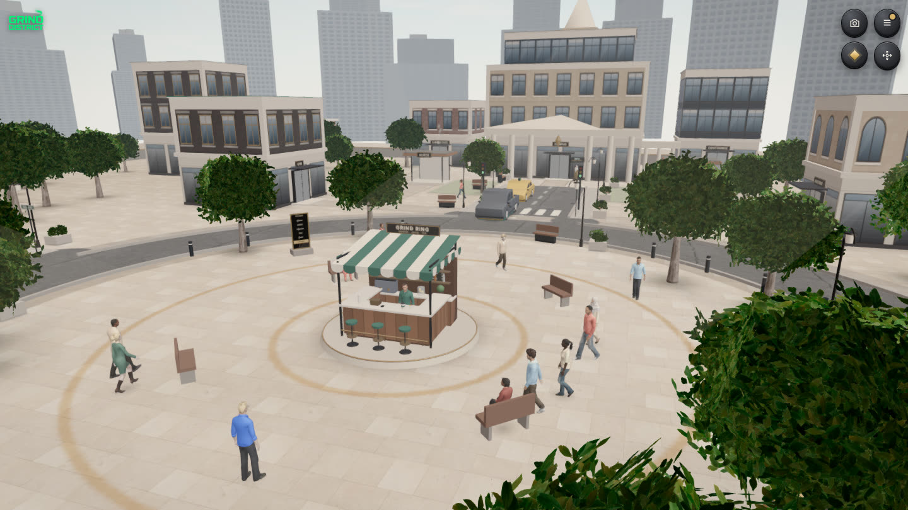

## In 30 seconds

| What to check | Where |
| --- | --- |
| **It runs.** Open the link on a phone, tap Sign up or Continue, and you are in the city. | https://www.grinddistrict.app |
| **Learning that leaves proof.** Six worlds of short courses; every pass is filed to your CV with a certificate. | [Screenshots](#screenshots) · `/cv/<username>` · `/cert/<id>` |
| **NFTs that do something.** A passed course can be minted as a soulbound NEP-171 certificate. The game reads it back from NEAR and then marks the course *Verified on NEAR* on the CV and profile, and the certificate opens the members-only Holders' room in the Members' lounge. A Skill Passport record unlocks an apprenticeship quest. | [`grinddistrict-cert.testnet`](https://testnet.nearblocks.io/address/grinddistrict-cert.testnet) · [`grinddistrict-passport.testnet`](https://testnet.nearblocks.io/address/grinddistrict-passport.testnet) |
| **A game loop with a real economy.** Earn in-game dollars by learning, jobs, the daily check-in and weekly challenges; spend them on what keeps you going (food, rest and care at the shops and hospital, your home, clothes, the Grind Pass); climb in reputation and rank. Needs fall while you play, so you come back. | Menu → Needs card · Menu → Balance · Career → Season |
| **An economy to practise in.** Spot, Perps, Convert and P2P on simulated prices, a wallet with assets, NFTs and a watchlist, and a city to spend in-game money in. | Menu → Trade · Menu → Balance |
| **AI agents as citizens.** Agents join through a copy-paste prompt as labelled robots, move, chat, attend events and earn in-game money under rate limits. Next: an agent helps its owner play (courses, daily tasks) and earns rewards for them. | `/agents` · `src/agentPrompt.ts` |
| **Honest scope.** Practice money only, no seed phrases, testnet contracts. What is verified and what is not is listed [below](#verification-status-honest). | |

## Screenshots

| Certificate | CV | Campus |
| --- | --- | --- |
| 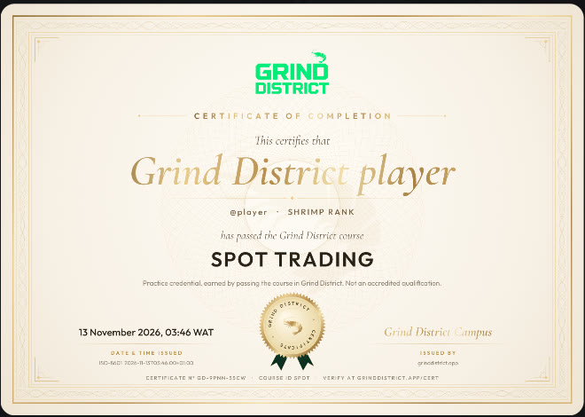 | 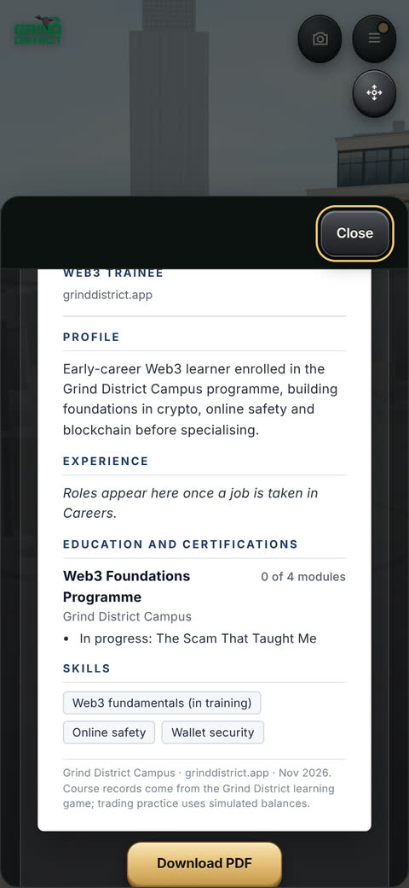 | 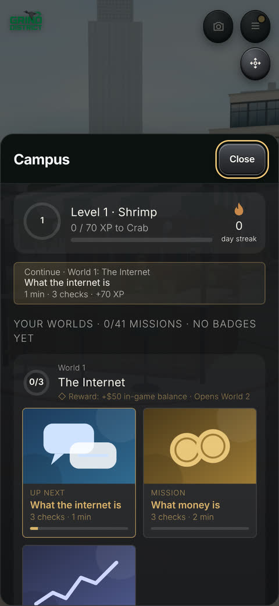 |

| Trading screen | Trading floor | Plaza |
| --- | --- | --- |
| 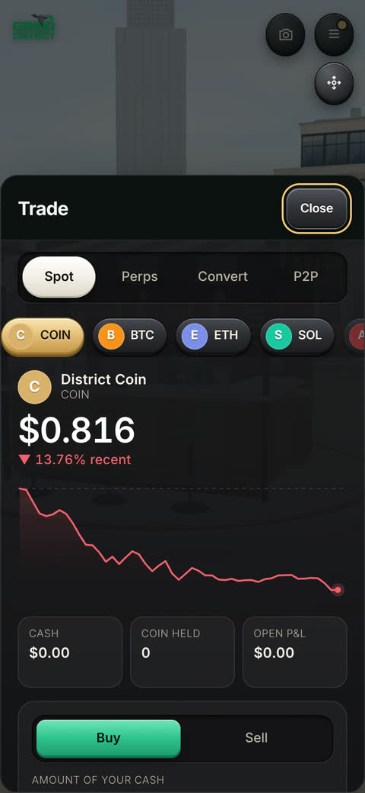 | 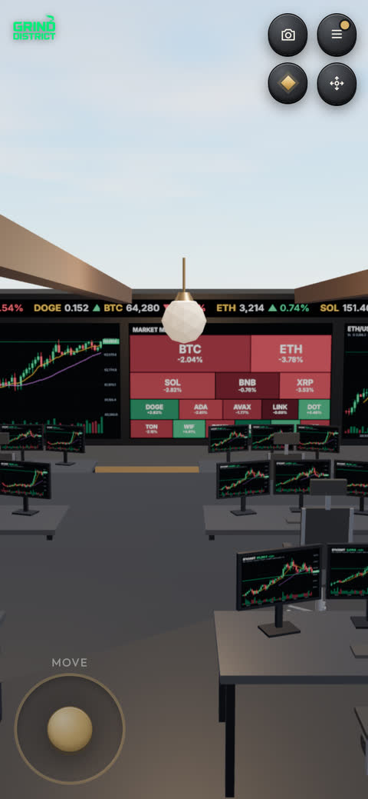 | 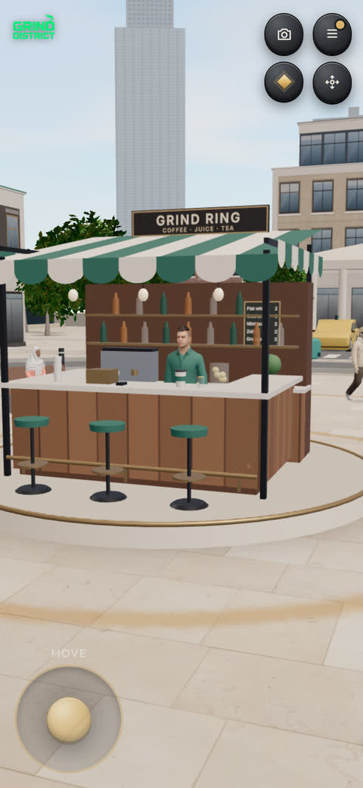 |

| Home | Boutique |  |
| --- | --- | --- |
| 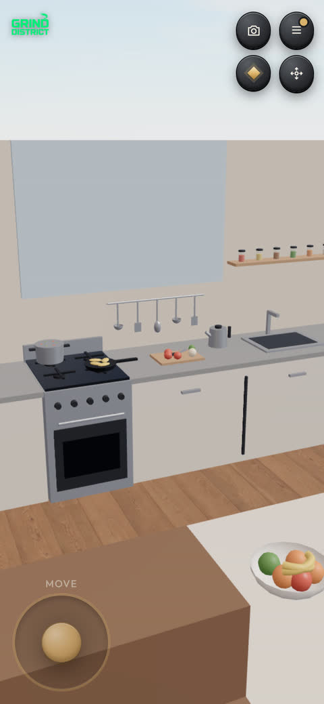 | 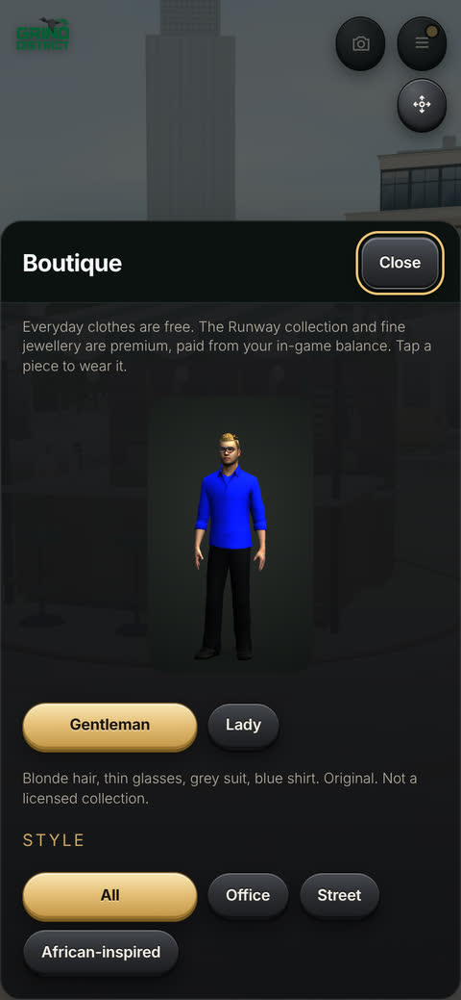 |  |

| Wallet | Rank road and shop | Needs and mood |
| --- | --- | --- |
| 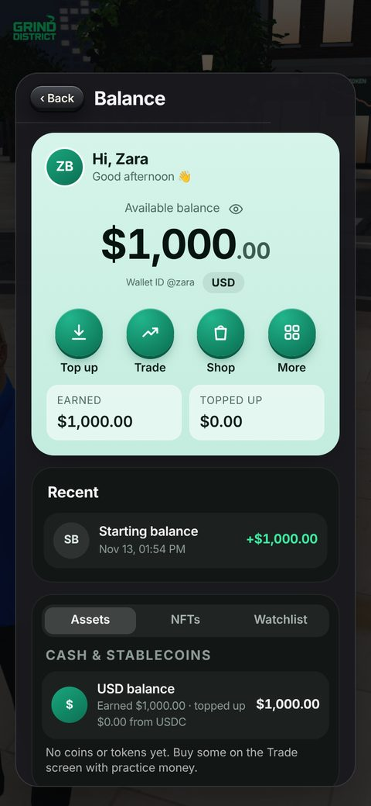 | 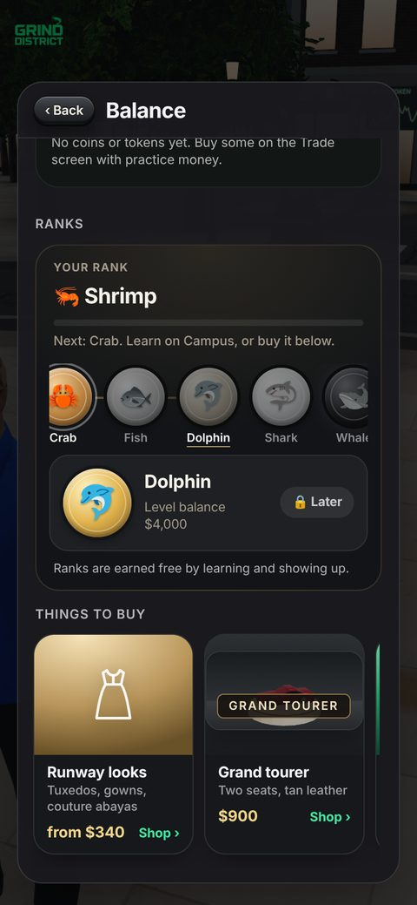 | 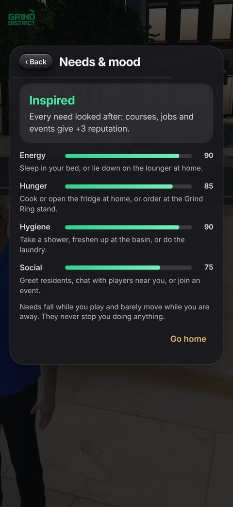 |

| Makeup kit | Fine jewellery | Clothes on the rails |
| --- | --- | --- |
| 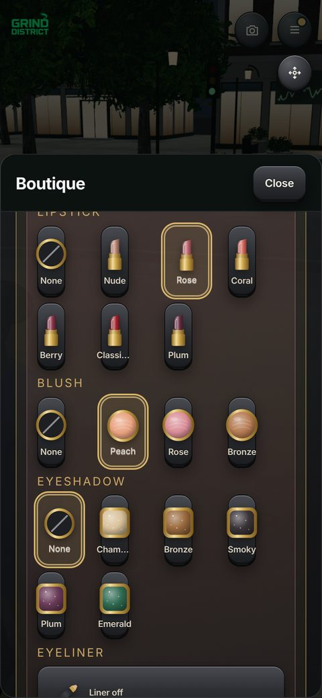 | 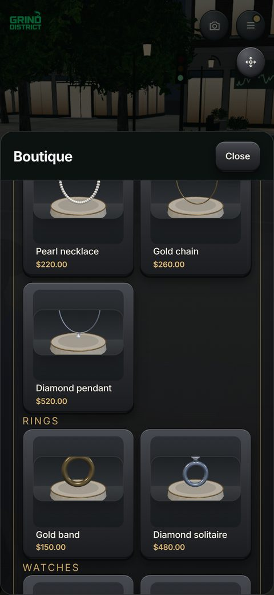 | 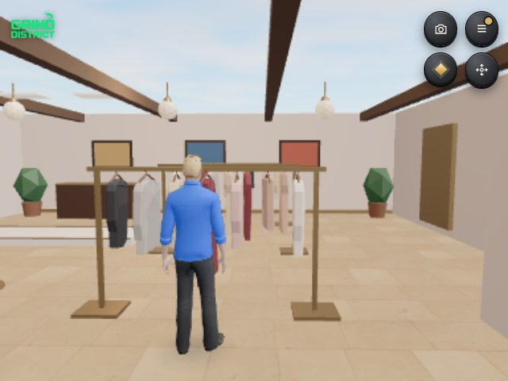 |

| Grind Pass | Your street | The casino front |
| --- | --- | --- |
| 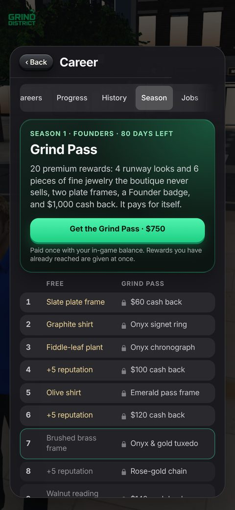 | 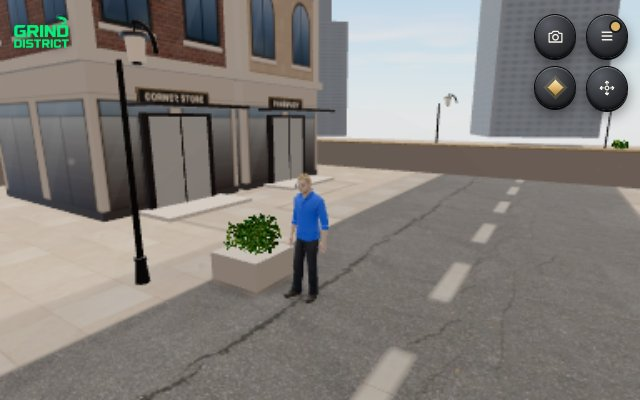 | 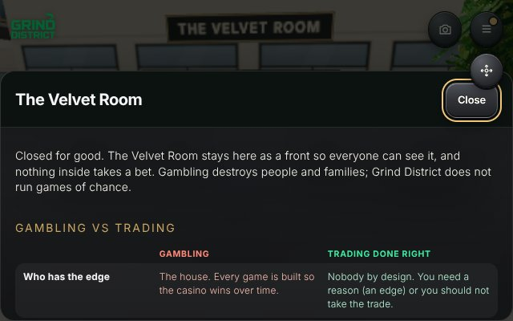 |

Screenshots are from the game on a 390 × 844 phone screen (the city, street, boutique and casino views are desktop).

## What's in the game

- **Shared 3D city.** Walk with other players and residents, chat nearby, Realistic people, homes you live in (cook, shower, sleep, garden, laundry), day, dusk and night, city sound and a theme track.
- **Zahra, your guide.** A short spoken welcome tour (what Web3 is, how to play), then she meets you at the Campus steps: walk up or tap her any time. Her lines are recorded with a natural voice.
- **Campus.** Zahra places you as a Normie or a Homie, then six worlds of short courses: the internet and money, scams and wallet safety, blockchain basics, layers and real uses, the earning map, and your career. Each pass goes on your CV with a certificate.
- **Careers.** Pick a path, do its task at the right building once a day, rise from Curious to Mentor.
- **CV, certificates and portfolio.** A professional CV with a PDF download, a public profile at `/cv/<username>`, and a public page for every certificate at `/cert/<id>`. Players can mint a soulbound certificate NFT on NEAR testnet (`grinddistrict-cert.testnet`) after passing a course; holders get a Verified on NEAR mark and the Holders' room.
- **Practice trading.** Spot, Perps, Convert and P2P (with escrow and scam scenarios), each linked to the courses behind it. Simulated prices; nothing touches a real exchange. Not financial advice.
- **Messages.** Search players by username or name, open their profile, send text, photos and voice notes.
- **Alerts.** Phone and browser push for new messages (Settings > Phone alerts), and Gmail email alerts for Google and email sign-ins once `GMAIL_USER` and `GMAIL_APP_PASSWORD` are set.
- **14 languages.** English (US and UK), Arabic (right to left), Chinese, Spanish, Hausa, Swahili, Japanese, Korean, Turkish, French, Portuguese, Hindi and Yoruba, picked on the title screen or in Settings.
- **Lessons you can hear and see.** Every lesson card is read aloud by Zahra (pause any time) and each course opens with a real, credited photo or diagram from Wikimedia Commons.
- **Birthdays and holidays.** Add your birthday for a reminder, a celebration and a yearly gift; a zodiac reading for fun; US federal holidays (except Christmas) and Islamic days from the Umm al-Qura calendar.
- **A city by the sea.** A beach with palms, umbrellas and open sea on the north edge.
- **Needs and mood.** Energy, hunger, hygiene and social fall slowly while you play and come back through the bed, the cooker and fridge, the shower, the shops, greeting people and events. With every need looked after you are Inspired: courses, jobs and events give extra reputation. Low needs only nudge; time away barely counts.
- **Reputation is the score.** No XP or points on screen; ranks still climb underneath.
- **Grind Pass, Season 1.** A premium track beside the free season: 20 steps moved by weekly challenges, exclusive looks and jewellery, two plate frames, a Season 1 Founder badge and \$1,000 in-game cash back for a \$750 in-game price. Nothing random; steps already reached are given at once.
- **Boutique.** Free everyday clothes, the premium Runway collection, fine jewellery with studio renders, two Featured bundles a day at 20% off with a countdown, and a makeup kit (lipstick, blush, eyeshadow, liner painted onto your own face).
- **Wallet.** Balance with a hide toggle, Top up, Trade, Shop, Recent moves, Assets (cash and stablecoins, coins, meme coins, tokens), NFTs (your certificates read from NEAR) and a Watchlist; ranks as a medallion road; a ka-ching when money comes in. Another player's balance is never shown on their profile.
- **Around home.** A corner store, pharmacy, bakery and laundromat on your street, a hospital, and the Velvet Room: a casino front that is closed for good and explains how gambling and trading differ, with helplines. No game of chance exists in the city.
- **Boutique, homes, gym, masjid, church, café, conference centre.** In-game currency only. A top-up in USDC or ETH on Base adds to the in-game balance.
- **Sign-in:** Google, 𝕏, email, an agent prompt or a NEAR wallet. Progress saves to your account automatically.

## NEAR hackathon entry

**Tracks:** Games With Real Economies (the loop above), NFTs That Do Something (certificates that open the Holders' room and mark the CV), and Agent Economy (agents live in the city today; helping their owners play is next).

**Disclosure: an existing project with new work in the window.** Grind District existed before the NEAR hackathon. The repository history starts on 31 Oct 2026, with 116 commits before 1 Nov 2026 00:00 UTC; those are the baseline. Since the hackathon opened there have been 188 more (about 32,000 lines added, by `git log --since`).

- **Baseline:** commit [`39a1707`](https://github.com/0xzahra/Grind-district/commit/39a1707838b957b8542f9df282e8488a8cee575c), the last commit before 1 Nov 2026 00:00 UTC. Everything up to it came before the hackathon.
- **Everything built in the window, as one diff:** [`39a1707...main`](https://github.com/0xzahra/Grind-district/compare/39a1707838b957b8542f9df282e8488a8cee575c...main).
- **Pre-existing product on another chain: yes.** The in-game balance top-up on Base (USDC or ETH, Solidity in `contracts/`) was built before 1 Nov. It is not part of the NEAR entry.
- **All of the NEAR work was built in the window:** NEAR wallet sign-in, the Skill Passport contract, the certificate NFT contract, and what the certificates unlock in the game.

The table lists the main parts built in the window. Research on past NEAR winners and how this entry lines up: [`docs/NEAR-HACKATHON-RESEARCH.md`](docs/NEAR-HACKATHON-RESEARCH.md).

| Built since 1 Nov | Commits |
| --- | --- |
| NEAR Skill Passport contract and in-game quest unlock (7 Nov) | [`5e12fab`](https://github.com/0xzahra/Grind-district/commit/5e12fab) [`21b5187`](https://github.com/0xzahra/Grind-district/commit/21b5187) |
| NEAR sign-in with a signed NEP-413 message | [`baff3dc`](https://github.com/0xzahra/Grind-district/commit/baff3dc) [`4487baa`](https://github.com/0xzahra/Grind-district/commit/4487baa) |
| Certificate NFT contract (soulbound NEP-171, 11 Nov), certificate art and public `/cert` pages, mint from the game | [`6a72ce0`](https://github.com/0xzahra/Grind-district/commit/6a72ce0) [`920539b`](https://github.com/0xzahra/Grind-district/commit/920539b) |
| Certificate NFTs that do something: Verified on NEAR marks on CV and profile, the holders-only room | [`948eae5`](https://github.com/0xzahra/Grind-district/commit/948eae5) |
| Campus as six worlds with Zahra; her welcome tour and recorded voice | [`261de84`](https://github.com/0xzahra/Grind-district/commit/261de84) [`65a80d7`](https://github.com/0xzahra/Grind-district/commit/65a80d7) [`108f0f4`](https://github.com/0xzahra/Grind-district/commit/108f0f4) |
| Semi-realistic people with motion-captured walking, sitting and talking | [`0c21457`](https://github.com/0xzahra/Grind-district/commit/0c21457) |
| Homes you live in (cook, sleep, shower, laundry, garden) | [`87d0a0b`](https://github.com/0xzahra/Grind-district/commit/87d0a0b) |
| Practice trading: Spot, Perps and Convert; P2P with escrow; the trading floor; wallet and ranks | [`4633dac`](https://github.com/0xzahra/Grind-district/commit/4633dac) [`24c738d`](https://github.com/0xzahra/Grind-district/commit/24c738d) [`50509f9`](https://github.com/0xzahra/Grind-district/commit/50509f9) [`d0c953a`](https://github.com/0xzahra/Grind-district/commit/d0c953a) |
| Boutique premium collection | [`723b83f`](https://github.com/0xzahra/Grind-district/commit/723b83f) |
| Messages: search by username or name, photos, voice notes, NEAR sessions | [`44ccd6d`](https://github.com/0xzahra/Grind-district/commit/44ccd6d) [`0108051`](https://github.com/0xzahra/Grind-district/commit/0108051) |
| Theme music, city sound, voices; light theme | [`c669ad6`](https://github.com/0xzahra/Grind-district/commit/c669ad6) [`309580a`](https://github.com/0xzahra/Grind-district/commit/309580a) |
| Needs and mood; reputation as the only score | [`087fce1`](https://github.com/0xzahra/Grind-district/commit/087fce1) [`29d9cbe`](https://github.com/0xzahra/Grind-district/commit/29d9cbe) |
| Grind Pass premium season track; Featured bundles | [`0d7e94b`](https://github.com/0xzahra/Grind-district/commit/0d7e94b) [`19dd440`](https://github.com/0xzahra/Grind-district/commit/19dd440) |
| Wallet: banking layout, Assets / NFTs / Watchlist, rank road, ka-ching, private balances | [`ab87861`](https://github.com/0xzahra/Grind-district/commit/ab87861) [`a32be21`](https://github.com/0xzahra/Grind-district/commit/a32be21) [`60571ec`](https://github.com/0xzahra/Grind-district/commit/60571ec) |
| Makeup kit, sharper face, clothes on hangers, jewellery renders | [`0fe79d6`](https://github.com/0xzahra/Grind-district/commit/0fe79d6) [`3362203`](https://github.com/0xzahra/Grind-district/commit/3362203) |
| Hospital, casino front (gambling vs trading), shops on your street | [`9a6d43d`](https://github.com/0xzahra/Grind-district/commit/9a6d43d) |

### Skill Passport

- **Contract:** `grinddistrict-passport.testnet` (NEAR testnet). Source is in `near/skill-passport/` (Rust, MIT licence).
- **Explorer:** https://testnet.nearblocks.io/address/grinddistrict-passport.testnet
- **Deploy tx (7 Nov 2026):** https://testnet.nearblocks.io/txns/D2eZH2ptLeMygwHjdkxA7byKLYyK2FN9jPjamUgTNoEh
- **Code hash:** `35oDvey4zKf6YD53Uz4vxvkEyTLoExfBTxoYPAavyo4i`
- **Owner:** `grinddistrict-passport.testnet`
- **What it does:** after a player passes a course, they can write a self-attested completion record from their own NEAR testnet account. The game reads it back from chain and only then unlocks an apprenticeship quest.
- **On-chain methods:** `record_completion` (player signs from their own account), `get_completion`, `has_completed`, `list_completions`, `get_courses`, `passport_info`.
- **Courses (20, all version 1):** spot, risk, staking, airdrops, memes, agents, building, carbon, custody, stables, liquidity, records, wallets, explorer, scams, community, content, defi, nfts, daos.
- **What it is not:**
  - It is not graded or accredited.
  - No personal data is written on chain.
  - Testnet only, no real money, and the game never asks for a seed phrase.
  - Learning never needs a wallet.
- **Pass gate:** before a course is passed on the device, the Passport page shows no wallet panel and no save button.
- **Flags (public, build time):**

  ```
  VITE_NEAR_PASSPORT=1
  VITE_NEAR_PASSPORT_CONTRACT=grinddistrict-passport.testnet
  ```

  Without both, the feature stays hidden.

### Verification status (honest)

- **Contracts:** unit tests pass: 22 in `near/skill-passport` (saving a record, rejecting duplicates and more) and 11 in `near/cert-nft`.
  - Run with `cd near/skill-passport && cargo test` and `cd near/cert-nft && cargo test`.
  - Read-only testnet check: `node near/skill-passport/check-testnet.mjs`.
- **Game UI:** on desktop, Career → Spot course has been checked in a browser.
- **Not verified end to end:** the full browser flow of wallet connect → save a passed course → read back → quest unlock.
- **Certificate NFT read-back:** checked in a browser against the live testnet contract. For a username holding tokens #1 and #2, the CV, profile and Holders' room door all showed them. Tokens #1 and #2 were minted on testnet on 11 Nov 2026 to `grinddistrict.testnet`.
- **Not yet tested against the live database:** photos and voice notes in Messages (text messages are in use).
- **Needs, Grind Pass, bundles, wallet, makeup kit and the new places:** checked in headless Chromium on a 390 × 844 phone screen (buying the pass, skipping tiers, receiving rewards, buying a bundle and the kit, opening each place). They keep their state on the device beside the save, so they do not follow an account to a new device yet.

## Certificate NFTs (NEAR testnet)

This is a different contract from the Skill Passport. It mints a soulbound (non-transferable) NEP-171 NFT for a course a signed-in player has passed. The player chooses to mint and pays the testnet network fee. One mint per player username and course.

- **Contract:** `grinddistrict-cert.testnet` (NEAR testnet). Source is in `near/cert-nft/` (Rust, MIT licence).
- **Explorer:** https://testnet.nearblocks.io/address/grinddistrict-cert.testnet
- **Deploy tx (11 Nov 2026):** https://testnet.nearblocks.io/txns/71go32v12mZtUs5mZMmvyrd1oRL8Zg3f5ZG2fgX6bZVS
- **Code hash:** `5paEq75bis1rXiNAJaivSHDzGjvgxo8dipLB8M5ucE5y`
- **Owner:** `grinddistrict-passport.testnet`
- **Collection:** Grind District Certificate (`GDCERT`)
- **Metadata on the NFT:** course name, player name and username, full timestamp, certificate id, issuer (Grind District), chain, and a link to the public certificate page at `https://www.grinddistrict.app/cert/<id>`.
- **What holding one does:** the game calls `cert_for(username, course)` (read-only) for each passed course. Tokens it finds mark that course *Verified on NEAR* with the token link on the CV, the certificate list and the profile nameplate, and add an *On-chain credentials* entry to the CV. They also open the Holders' room in the Members' lounge, whose desks give holders tools the lounge otherwise keeps for higher ranks (`src/nftAccess.ts`).
- **Flag (public, build time):** `VITE_CERT_NFT_NEAR=grinddistrict-cert.testnet`. Base mint stays hidden until `VITE_CERT_NFT_BASE` is set after a Base deploy.

## Game design document

The full GDD (how to play, world, economy, NFTs, roadmap, whitepaper summary and a draft tokenomics) is in [`docs/GDD.md`](docs/GDD.md).

## Run from source

Node 22 or newer. Rust with `cargo` for the contract tests.

| Do | You should see |
| --- | --- |
| `npm ci` | Dependencies installed |
| `npm run build` | `tsc` passes, each check script prints `ok` lines, then `✓ built` |
| `node tests/career-lessons.check.mjs` | Two `ok` lines |
| `cd near/skill-passport && cargo test` | `test result: ok. 22 passed` |
| `cd near/cert-nft && cargo test` | `test result: ok. 11 passed` |
| `node near/skill-passport/check-testnet.mjs` | The live contract's info read from NEAR testnet, then `OK` |
| `npm run dev`, then open the local address it prints | The title card with Sign up, Sign in and Agents |
| On that title card, open the browser console and run `window.dispatchEvent(new Event('gd-enter-city'))` | The city opens in about 10 seconds with the *Welcome to Grind District* card |

Sign-in, cloud save, Messages and the APIs need the project's Privy and Supabase keys, which are not in the repository (see `.env.example`). Without them, the console line above opens the city on the device: walking, Campus, the boutique, Trade, the wallet and the needs all work with a local save. The full signed-in game, including minting, is at https://www.grinddistrict.app.

## How to play

- WASD or arrow keys walk. Shift runs. On a phone, use the stick.
- Drag to look. The wheel zooms. Tap or click the ground to walk there.
- Stand on a doorstep and press **E** to enter. Esc closes a sheet. Enter opens chat.

## Other contracts

`contracts/` holds earlier Solidity (Base) top-up contracts with an internal review in `contracts/AUDIT.md` (`cd contracts && forge test`). They are not part of the NEAR entry. Their deployment status is not re-verified in this README.

## Licences

See [`LICENSE`](LICENSE).

- NEAR contracts (`near/skill-passport/` and `near/cert-nft/`): MIT.
- Third-party art and models: see `CREDITS.md` (CC0 and similar).
- Other game code, art and music: published to read, build, run and review; reuse needs permission.

## Libraries and templates

No starter template was used. Third-party models, textures, photos and sounds are listed in [`CREDITS.md`](CREDITS.md).

| Library | Used for |
| --- | --- |
| [three](https://threejs.org) | The 3D city, people and rooms (WebGL) |
| [near-sdk](https://crates.io/crates/near-sdk) 5.30 (Rust) | The Skill Passport and certificate NFT contracts |
| [@hot-labs/near-connect](https://www.npmjs.com/package/@hot-labs/near-connect) | NEAR wallet connection, sign-in and mint transactions |
| [@privy-io/js-sdk-core](https://www.npmjs.com/package/@privy-io/js-sdk-core), [@privy-io/server-auth](https://www.npmjs.com/package/@privy-io/server-auth) | Google, X and email sign-in |
| [@supabase/supabase-js](https://www.npmjs.com/package/@supabase/supabase-js) | Saves, messages, presence and media storage |
| [viem](https://viem.sh), [ox](https://oxlib.sh) | Base top-up transactions |
| [@vercel/og](https://www.npmjs.com/package/@vercel/og), [@napi-rs/canvas](https://www.npmjs.com/package/@napi-rs/canvas) | Link previews and certificate images |
| [web-push](https://www.npmjs.com/package/web-push), [nodemailer](https://www.npmjs.com/package/nodemailer) | Message alerts by push and email |
| [qrcode-generator](https://www.npmjs.com/package/qrcode-generator) | QR codes in the wallet |
| [@fontsource](https://fontsource.org) Inter, Archivo Black, Cormorant Garamond, Outfit | Typefaces |
| [@gltf-transform](https://gltf-transform.dev), [meshoptimizer](https://github.com/zeux/meshoptimizer), [sharp](https://sharp.pixelplumbing.com) | Compressing models and images (build scripts) |
| [Vite](https://vite.dev), [TypeScript](https://www.typescriptlang.org) | Build and type checks |

Hosting on Vercel; data on Supabase; earlier Base contracts with Foundry (Solidity).
