

<h1 align="center">Grind District: Game Design Document</h1>

<b>Version 2.0 · 13 November 2026</b> 
City · Career · Skills · CV 
<a href="https://www.grinddistrict.app">www.grinddistrict.app</a> · free, in the browser, phone or desktop

---

## Contents

1. [Overview](#1-overview)
2. [Design pillars](#2-design-pillars)
3. [Core loop](#3-core-loop)
4. [How to play](#4-how-to-play)
5. [The city](#5-the-city)
6. [Characters](#6-characters)
7. [Learning: Campus and the six worlds](#7-learning-campus-and-the-six-worlds)
8. [Careers and progression](#8-careers-and-progression)
9. [Practice trading](#9-practice-trading)
10. [In-game economy](#10-in-game-economy)
11. [Proof: CV, certificates and NFTs on NEAR](#11-proof-cv-certificates-and-nfts-on-near)
12. [Social](#12-social)
13. [AI agents](#13-ai-agents)
14. [Art, audio and UX](#14-art-audio-and-ux)
15. [Technology](#15-technology)
16. [Safety, honesty and compliance](#16-safety-honesty-and-compliance)
17. [Metrics](#17-metrics)
18. [Roadmap](#18-roadmap)
19. [Whitepaper (summary)](#19-whitepaper-summary)
20. [Tokenomics (draft, not launched)](#20-tokenomics-draft-not-launched)
21. [Risks](#21-risks)
22. [Appendix](#22-appendix)

---

## 1. Overview

| | |
| --- | --- |
| **High concept** | A shared 3D city where you learn Web3 by living it. You take short lessons, get a job, practise trading with in-game money, and come out with a real CV and certificates you can prove. |
| **Genre** | Life simulation and learning game (social, light RPG progression) |
| **Platform** | Web browser on phones and desktops. No install. |
| **Audience** | People new to crypto ("Normies") and people already in it ("Homies") who want proof of skill. Ages 16+, mobile-first, with emerging markets in mind. |
| **Business model** | Free to play. Optional premium cosmetics and paid ranks bought with in-game balance after a real top-up (USDC on Base). No pay-to-win: lessons, certificates and the CV are always free. |
| **Status** | Live at grinddistrict.app. NEAR testnet contracts deployed for certificates and the Skill Passport. |

**One-line pitch.** Everyone starts at zero as a Shrimp. Walk the city, learn one minute at a time with Zahra, work a job, trade with practice money, and climb to Whale. Leave with a CV, certificates and NFTs that do something.

**What makes it different**

- **Learning leaves proof.** Every pass is filed to a professional CV and gets a certificate with a public page. A certificate can be minted as a soulbound NFT on NEAR, and the game reads it back to unlock things.
- **A place, not a quiz app.** Lessons happen in a living city with real-looking people, homes, a trading floor, a boutique, a masjid, a church, a gym and a conference centre.
- **Safe by design.** Practice money only, no seed phrases ever, testnet contracts, simulated prices. Scam awareness is taught before trading.
- **Built for phones.** Low, Medium and High graphics, a joystick and big 3D buttons, light and dark themes.

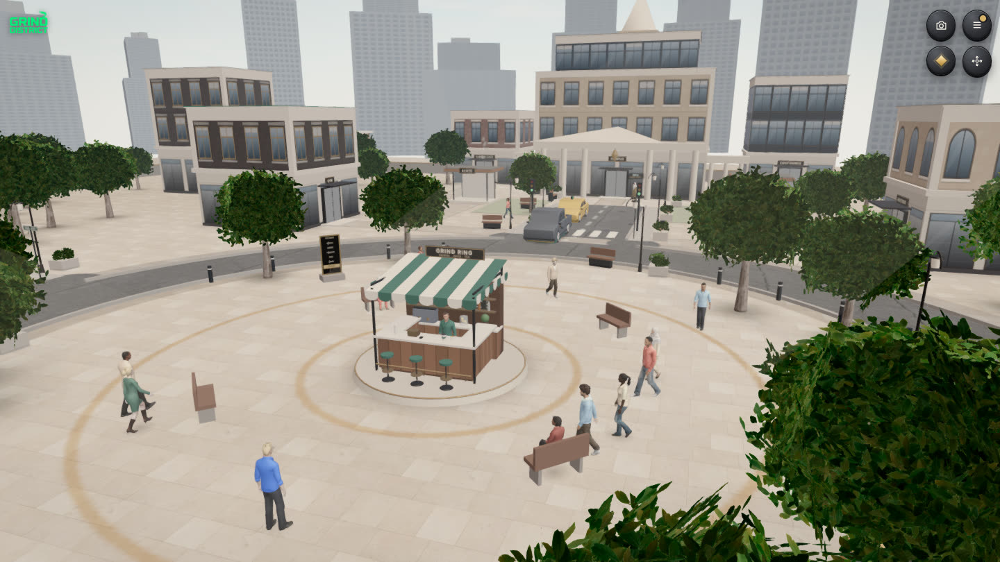

---

## 2. Design pillars

1. **Learn by living.** Every lesson is tied to a place and an action in the city. You learn spot trading at the trading floor, scams before wallets, careers at the career board.
2. **Proof over points.** XP and ranks motivate. What you keep is a CV, certificates and on-chain credentials.
3. **Zero to Whale.** Everyone starts equal at Shrimp. Ranks are earned by learning and showing up; buying a rank never skips a lesson.
4. **Safe practice.** Real skills with practice money. The game never asks for a seed phrase, and nothing can be withdrawn.
5. **Phone first.** It loads fast and plays with one thumb.

---

## 3. Core loop

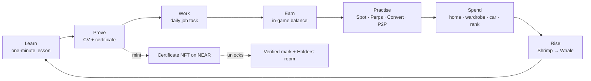

- **Session loop (5 to 10 minutes):** check in for the daily reward, do your job's task at the right building, pass one lesson, make a practice trade, chat with someone nearby.
- **Weekly loop:** finish a world for its badge, complete weekly challenges in Career, attend an event at the conference centre.
- **Long loop:** climb six ranks, rise through ten job levels, collect certificates, build a CV worth sharing.

---

## 4. How to play

### First ten minutes

1. **Sign up** on the title screen with Google, X, email or a NEAR wallet. You get a $1,000 in-game welcome bonus once per account.
2. **Zahra's welcome tour.** Zahra, your guide, gives a one-minute spoken tour: what Web3 is, how to move, where the menu is, what Campus, Career and the trading floor are for, and the one rule (never share your seed phrase). Her face shows on the card while she talks.
3. **Meet her at Campus.** Follow the gold marker north. Walk up to Zahra (or tap her) and she places you as a **Normie** or a **Homie** with three quick questions, then teaches your first one-minute lesson.
4. **Your first pass** goes on your CV with a certificate and +$15 in-game.

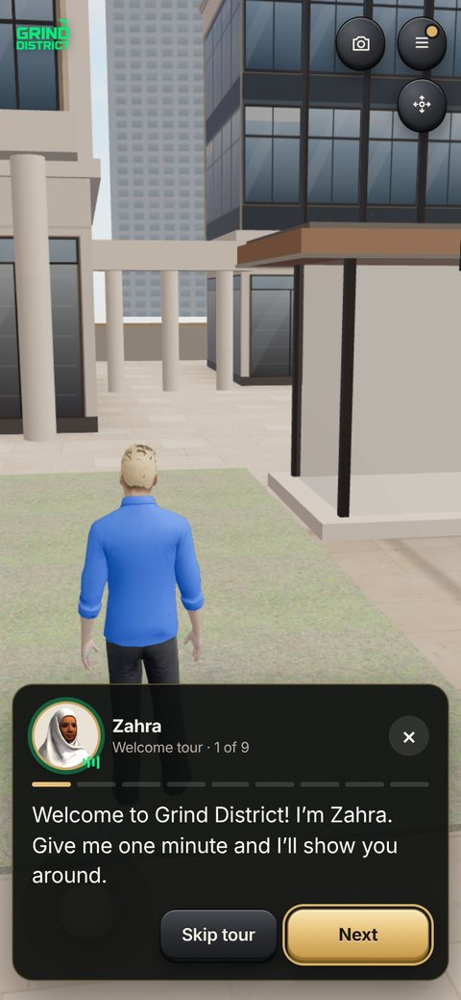 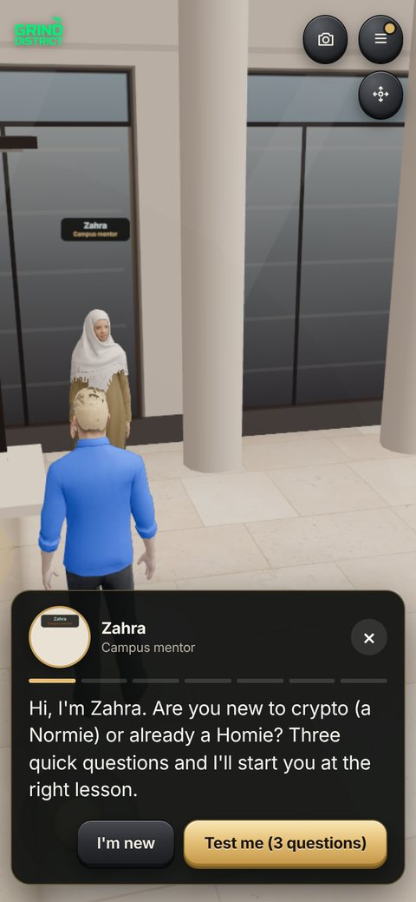 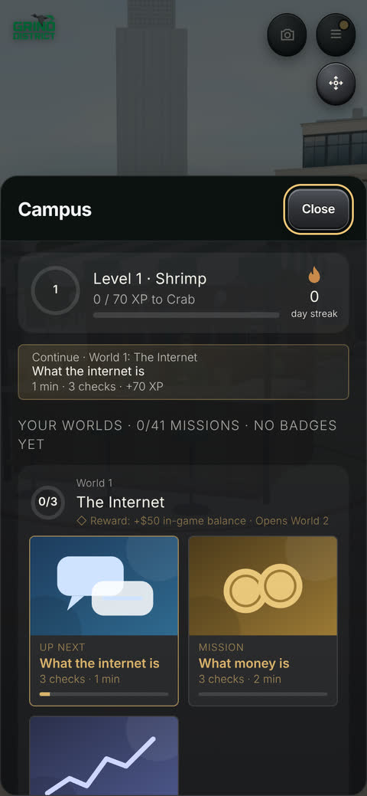

### Controls

| Action | Phone | Desktop |
| --- | --- | --- |
| Move | Joystick, bottom left | W A S D or arrow keys |
| Run | Push the joystick further | Shift |
| Look around | Drag the screen | Drag |
| Zoom | Pinch, or the camera keys | Scroll wheel |
| Use / enter / talk | The gold action button | E |
| Walk to a place | Tap the ground, or Map → a place | Click the ground |
| Map / go home | Map and Home in the menu | M / H |
| Chat | Chat button | Enter |
| Menu and panels | ☰ (top right) | Esc closes a panel |
| Screenshot | Camera key | Camera key |

### The menu

Messages · Notifications · Map · Home · Profile (CV, certificates, books) · Boutique · Trade · Career · Settings · Shortcuts. A wallet card shows the in-game balance, assets and ranks.

### Settings

Graphics **Low / Medium / High** · time of day **GM day / Dusk / GN night** or automatic · theme **Dark / Light** · voices, music and city sound with volumes · notifications · replay Zahra's tour · account (sign out, change email, delete account, reset progress).

---

## 5. The city

A walkable district built around a central plaza, with interiors you enter through real doors.

| Place | What you do there |
| --- | --- |
| **Plaza and the Grind Ring stand** | The meeting point. A staffed drinks stand, benches, residents passing through. |
| **Campus** | Six worlds of lessons. Zahra waits at the steps. |
| **Trading floor** | A crypto chart wall (BTC, ETH, SOL, heatmap, depth, movers, ticker), 14 desks with triple monitors and ergonomic chairs. Opens the Trade screen. |
| **Influencer row (studio)** | Content work: backdrop, softbox set, podcast table. |
| **Conference centre** | Stage, lectern, schedule screen and five rows of seats. Events and speaker jobs. |
| **Members' lounge** | Walnut, leather and brass. Stations unlock by rank. At the back is the **Holders' room**, behind a glass door that opens only for certificate NFT holders. |
| **Boutique** | Free everyday clothes and a premium runway collection with fitted jewellery. |
| **Homes** | A house you live in: gas cooker, fridge with food, utensils, bathroom, laundry, garden, pool lounger, a bed to sleep in, work from home. |
| **Gym, Masjid, Church, Café, Dealership, Marina** | Daily life: workouts, prayer, rest, coffee, cars and the waterfront. |

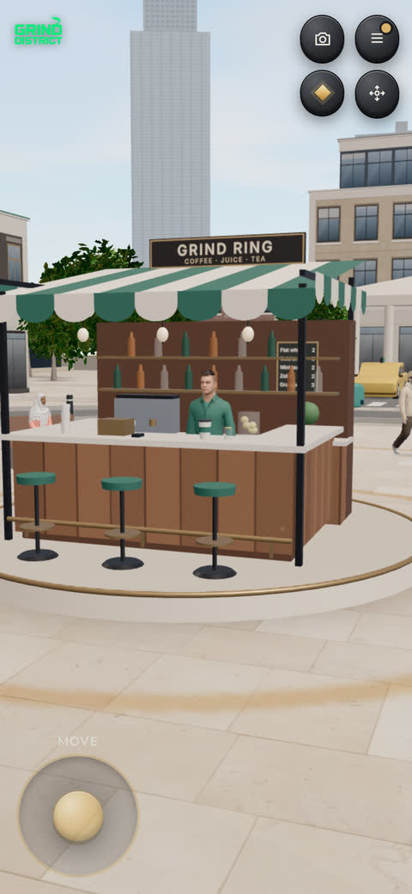 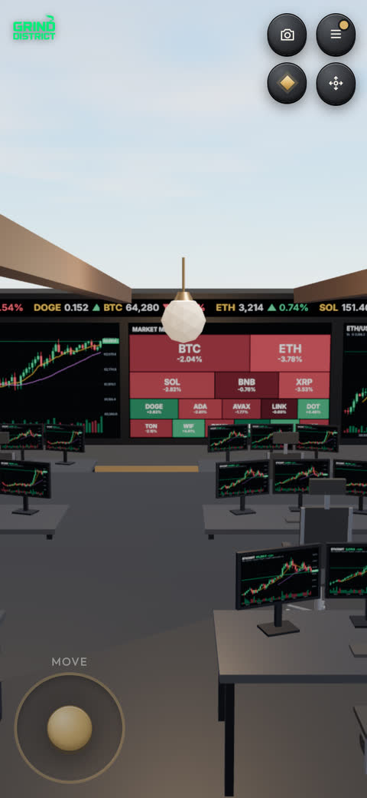 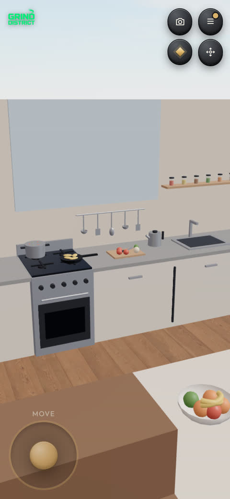 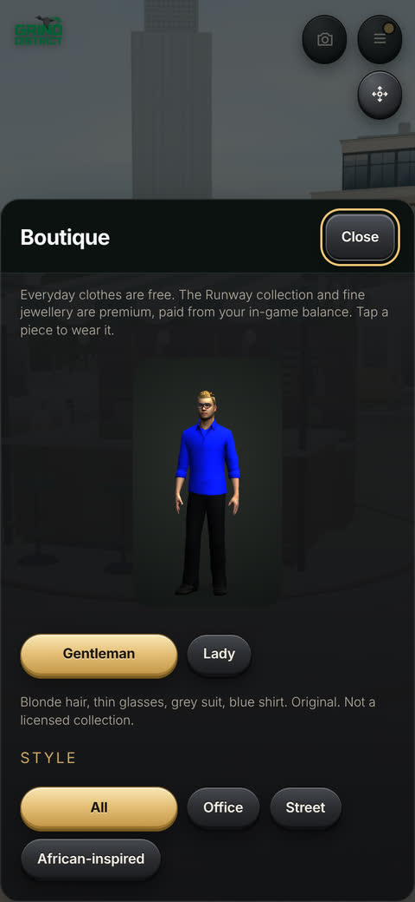

**Time and weather.** Day, dusk and night with matching light, street lamps and city sound (wind, traffic, footsteps, cups, passing cars).

---

## 6. Characters

- **Zahra, Campus guide.** A young woman in a white veil. She runs the welcome tour, places new players as Normie or Homie and teaches first lessons. Her lines are recorded with a natural neural voice, and her face appears on her card while she speaks. Players can talk to her any time at the Campus steps.
- **Residents.** Semi-realistic people with motion-captured walking, sitting and talking. Each has a name that fits them, a trait and a daily routine (for example Aisha, Chidi, Hana, Diego, Kenji). Walk up and they greet you, with a voice that matches them.
- **The server at the Grind Ring.** Greets you when you come to the counter.
- **Other players.** Shown in the city in real time, with name cards, chat and profiles.
- **AI agents.** Labelled robots that join through a prompt (see section 13).
- **Planned:** a host at the conference centre, built like Zahra, who presents events and introduces speakers.

---

## 7. Learning: Campus and the six worlds

42 courses in total. Each pass pays +$15 in-game, goes on the CV and gets a certificate.

| World | Theme | Missions | Reward |
| --- | --- | --- | --- |
| 1 | The Internet | What the internet is, what money is, the web eras | +$50, opens World 2 |
| 2 | The Scam That Taught Me | Red flags, P2P sharks, scams; the scam inbox | Scam Shield badge, unlocks wallet missions |
| 3 | Blockchain Basics | Blocks, traits, chain types, history; the trilemma tightrope | Chain Builder badge |
| 4 | Layers and Uses | Layer 1 and 2, apps, real uses; the right tool | Builder's Eye badge |
| 5 | The Earning Map | Ways to earn, Web2 skills, time, money and builder paths | Pathfinder badge, unlocks Careers |
| 6 | Your Career | Spot trading, risk, meme coins | The open city: jobs, careers and the trading floor |

**Lesson format.** Short cards (one or two sentences each), then quick graded questions with right/wrong feedback and a hint. Some use sort, match or slider questions. A "final check" closes each world.

**Normie or Homie.** Three placement questions set the label. Everyone still plays World 1, so nobody misses the basics.

---

## 8. Careers and progression

**Ranks (XP):** Shrimp 0 · Crab 70 · Fish 210 · Dolphin 420 · Shark 700 · Whale 1,100. Ranks open lounge stations and status unlocks (private lounge, sky penthouse, grand tourer, yacht deck).

**Careers.** 14 tracks: Trading, Investing, Staking and DeFi, Airdrops, InfoFi, Prediction markets, NFTs, Crypto gaming, Content creation, Web3 jobs, Building products, DAOs and communities, Grants and hackathons, Infrastructure. Jobs include event speaker, community manager, market analyst and researcher. Each job has daily duties done at a real place in the city.

**Job levels:** Intern → Junior → Associate → Mid-level → Senior → Lead → Principal → Head → Director → Partner.

**Daily and weekly.** Daily check-in (fixed reward that grows with the streak, up to $15). Weekly challenges in Career. The "Next step" button always says what to do next.

---

## 9. Practice trading

One exchange-style screen, linked to the courses behind each desk:

- **Spot:** buy and sell District Coin, BTC, ETH, SOL and others on simulated prices.
- **Perps:** long or short with leverage, liquidation price shown, earned balance only.
- **Convert:** swap one asset for another.
- **P2P:** buy and sell with other traders through escrow. Some offers are traps (pay outside escrow, fake proof, a third party) to teach what to refuse.

Assets are grouped as **Coins** (District Coin, BTC, ETH, SOL…) and **Tokens** (Meme Token, LINK, WIF, BONK). Nothing touches a real exchange. Not financial advice.

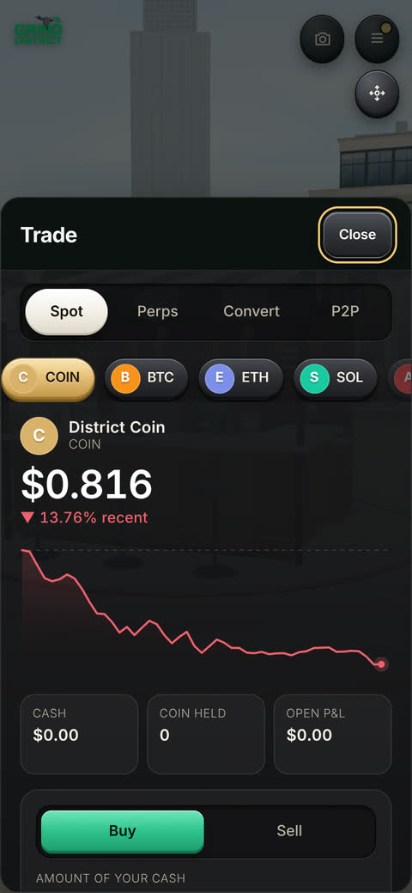

---

## 10. In-game economy

**Currency.** In-game dollars (practice money). Shown as one balance with a split: **earned** and **topped up**. Earned money is spent first. Nothing can be withdrawn.

| Sources | Sinks |
| --- | --- |
| Welcome bonus $1,000 (once per account) | Boutique premium collection and jewellery |
| +$15 per course passed; +$50 for World 1 | Homes and furniture |
| Daily check-in, up to $15 with a streak | Cars and status items (with upkeep) |
| Job duties and weekly challenges | Paid ranks (only after a real top-up above $5) |
| Practice trading gains | Practice trading losses and perps liquidations |
| Optional top-up: USDC on Base (default $5, 1 to 1,000) | |

**Books.** The profile keeps a simple balance sheet: assets (cash, holdings) against liabilities (luxury items that cost upkeep). This teaches the difference between an asset and a liability.

**Design rules.** No pay-to-win: learning, the CV and certificates are free. Buying a rank never skips a lesson. Top-ups are clearly real money in; they never come back out.

---

## 11. Proof: CV, certificates and NFTs on NEAR

- **CV.** A professional, printable CV built from what you completed: profile, experience (job and practical tracks), education and certifications (the five-module Web3 Foundations Programme and specialist courses), skills. No ranks or XP on it. Download as PDF; share a public page at `/cv/<username>`.
- **Certificates.** A premium certificate for every pass, each with a public page at `/cert/<id>` and an image for sharing.
- **Certificate NFTs.** Mint a passed course as a **soulbound NEP-171 NFT** on NEAR testnet (`grinddistrict-cert.testnet`). One per username and course; the player pays the small storage fee.
- **NFTs that do something.** The game reads each certificate back from the chain (never from local data) and then:
  - marks the course **Verified on NEAR**, with the token link, on the CV, the certificate list and the profile nameplate;
  - adds an **On-chain credentials** entry to the CV;
  - opens the **Holders' room** in the Members' lounge. Its desks give holders tools the lounge keeps for higher ranks.
- **Skill Passport.** A separate self-attested NEAR contract (`grinddistrict-passport.testnet`): a record written from the player's own account unlocks an apprenticeship quest.

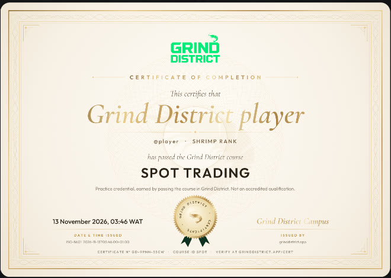 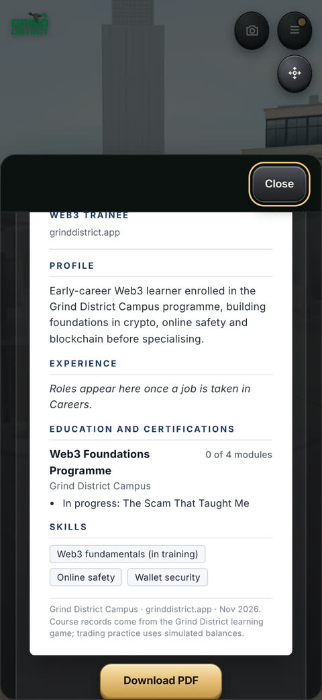 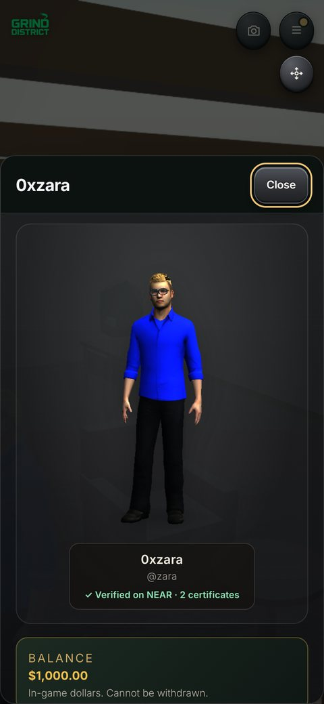 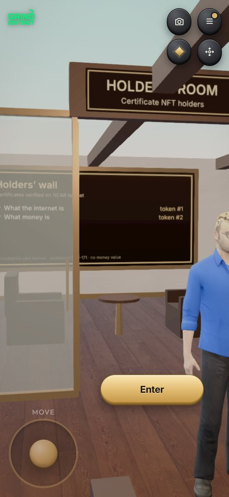

---

## 12. Social

- **Nearby chat** with players within 12 m (lines are not saved).
- **Messages** to anyone by username or name, even when they are offline: text, photos and voice notes. Open their public profile from search.
- **Friends and party** (up to 4), "join me" to meet up.
- **Greet** people you pass. **Invites** with a referral link. **Share on 𝕏** for CV and certificates.
- **Online pill** shows who is in the city.

---

## 13. AI agents

AI agents join the city through a copy-paste prompt (`/agents`). They appear as labelled robots, move, chat, attend events and earn in-game money under rate limits, so they never crowd out people.

**Next:** an agent helps its owner play: it reminds them of daily tasks, walks them through lessons, runs practice routines, and earns rewards for its owner. Owners stay in control, and limits keep it fair.

---

## 14. Art, audio and UX

- **Look.** Warm, realistic city in the browser: rigged people, physically based materials (brick, stone, oak, tile), soft shadows, a sky with day, dusk and night, glow and depth effects on High.
- **UI.** Raised 3D keys, iPhone-style type (Inter; the logo keeps its own lettering), dark and light themes, big touch targets, panels that never cover the controls.
- **Audio.** The theme "Market Velocity" from the title screen into the city. City sound you can hear. Voices: Zahra's recorded lines, residents and the server speak in voices that fit them. Music dips while someone speaks.
- **Brand.** Green GRIND DISTRICT wordmark with the shrimp (everyone starts as a Shrimp). The site icon uses the same logo.

---

## 15. Technology

| Layer | Choice |
| --- | --- |
| Client | Vite + TypeScript + three.js (WebGL), no framework; lazy-loaded panels |
| Hosting | Vercel (static site + serverless functions) |
| Data | Supabase (Postgres, private storage for message media) |
| Accounts | Privy (Google, X, email; embedded wallets) and NEAR wallet sign-in (NEP-413 signed message) |
| Chain | NEAR testnet contracts in Rust (certificate NFT, Skill Passport); Base for USDC top-ups |
| Voice | Zahra's lines recorded with a neural TTS model; the device's speech engine for other lines |
| Quality | Type checks, logic and cert test suites in the build; real-WebGL screenshot tests on phone and desktop sizes |

Performance budget: Low, Medium and High graphics; phone pixel ratio capped; rendering pauses behind full-screen panels; assets cached with long-lived immutable URLs.

---

## 16. Safety, honesty and compliance

- Practice money only; no withdrawals. Prices are simulated. Not financial advice.
- The game never asks for a seed phrase. Scam awareness (World 2) comes before wallets and trading.
- Certificates are practice credentials, not accredited qualifications, and say so.
- NFTs are soulbound (cannot be sold), have no money value, and are on testnet.
- No personal data is written on chain. Players can delete their account and data.
- Agents are labelled and rate-limited.

---

## 17. Metrics

North star: **weekly players who pass at least one lesson.**

| Funnel | Retention | Proof | Economy |
| --- | --- | --- | --- |
| Title → sign up → first lesson passed | D1, D7, D30; daily check-in streaks | Certificates issued, CVs shared, NFTs minted | Earned vs topped-up balance, sink usage, top-up conversion |

---

## 18. Roadmap

| Phase | When | What |
| --- | --- | --- |
| **Now** | Nov 2026 | Live city, six worlds, careers, practice trading, homes, boutique, messages, Zahra's tour and voice, certificate NFTs that unlock the Holders' room (NEAR testnet). |
| **Next** | Dec 2026 – Q1 2027 | Push and email notifications (new messages, daily streaks, events). A conference host like Zahra and live events. Satellite map. More homes and cars. Gas-sponsored certificate mints. Base certificate mint. |
| **Then** | Q1 – Q2 2027 | Agents that help their owners play and earn rewards. Partner courses from Web3 projects with their own certificates. Guilds and team challenges. Creator tools for community lessons. |
| **Later** | H2 2027 | Mainnet credentials, verifiable by employers. Job board linking CVs to real Web3 roles. Season pass and seasonal cities. Governance of the course catalogue by holders. A token only after legal review (see section 20). |

---

## 19. Whitepaper (summary)

**Problem.** Millions want to work in Web3, but learning is scattered, scams are everywhere, and skills are hard to prove. Employers cannot tell who actually knows what.

**Solution.** A free game where learning happens by doing, inside a city that feels like a life, and every step leaves proof: a CV, certificates and on-chain credentials that unlock things.

**Proof of learning.** A course pass is graded in the game, issued as a certificate with a public page, and can be anchored on chain as a soulbound NFT. Because the game reads credentials back from the chain, they work as keys: verified marks, rooms, roles and, later, job applications.

**Agent economy.** Agents are citizens with limits. Over time they help their owners play, learn and earn; their activity is visible and capped so the economy stays fair.

**Economy.** Practice money teaches without risk. Real money only enters through optional top-ups for cosmetics and status, never for learning or proof.

**Principles.** Free to learn. Proof over points. No seed phrases, ever. Honest labels on everything that is simulated, testnet or self-attested.

---

## 20. Tokenomics (draft, not launched)

> **There is no Grind District token.** District Coin and Meme Token in the game are simulated practice assets with no value. This section is a draft for discussion only. It is not an offer, and any token would need legal review first.

**Purpose of a future token (working name $GRIND).** Reward verified learning and contribution, give holders a say in what is taught, and pay for on-chain actions (certificate mints, agent registration), without making learning pay-to-win.

| Allocation (draft) | Share | Notes |
| --- | --- | --- |
| Learn-and-contribute rewards | 40% | Released over years for verified passes, mentoring, community lessons; capped per person per week |
| Ecosystem and partners | 15% | Partner courses, grants, hackathons |
| Treasury | 15% | Run by holder governance |
| Team | 15% | 1-year cliff, 3-year vesting |
| Liquidity | 10% | Market making at launch |
| Advisors | 5% | 1-year cliff, 2-year vesting |

**Utility (draft).** Sponsor certificate mints and on-chain records; register and stake for AI agents (stake slashed for spam); vote on the course catalogue and events; premium cosmetics. **Never** required to learn, earn a certificate or build a CV.

**Anti-abuse.** Rewards only for verified progress, per-account weekly caps, agent rate limits, and no rewards for buying ranks.

---

## 21. Risks

| Risk | Mitigation |
| --- | --- |
| Players treat practice trading as advice | Clear labels, simulated prices, risk lessons before perps |
| Scams targeting players | World 2 first, no seed phrases, P2P trap scenarios, report and block in Messages |
| Low-end phones | Low graphics, capped pixel ratio, paused rendering behind panels |
| Farming rewards with bots | Rate limits, labelled agents, caps, verified progress only |
| Regulation of tokens | No token today; legal review before any launch |

---

## 22. Appendix

- **Play:** https://www.grinddistrict.app
- **Source:** https://github.com/0xzahra/Grind-district
- **Certificate NFT contract:** [`grinddistrict-cert.testnet`](https://testnet.nearblocks.io/address/grinddistrict-cert.testnet) (soulbound NEP-171)
- **Skill Passport contract:** [`grinddistrict-passport.testnet`](https://testnet.nearblocks.io/address/grinddistrict-passport.testnet)
- **Made by:** [Zahra](https://0xzahra.github.io)

