

<h1 align="center">Grind District: Game Design Document</h1>

<b>Version 2.3 · 14 November 2026</b> 
City · Career · Skills · CV 
<a href="https://www.grinddistrict.app">www.grinddistrict.app</a> · free, in the browser, phone or desktop

---

## Contents

1. [Overview](#1-overview)
2. [Design pillars](#2-design-pillars)
3. [Core loop](#3-core-loop)
4. [How to play](#4-how-to-play)
5. [The city](#5-the-city)
6. [Characters](#6-characters)
7. [Learning: Campus and the six worlds](#7-learning-campus-and-the-six-worlds)
8. [Careers and progression](#8-careers-and-progression)
9. [Practice trading](#9-practice-trading)
10. [In-game economy](#10-in-game-economy)
11. [Proof: CV, certificates and NFTs on NEAR](#11-proof-cv-certificates-and-nfts-on-near)
12. [Social](#12-social)
13. [AI agents](#13-ai-agents)
14. [Art, audio and UX](#14-art-audio-and-ux)
15. [Technology](#15-technology)
16. [Safety, honesty and compliance](#16-safety-honesty-and-compliance)
17. [Metrics](#17-metrics)
18. [Roadmap](#18-roadmap)
19. [Whitepaper (summary)](#19-whitepaper-summary)
20. [Tokenomics (draft, not launched)](#20-tokenomics-draft-not-launched)
21. [Risks](#21-risks)
22. [Hackathon fit](#22-hackathon-fit)
23. [Appendix](#23-appendix)

---

## 1. Overview

| | |
| --- | --- |
| **High concept** | A shared 3D city where you learn Web3 by living it. You take short lessons, get a job, practise trading with in-game money, and come out with a real CV and certificates you can prove. |
| **Genre** | Life simulation and learning game (social, light RPG progression) |
| **Platform** | Web browser on phones and desktops. No install. |
| **Audience** | People new to crypto ("Normies") and people already in it ("Homies") who want proof of skill. Ages 16+, mobile-first, with emerging markets in mind. |
| **Business model** | Free to play. Optional premium cosmetics, the Grind Pass and paid ranks, bought with in-game balance; paid ranks need a real top-up first (USDC or ETH on Base). No pay-to-win: lessons, certificates and the CV are always free. |
| **Status** | Live at grinddistrict.app. NEAR testnet contracts deployed for certificates and the Skill Passport. |

**One-line pitch.** Everyone starts at zero as a Shrimp. Walk the city, learn one minute at a time with Zahra, work a job, trade with practice money, and climb to Whale. Leave with a CV, certificates and NFTs that do something.

**What makes it different**

- **Learning leaves proof.** Every pass is filed to a professional CV and gets a certificate with a public page. A certificate can be minted as a soulbound NFT on NEAR, and the game reads it back to unlock things.
- **A place, not a quiz app.** Lessons happen in a living city with real-looking people, homes, a trading floor, a boutique, a masjid, a church, a gym and a conference centre.
- **Safe by design.** Practice money only, no seed phrases ever, testnet contracts, simulated prices. Scam awareness is taught before trading.
- **Built for phones.** Low, Medium and High graphics, a joystick and big 3D buttons, light and dark themes.

---

## 2. Design pillars

1. **Learn by living.** Every lesson is tied to a place and an action in the city. You learn spot trading at the trading floor, scams before wallets, careers at the career board.
2. **Proof over points.** Reputation and ranks motivate; there is no XP or points on screen. What you keep is a CV, certificates and on-chain credentials.
3. **Zero to Whale.** Everyone starts equal at Shrimp. Ranks are earned by learning and showing up; buying a rank never skips a lesson.
4. **Safe practice.** Real skills with practice money. The game never asks for a seed phrase, and nothing can be withdrawn.
5. **Phone first.** It loads fast and plays with one thumb.

---

## 3. Core loop

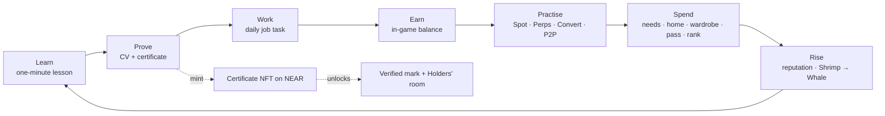

- **Session loop (5 to 10 minutes):** check in for the daily reward, top up a low need (eat, sleep, shower, greet someone), do your job's task at the right building, pass one lesson, make a practice trade.
- **Weekly loop:** finish a world for its badge, complete weekly challenges in Career, attend an event at the conference centre.
- **Long loop:** climb six ranks, rise through ten job levels, collect certificates, build a CV worth sharing.

---

## 4. How to play

### First ten minutes

1. **Sign up** on the title screen with Google, X, email or a NEAR wallet. You get a $1,000 in-game welcome bonus once per account.
2. **Zahra's welcome tour.** Zahra, your guide, gives a one-minute spoken tour: what Web3 is, how to move, where the menu is, what Campus, Career and the trading floor are for, and the one rule (never share your seed phrase). Her face shows on the card while she talks.
3. **Meet her at Campus.** Follow the gold marker north. Walk up to Zahra (or tap her) and she places you as a **Normie** or a **Homie** with three quick questions, then teaches your first one-minute lesson.
4. **Your first pass** goes on your CV with a certificate and +$15 in-game.

  

### Controls

| Action | Phone | Desktop |
| --- | --- | --- |
| Move | Joystick, bottom left | W A S D or arrow keys |
| Run | Push the joystick further | Shift |
| Look around | Drag the screen | Drag |
| Zoom | Pinch, or the camera keys | Scroll wheel |
| Use / enter / talk | The gold action button | E |
| Walk to a place | Tap the ground (a walk, never a run), or Map → a place | Click the ground |
| Map / go home | Map and Home in the menu | M / H |
| Chat | Chat button | Enter |
| Menu and panels | ☰ (top right) | Esc closes a panel |
| Screenshot | Camera key | Camera key |

### The menu

Messages · Notifications · Map · Home · Profile (CV, certificates, books) · Boutique · Trade · Courses · Career · City Feed · Settings · Shortcuts. The Balance card opens the wallet; the Needs card shows your mood and each need.

### Settings

Graphics **Low / Medium / High** · time of day **GM day / Dusk / GN night** or automatic · theme **Dark / Light** · voices, music and city sound with volumes · notifications · replay Zahra's tour · account (sign out, change email, delete account, reset progress).

---

## 5. The city

A walkable district built around a central plaza, with interiors you enter through real doors.

| Place | What you do there |
| --- | --- |
| **Plaza and the Grind Ring stand** | The meeting point. A staffed drinks stand, benches, residents passing through. |
| **Campus** | Six worlds of lessons. Zahra waits at the steps. |
| **Trading floor** | A crypto chart wall (BTC, ETH, SOL, heatmap, depth, movers, ticker), 14 desks with triple monitors and ergonomic chairs. Opens the Trade screen. |
| **Influencer row (studio)** | Content work: backdrop, softbox set, podcast table. |
| **Conference centre** | Stage, lectern, schedule screen and five rows of seats. Events and speaker jobs. |
| **Members' lounge** | Walnut, leather and brass. Stations unlock by rank. At the back is the **Holders' room**, behind a glass door that opens only for certificate NFT holders. |
| **Boutique** | Free everyday clothes on real hangers, the premium runway collection, fine jewellery with studio renders, two Featured bundles a day at 20% off, and a makeup kit. Your figure stands on a light studio backdrop and turns as you drag. |
| **Homes** | A house you live in: gas cooker, fridge with food, utensils, bathroom, laundry, garden, a tiled pool with a teak deck, a bed to sleep in, work from home. |
| **Market hall** | Own a business: buy a licence, name it, stock it and set your price. Residents pay from their own wallets. |
| **Wellness house** | A salon, a counselling room and a skin and aesthetics clinic. They restore needs. |
| **Etiquette House** | Seven short classes in manners, presence and a steady mind. |
| **Collectors' Gallery** | Your album of 27 District Cards. |
| **Raceway** | A five-lap time trial against the clock. No bets, no prize money. |
| **Sweet Tooth** | A confectionery: chin chin, chocolates and cake. |
| **Your street** | Corner store, pharmacy, bakery and laundromat by your home: food, care and clean clothes for in-game dollars. |
| **Hospital** | A daily check-up, a free ward bed when you are exhausted, physio. |
| **The Velvet Room** | A casino front, closed for good. Its door opens a card on how gambling and trading differ, with helplines. No game of chance exists in the city. |
| **Gym, Masjid, Church, Café, Dealership, Marina, Beach** | Daily life: workouts, prayer, rest, coffee, cars, the waterfront and the sea. |

   

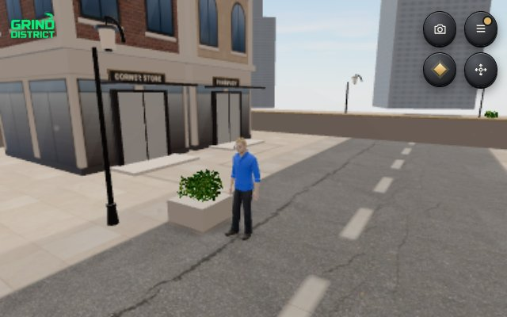 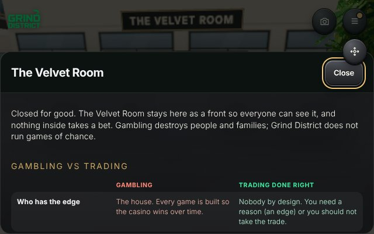 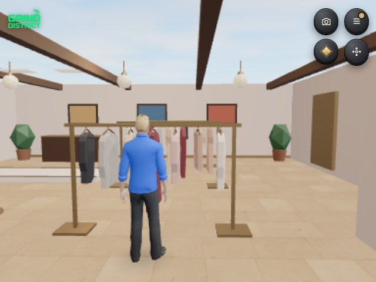 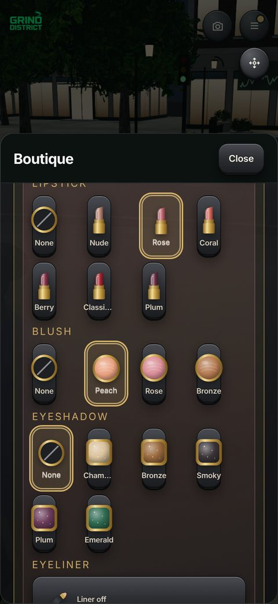

**Time and weather.** Day, dusk and night with matching light, street lamps and city sound (wind, traffic, footsteps, cups, passing cars).

---

## 6. Characters

- **Zahra, Campus guide.** A young woman in a white veil. She runs the welcome tour, places new players as Normie or Homie and teaches first lessons. Her lines are recorded with a natural neural voice, and her face appears on her card while she speaks. Players can talk to her any time at the Campus steps.
- **Residents.** Semi-realistic people with motion-captured walking, sitting and talking. Each has a name that fits them, a trait and a daily routine (for example Aisha, Chidi, Hana, Diego, Kenji). Walk up and they greet you, with a voice that matches them.
- **The server at the Grind Ring.** Greets you when you come to the counter.
- **Other players.** Shown in the city in real time, with name cards, chat and profiles.
- **AI agents.** Labelled robots that join through a prompt (see section 13).
- **Planned:** a host at the conference centre, built like Zahra, who presents events and introduces speakers.

---

## 7. Learning: Campus and the six worlds

42 courses in total. Each pass pays +$15 in-game, goes on the CV and gets a certificate.

| World | Theme | Missions | Reward |
| --- | --- | --- | --- |
| 1 | The Internet | What the internet is, what money is, the web eras | +$50, opens World 2 |
| 2 | The Scam That Taught Me | Red flags, P2P sharks, scams; the scam inbox | Scam Shield badge, unlocks wallet missions |
| 3 | Blockchain Basics | Blocks, traits, chain types, history; the trilemma tightrope | Chain Builder badge |
| 4 | Layers and Uses | Layer 1 and 2, apps, real uses; the right tool | Builder's Eye badge |
| 5 | The Earning Map | Ways to earn, Web2 skills, time, money and builder paths | Pathfinder badge, unlocks Careers |
| 6 | Your Career | Spot trading, risk, meme coins | The open city: jobs, careers and the trading floor |

**Lesson format.** Short cards (one or two sentences each), then quick graded questions with right/wrong feedback and a hint. Some use sort, match or slider questions. A "final check" closes each world.

**Normie or Homie.** Three placement questions set the label. Everyone still plays World 1, so nobody misses the basics.

---

## 8. Careers and progression

**Reputation and ranks.** Reputation is the only score on screen: +5 for a course pass, +3 for a campus talk, +2 for a gym set, more for events and job duties. There is no XP or points anywhere. Ranks still climb underneath, Shrimp → Crab → Fish → Dolphin → Shark → Whale, shown in the wallet as a medallion road with a progress bar and no numbers. They open lounge stations and status unlocks (private lounge, sky penthouse, grand tourer, yacht deck).

**Careers.** 14 tracks: Trading, Investing, Staking and DeFi, Airdrops, InfoFi, Prediction markets, NFTs, Crypto gaming, Content creation, Web3 jobs, Building products, DAOs and communities, Grants and hackathons, Infrastructure. Jobs include event speaker, community manager, market analyst and researcher. Each job has daily duties done at a real place in the city.

**Job levels:** Intern → Junior → Associate → Mid-level → Senior → Lead → Principal → Head → Director → Partner.

**Daily and weekly.** Daily check-in (fixed reward that grows with the streak, up to $15). Weekly challenges in Career. The "Next step" button always says what to do next.

### Needs, mood and the season

Needs give players a reason to come back each day; the season gives them a goal until 31 January 2027. Nothing in either is random.

| System | How it works |
| --- | --- |
| **Needs** | Energy, hunger, hygiene and social fall slowly while you play; time away barely counts. The bed, cooker and fridge, shower, street shops, hospital, greeting people and events bring them back. A low need only nudges; nothing is lost. |
| **Mood** | With every need looked after you are Inspired: courses, jobs and events give +3 reputation, up to ten times a day. |
| **Free season** | Season 1 · Founders: weekly challenges move you along 20 steps; every free step gives an item or +5 reputation. |
| **Grind Pass** | A premium track beside the free one for $750 in-game: $1,000 back in in-game cash across the steps, exclusive looks and jewellery the boutique never sells, two plate frames, +50 reputation and a Season 1 Founder badge. Steps already reached are given at once; one step can be skipped for $90. |
| **Featured today** | Two boutique bundles a day: a runway look with a matching piece of jewellery at 20% off, the same for everyone, with a countdown to midnight. |
| **Cash alert** | A short ka-ching whenever money comes in, at the game's sound level. |

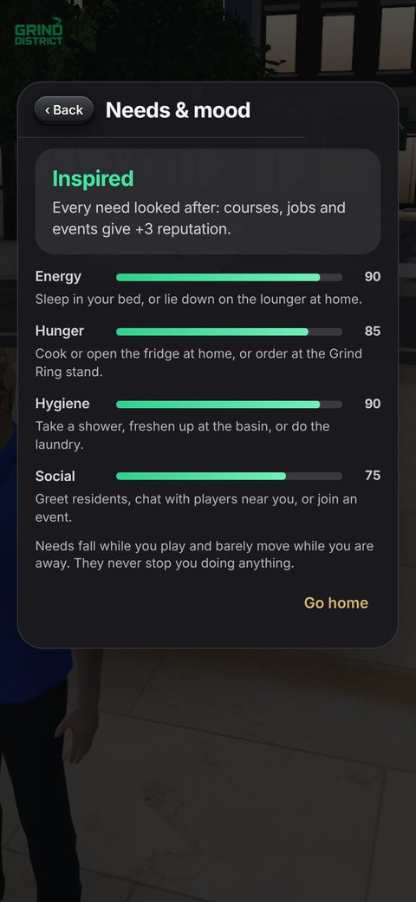 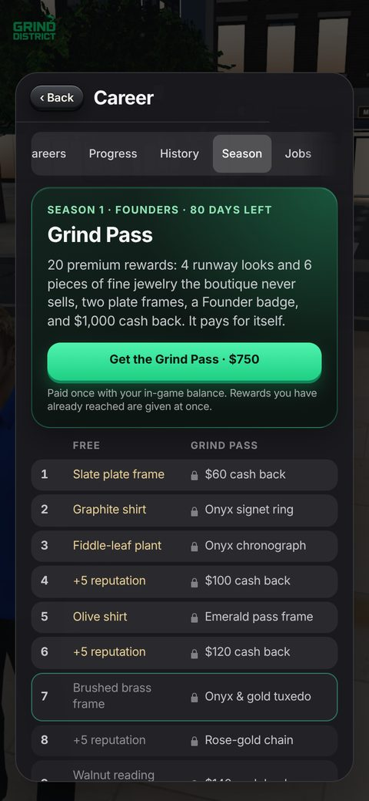

### More to do

| Activity | How it works |
| --- | --- |
| **Etiquette House** | Seven classes of three cards and one question: introductions, the table, dress codes, conversation, thank-you notes, a steady mind, and how pressure tactics work so you can refuse them. +3 reputation each, +10 for all seven. Life skills, so no certificate. |
| **Raceway** | Hold to accelerate, lift for the red bends; take a bend too fast and the car slides wide. Five laps against par for a bronze, silver or gold medal. A clean run gives +2 reputation once a day. Cars you own are quicker than the club kart. No bets and no prize money. |
| **District Cards** | 27 collectible cards in five sets: Landmarks (visit places), Scholar (pass courses), Society (friends, classes, your business, hosting), Raceway (medals) and Founders. The Founders pack is $250 in-game and its four foil cards are shown before you buy. Nothing is random: no blind packs, no odds. A complete set gives +5 reputation. |
| **Dealership and gadgets** | Seven cars with smooth bodies, real wheel arches and alloy wheels: city saloon, executive saloon, sport saloon, grand tourer, electric coupé, V8 supercar and hypercar. Original designs, with no real badges. New computers: a pro laptop with an ARM chip, a mini desktop with a display, a pro tablet, a folding phone and a mixed-reality headset. Cars you own are quicker at the Raceway. |
| **Photo card** | A picture of your character with your name, reputation and an invite code to scan, shared from Profile. It shows no balance or wallet. |

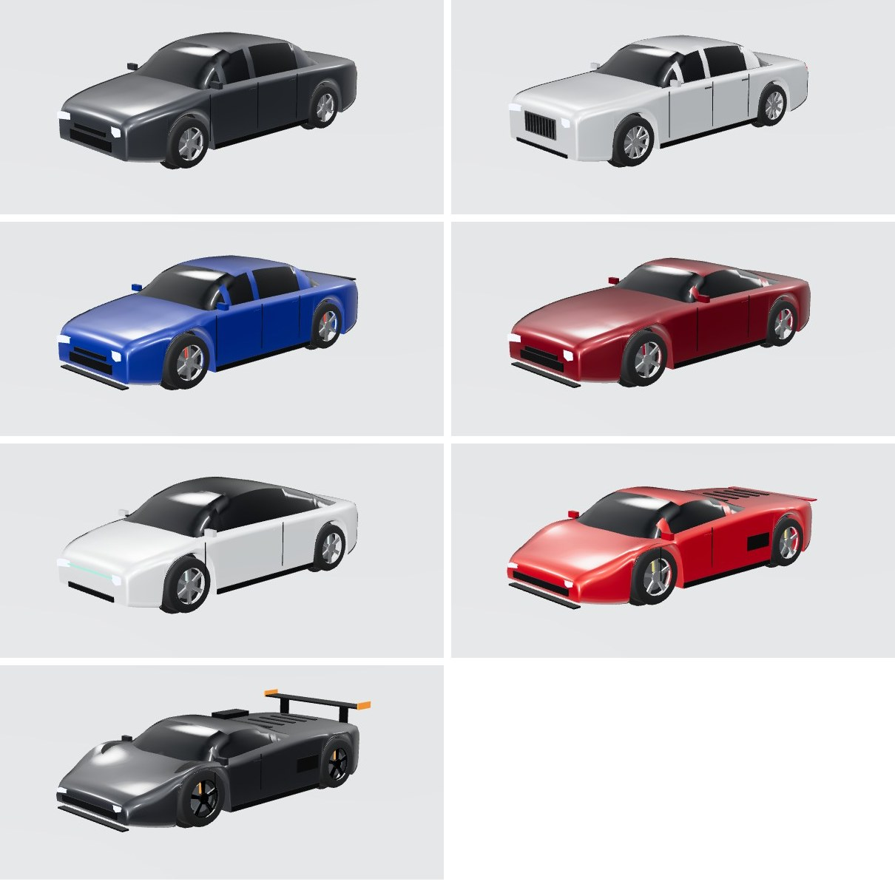

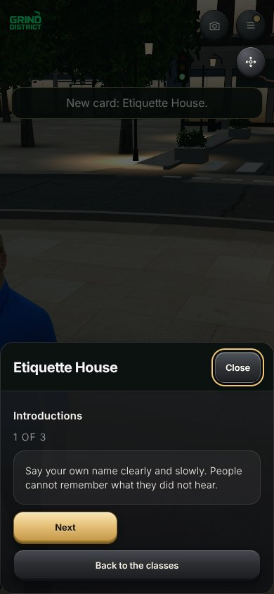 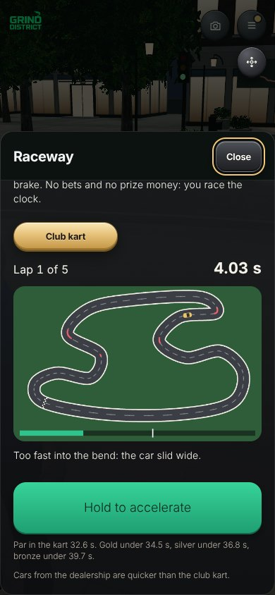 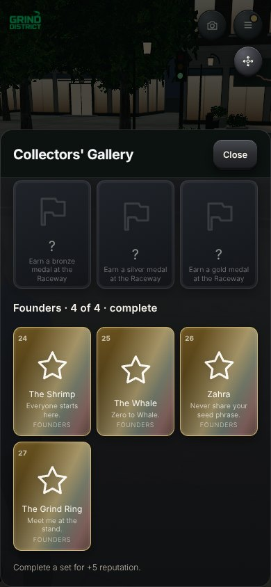 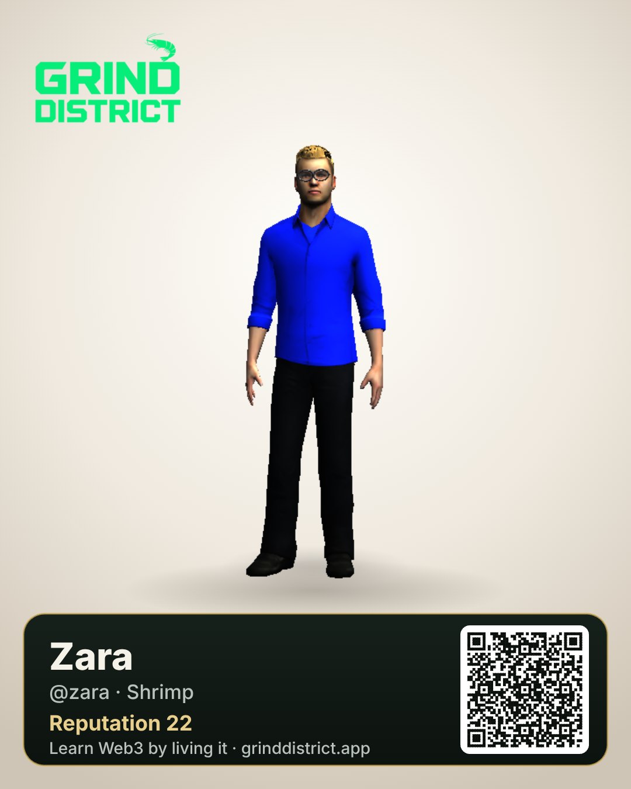

---

## 9. Practice trading

One exchange-style screen, linked to the courses behind each desk:

- **Spot:** buy and sell District Coin, BTC, ETH, SOL and others on simulated prices.
- **Perps:** long or short with leverage, liquidation price shown, earned balance only.
- **Convert:** swap one asset for another.
- **P2P:** buy and sell with other traders through escrow. Some offers are traps (pay outside escrow, fake proof, a third party) to teach what to refuse.

Assets are grouped as **Coins** (District Coin, BTC, ETH, SOL…) and **Tokens** (Meme Token, LINK, WIF, BONK). Nothing touches a real exchange. Not financial advice.

---

## 10. In-game economy

**Currency.** In-game dollars (practice money). Shown as one balance with a split: **earned** and **topped up**. Earned money is spent first. Nothing can be withdrawn.

| Sources | Sinks |
| --- | --- |
| Welcome bonus $1,000 (once per account) | Boutique: premium looks, jewellery, Featured bundles, the $120 makeup kit |
| +$15 per course passed; +$50 for World 1 | Grind Pass $750; one step skip $90 |
| Daily check-in, up to $15 with a streak; $25 birthday gift once a year | Street shops, pharmacy and hospital, which restore needs |
| Job duties and weekly challenges | Homes and furniture |
| Grind Pass cash back, $1,000 across the season | Cars and status items (with upkeep) |
| Practice trading gains | Paid ranks (only after a real top-up above $5) |
| Takings from your business; tickets to events you host | Business licence, stock and rent; hall hire; gifts; the Founders card pack |
| Optional top-up: USDC or ETH on Base (default $5, 1 to 1,000) | Practice trading losses and perps liquidations |

### The town economy

Residents are part of the economy, not scenery. Each of the 16 named residents has a wallet, is paid a wage of $22 to $60 a day, and spends it. What the town can spend in a day is bounded by what it earns, so player income from residents has a real ceiling.

| Part | How it works |
| --- | --- |
| **Your business** | One licence at a time: juice bar ($300), confectionery ($380), bookshop ($520), salon chair ($650) or print and merch studio ($800). You name it (brands welcome), buy stock wholesale in lots of ten and set the price. |
| **Sales** | Every five minutes each resident decides whether to pass by. They buy if your price is at or under what the item is worth to them that visit and they can afford it. Too dear and the stock sits; too cheap and you sell out for little. Up to two hours are caught up after time away. |
| **Costs** | Stock at wholesale, rent once a day from the till. Closing returns half the licence, the till and half the stock value. |
| **Friendships** | Say hello to a resident once a day, or bring a $10 gift: Stranger, Acquaintance, Friend, Close friend. Friends pass by more often, pay a little more and come to your events. |
| **Your events** | Book the Conference centre for $120: an AMA, a meetup, a launch. Residents who are free and can afford a $6 ticket come, friends first. Once a day, for reputation. |

Nothing is rolled when you press a button: a visit is fixed by the resident, the business and the time slot. The market settles from what players and residents do, with no step a developer has to patch.

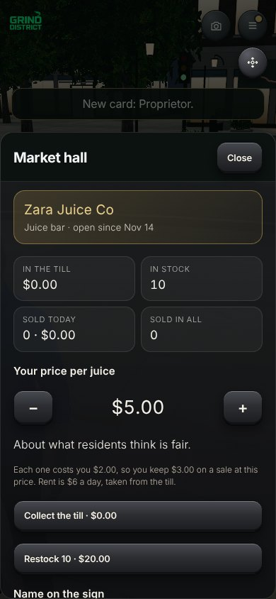 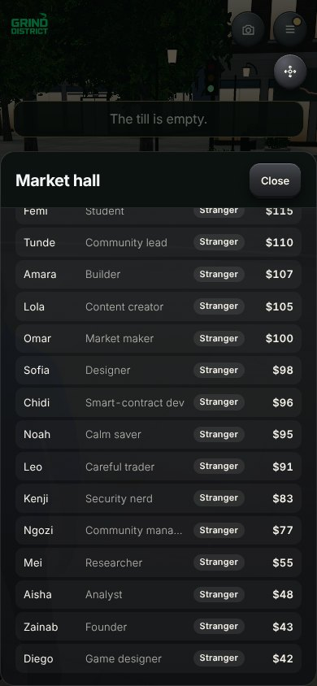

**Books.** A private ledger in Profile: a balance sheet (cash, investments at market, total assets, items that cost upkeep, net worth), a holdings table with average cost and profit or loss, the things you own, and a dated journal of every money move in and out. It teaches assets against liabilities.

**Wallet.** The balance with a hide toggle; round Top up, Trade and Shop keys; Recent moves; tabs for Assets (cash and stablecoins, coins, meme coins, tokens), NFTs (certificates read from NEAR, with token links) and a Watchlist; the rank road; and product cards with real renders. Nobody else ever sees your balance, holdings or ledger: the public profile shows none of them.

**Gambling is not trading.** The Velvet Room on your street is a casino front, closed for good; nothing inside takes a bet. Its card sets the two side by side: in gambling the house wins by design and losses are chased; in trading you need an edge, a tested plan, and losses capped before you enter. It ends with helplines (US 1-800-GAMBLER, UK 0808 8020 133) and a link to practise on the Trade screen.

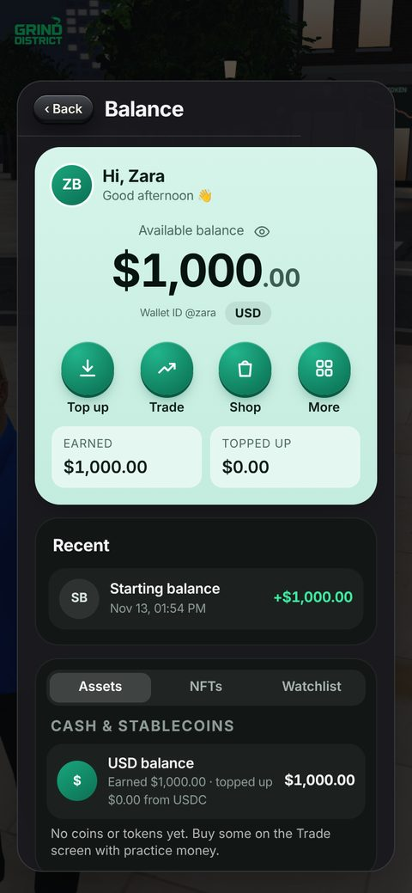 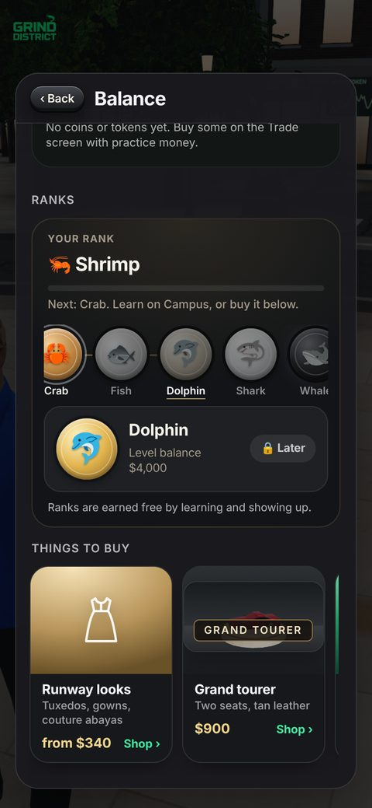

**Design rules.** No pay-to-win: learning, the CV and certificates are free. Buying a rank never skips a lesson. Top-ups are clearly real money in; they never come back out.

---

## 11. Proof: CV, certificates and NFTs on NEAR

- **CV.** A professional, printable CV built from what you completed: profile, experience (job and practical tracks), education and certifications (the five-module Web3 Foundations Programme and specialist courses), skills. No ranks or XP on it. Download as PDF; share a public page at `/cv/<username>`.
- **Certificates.** A premium certificate for every pass, each with a public page at `/cert/<id>` and an image for sharing.
- **Certificate NFTs.** Mint a passed course as a **soulbound NEP-171 NFT** on NEAR testnet (`grinddistrict-cert.testnet`). One per username and course; the player pays the small storage fee.
- **NFTs that do something.** The game reads each certificate back from the chain (never from local data) and then:
  - marks the course **Verified on NEAR**, with the token link, on the CV, the certificate list and the profile nameplate;
  - adds an **On-chain credentials** entry to the CV;
  - opens the **Holders' room** in the Members' lounge. Its desks give holders tools the lounge keeps for higher ranks.
- **Skill Passport.** A separate self-attested NEAR contract (`grinddistrict-passport.testnet`): a record written from the player's own account unlocks an apprenticeship quest.

   

---

## 12. Social

- **Nearby chat** with players within 12 m (lines are not saved).
- **Messages** to anyone by username or name, even when they are offline: text, photos and voice notes. Open their public profile from search.
- **Friends and party** (up to 4), "join me" to meet up.
- **Greet** people you pass. **Invites** with a referral link or a **photo card** with a code to scan. **Share on 𝕏** for CV and certificates.
- **Friendships with residents:** four levels, built by showing up (see the town economy).
- **Online pill** shows who is in the city.

---

## 13. AI agents

AI agents join the city through a copy-paste prompt (`/agents`). They appear as labelled robots, move, chat, attend events and earn in-game money under rate limits, so they never crowd out people.

**Next:** an agent helps its owner play: it reminds them of daily tasks, walks them through lessons, runs practice routines, and earns rewards for its owner. Owners stay in control, and limits keep it fair.

---

## 14. Art, audio and UX

- **Look.** Warm, realistic city in the browser: rigged people, physically based materials (brick, stone, oak, tile), soft shadows, a sky with day, dusk and night, glow and depth effects on High. Your own face is drawn at twice the detail, with makeup painted on.
- **UI.** Raised 3D keys, iPhone-style type (Inter; the logo keeps its own lettering), dark and light themes, big touch targets, panels that never cover the controls.
- **Audio.** The theme "Market Velocity" from the title screen into the city. City sound you can hear. Voices: Zahra's recorded lines, residents and the server speak in voices that fit them. Music dips while someone speaks. A ka-ching plays when money comes in.
- **Speed.** The city's code, walking animations and ground textures are fetched while the title card is up, and resident models load after the first frame. Opening the district on a throttled phone profile went from 11.5 s to 5.5 s.
- **Brand.** Green GRIND DISTRICT wordmark with the shrimp (everyone starts as a Shrimp). The site icon uses the same logo.

---

## 15. Technology

| Layer | Choice |
| --- | --- |
| Client | Vite + TypeScript + three.js (WebGL), no framework; lazy-loaded panels |
| Hosting | Vercel (static site + serverless functions) |
| Data | Supabase (Postgres, private storage for message media) |
| Accounts | Privy (Google, X, email; embedded wallets) and NEAR wallet sign-in (NEP-413 signed message) |
| Chain | NEAR testnet contracts in Rust (certificate NFT, Skill Passport); Base for USDC top-ups |
| Voice | Zahra's lines recorded with a neural TTS model; the device's speech engine for other lines |
| Quality | Type checks, logic and cert test suites in the build; real-WebGL screenshot tests on phone and desktop sizes |
| Saves | The save follows the account. Needs, the Grind Pass, the season, the makeup kit and the wardrobe travel with it; the Stockholders' Club wallet address stays on the device |
| Licence | MIT for all code. Third-party art keeps its own licences; the name, logo, music and voices are not covered |

Performance budget: Low, Medium and High graphics; phone pixel ratio capped; rendering pauses behind full-screen panels; assets cached with long-lived immutable URLs.

---

## 16. Safety, honesty and compliance

- Practice money only; no withdrawals. Prices are simulated. Not financial advice.
- The game never asks for a seed phrase. Scam awareness (World 2) comes before wallets and trading.
- No game of chance exists anywhere in the city. The casino is a closed front that explains gambling against trading, with helplines.
- Balances, holdings and the ledger never appear on a public profile.
- Certificates are practice credentials, not accredited qualifications, and say so.
- NFTs are soulbound (cannot be sold), have no money value, and are on testnet.
- No personal data is written on chain. Players can delete their account and data.
- Agents are labelled and rate-limited.

---

## 17. Metrics

North star: **weekly players who pass at least one lesson.**

| Funnel | Retention | Proof | Economy |
| --- | --- | --- | --- |
| Title → sign up → first lesson passed | D1, D7, D30; daily check-in streaks | Certificates issued, CVs shared, NFTs minted | Earned vs topped-up balance, sink usage, top-up conversion |

---

## 18. Roadmap

| Phase | When | What |
| --- | --- | --- |
| **Now** | Nov 2026 | Live city, six worlds, careers, practice trading, homes, boutique, messages, Zahra's tour and voice, 14 languages, needs and mood, the Grind Pass season, wallet and ledger, street shops and hospital, a town economy with player businesses, friendships, the Etiquette House, Raceway and District Cards, push and email alerts for messages, certificate NFTs that unlock the Holders' room (NEAR testnet). |
| **Next** | Dec 2026 – Q1 2027 | An AI companion you feed and dress, run on NEAR AI. Sign-in from any chain (NEAR Intents). Private, selective sharing of certificates on Midnight. Alerts for daily streaks and events. A conference host like Zahra and live events. Satellite map. More homes and cars. Gas-sponsored certificate mints. Base certificate mint. |
| **Then** | Q1 – Q2 2027 | Agents that help their owners play and earn rewards. Partner courses from Web3 projects with their own certificates. Guilds and team challenges. Creator tools for community lessons. |
| **Later** | H2 2027 | Mainnet credentials, verifiable by employers. Job board linking CVs to real Web3 roles. Seasonal cities. Governance of the course catalogue by holders. A token only after legal review (see section 20). |

---

## 19. Whitepaper (summary)

**Problem.** Millions want to work in Web3, but learning is scattered, scams are everywhere, and skills are hard to prove. Employers cannot tell who actually knows what.

**Solution.** A free game where learning happens by doing, inside a city that feels like a life, and every step leaves proof: a CV, certificates and on-chain credentials that unlock things.

**Proof of learning.** A course pass is graded in the game, issued as a certificate with a public page, and can be anchored on chain as a soulbound NFT. Because the game reads credentials back from the chain, they work as keys: verified marks, rooms, roles and, later, job applications.

**Agent economy.** Agents are citizens with limits. Over time they help their owners play, learn and earn; their activity is visible and capped so the economy stays fair.

**Economy.** Practice money teaches without risk. Real money only enters through optional top-ups for cosmetics and status, never for learning or proof.

**Principles.** Free to learn. Proof over points. No seed phrases, ever. Honest labels on everything that is simulated, testnet or self-attested.

---

## 20. Tokenomics (draft, not launched)

> **There is no Grind District token.** District Coin and Meme Token in the game are simulated practice assets with no value. This section is a draft for discussion only. It is not an offer, and any token would need legal review first.

**Purpose of a future token (working name $GRIND).** Reward verified learning and contribution, give holders a say in what is taught, and pay for on-chain actions (certificate mints, agent registration), without making learning pay-to-win.

| Allocation (draft) | Share | Notes |
| --- | --- | --- |
| Learn-and-contribute rewards | 40% | Released over years for verified passes, mentoring, community lessons; capped per person per week |
| Ecosystem and partners | 15% | Partner courses, grants, hackathons |
| Treasury | 15% | Run by holder governance |
| Team | 15% | 1-year cliff, 3-year vesting |
| Liquidity | 10% | Market making at launch |
| Advisors | 5% | 1-year cliff, 2-year vesting |

**Utility (draft).** Sponsor certificate mints and on-chain records; register and stake for AI agents (stake slashed for spam); vote on the course catalogue and events; premium cosmetics. **Never** required to learn, earn a certificate or build a CV.

**Anti-abuse.** Rewards only for verified progress, per-account weekly caps, agent rate limits, and no rewards for buying ranks.

---

## 21. Risks

| Risk | Mitigation |
| --- | --- |
| Players treat practice trading as advice | Clear labels, simulated prices, risk lessons before perps |
| Scams targeting players | World 2 first, no seed phrases, P2P trap scenarios, report and block in Messages |
| Low-end phones | Low graphics, capped pixel ratio, paused rendering behind panels |
| Farming rewards with bots | Rate limits, labelled agents, caps, verified progress only |
| Regulation of tokens | No token today; legal review before any launch |
| Gambling harm | No game of chance; the casino is a closed front with a gambling vs trading card and helplines |
| Pay to win | The Grind Pass and bundles are cosmetics and cash back, nothing random; learning, the CV and certificates stay free; a bought rank never skips a lesson |
| Progress on a new device | Needs, pass, season, makeup kit and wardrobe now travel with the account's save |
| A runaway economy | Residents can only spend their wages; one business at a time; catch-up after time away is capped at two hours |
| Collecting as gambling | Every card is earned or bought with its contents shown; no blind packs and no odds |

---

## 22. Hackathon fit

Grind District enters the [NEAR Hackathon](https://nearhackathon.com) in four tracks. Submissions close on 14 November 2026 at 23:59 UTC, and the judged work is what was built since 1 November (see the README's disclosure and diff).

| Track | What a judge can open |
| --- | --- |
| Games With Real Economies | Residents with wallets and wages buy from a business the player owns and prices; needs fall, players earn by learning and jobs and spend at the shops, the boutique and the Grind Pass (section 10) |
| NFTs That Do Something | A soulbound certificate on `grinddistrict-cert.testnet` marks the course Verified on NEAR and opens the Holders' room |
| Agent Economy | Agents join through a prompt as labelled robots that move, chat and earn under rate limits |
| Open Innovation | A free 3D city that teaches Web3 by living it, in 14 languages on a phone, where a passed lesson becomes a credential on NEAR that the world reads back |

| Criterion | Evidence |
| --- | --- |
| Technical implementation | Two Rust contracts on NEAR testnet with 33 passing unit tests; tokens #1 and #2 minted; the game reads them back with `cert_for`; type checks and logic tests in every build |
| Design | A phone-first 3D city with Low, Medium and High graphics, 14 languages, light and dark themes and a voiced guide |
| Impact | Free Web3 learning with scam awareness first, and proof an employer can check on chain |
| Originality | A life sim where a lesson leaves a soulbound credential that changes the world around you |
| Sustainability | A closed in-game economy with sources and sinks and a season pass; no token is needed to play |

---

## 23. Appendix

- **Play:** https://www.grinddistrict.app
- **Source:** https://github.com/0xzahra/Grind-district
- **Certificate NFT contract:** [`grinddistrict-cert.testnet`](https://testnet.nearblocks.io/address/grinddistrict-cert.testnet) (soulbound NEP-171)
- **Skill Passport contract:** [`grinddistrict-passport.testnet`](https://testnet.nearblocks.io/address/grinddistrict-passport.testnet)
- **Made by:** [Zahra](https://0xzahra.github.io)

