

<h1 align="center">Grind District: Game Design Document</h1>

<b>Version 2.6 · 28 November 2026</b> 
City · Career · Skills · CV 
<a href="https://www.grinddistrict.app">www.grinddistrict.app</a> · free, in the browser, phone or desktop

**Changelog**

- **2.6 — 28 November 2026.** Live on grinddistrict.app (commit `947bd81`). First-visit onboarding uses the title line *Walk out with a CV, Resume and Portfolio*, one gold *Go to the Learning Center* card, and the CV and certificate opening after the first lesson. Lessons give instant right-or-wrong feedback, Zahra reacts, a wrong pick gets a free retry, first-try answers earn a share of the course's $15 in-game bonus, and a soft lesson streak is kept (no hearts or XP). The Chain Gallery, a glass hall beside the airport, has seven display slots, with NEAR, Base and Solana filled (display only). The certificate mint screen lists Base, Arbitrum, OP Mainnet, Robinhood Chain, Polygon, BNB Chain, NEAR testnet and Solana devnet. Solana writes a soulbound certificate record, not a token NFT, automatically after the exam, free. UI polish from the same day: a smaller resident card, separate gadget cards, Buy / Equip / Pocket on drones, glasses and jewellery visible on the figure, feet kept on the ground, a tidier settings grid, map travel to Grind Park, the mall, the metro and the masjid, and arriving at the plaza no longer clipping into the kiosk. Live counts at 09:42 WAT: 1,648 visitors, 95 registered, 48 learners, 90 lessons passed, 36 certificates.
- **2.5 — 24 November 2026.** Competitor research (section 24) and the design intent for the title line and first-lesson proof, now live in 2.6.

---

## Contents

1. [Overview](#1-overview)
2. [Design pillars](#2-design-pillars)
3. [Core loop](#3-core-loop)
4. [How to play](#4-how-to-play)
5. [The city](#5-the-city)
6. [Characters](#6-characters)
7. [Learning: Campus and the six worlds](#7-learning-campus-and-the-six-worlds)
8. [Careers and progression](#8-careers-and-progression)
9. [Practice trading](#9-practice-trading)
10. [In-game economy](#10-in-game-economy)
11. [Proof: CV, certificates and on-chain credentials](#11-proof-cv-certificates-and-on-chain-credentials)
12. [Social](#12-social)
13. [AI agents](#13-ai-agents)
14. [Art, audio and UX](#14-art-audio-and-ux)
15. [Technology](#15-technology)
16. [Safety, honesty and compliance](#16-safety-honesty-and-compliance)
17. [Metrics](#17-metrics)
18. [Roadmap](#18-roadmap)
19. [Whitepaper (summary)](#19-whitepaper-summary)
20. [Tokenomics (draft, not launched)](#20-tokenomics-draft-not-launched)
21. [Risks](#21-risks)
22. [Hackathon fit](#22-hackathon-fit)
23. [Appendix](#23-appendix)
24. [Competitor research](#24-competitor-research)

---

## 1. Overview

| | |
| --- | --- |
| **High concept** | A shared 3D city where you learn Web3 by living it. You take short lessons, get a job, practise trading with in-game money, and come out with a real CV and certificates you can prove. |
| **Genre** | Life simulation and learning game (social, light RPG progression) |
| **Platform** | Web browser on phones and desktops. No install. |
| **Audience** | People new to crypto ("Normies") and people already in it ("Homies") who want proof of skill. Ages 16+, mobile-first, with emerging markets in mind. |
| **Business model** | Free to play. Optional premium cosmetics, the Grind Pass and paid ranks, bought with in-game balance; paid ranks need a real top-up first (USDC or ETH on Base). No pay-to-win: lessons, certificates and the CV are always free. |
| **Status** | Live at grinddistrict.app. Certificates can be minted on Base, Arbitrum, OP Mainnet, Robinhood Chain, Polygon, BNB Chain and NEAR testnet; a soulbound record is also written on Solana devnet after the exam. |

**One-line pitch.** Everyone starts at zero as a Shrimp. Walk the city, learn one minute at a time with Zahra, work a job, trade with practice money, and climb to Whale. Leave with a CV, certificates and NFTs that do something.

**What makes it different**

- **Learning leaves proof.** Every pass is filed to a professional CV and gets a certificate with a public page. A certificate can be minted as a soulbound NFT on Base, Arbitrum, OP Mainnet, Robinhood Chain, Polygon, BNB Chain or NEAR, or recorded on Solana devnet, and the game reads it back to unlock things.
- **A place, not a quiz app.** Lessons happen in a living city with real-looking people, homes, a trading floor, a boutique, a masjid, a church, a gym and a conference centre.
- **Safe by design.** Practice money only, no seed phrases ever, testnet contracts, simulated prices. Scam awareness is taught before trading.
- **Built for phones.** Low, Medium and High graphics, a joystick and big 3D buttons, light and dark themes.

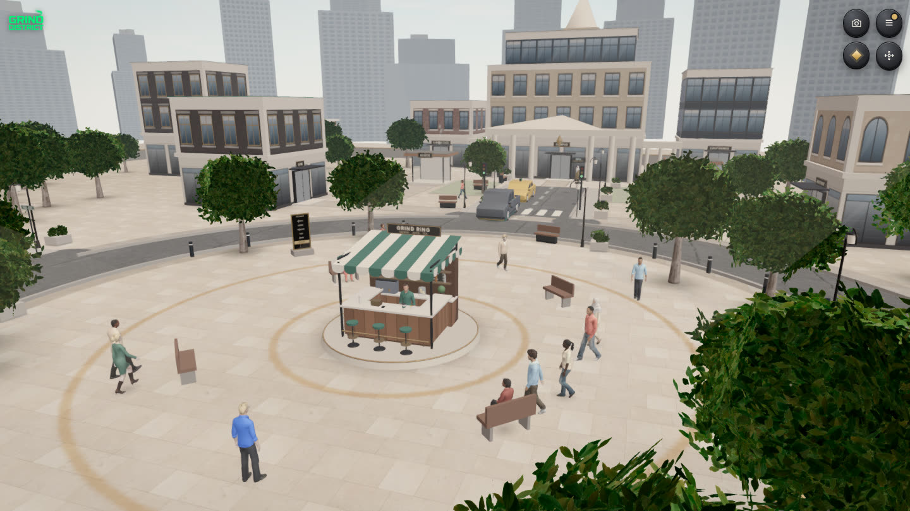

---

## 2. Design pillars

1. **Learn by living.** Every lesson is tied to a place and an action in the city. You learn spot trading at the trading floor, scams before wallets, careers at the career board.
2. **Proof over points.** Reputation and ranks motivate; there is no XP or points on screen. What you keep is a CV, certificates and on-chain credentials.
3. **Zero to Whale.** Everyone starts equal at Shrimp. Ranks are earned by learning and showing up; buying a rank never skips a lesson.
4. **Safe practice.** Real skills with practice money. The game never asks for a seed phrase, and nothing can be withdrawn.
5. **Phone first.** It loads fast and plays with one thumb.

---

## 3. Core loop

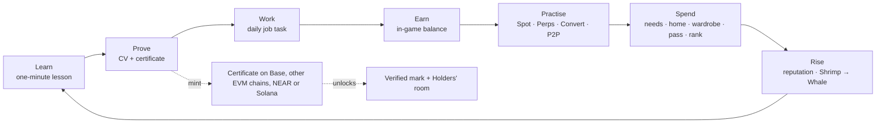

- **Session loop (5 to 10 minutes):** check in for the daily reward, top up a low need (eat, sleep, shower, greet someone), do your job's task at the right building, pass one lesson, make a practice trade.
- **Weekly loop:** finish a world for its badge, complete weekly challenges in Career, attend an event at the conference centre.
- **Long loop:** climb six ranks, rise through ten job levels, collect certificates, build a CV worth sharing.

---

## 4. How to play

### First ten minutes

1. **Sign up** on the title screen (*Walk out with a CV, Resume and Portfolio.*) with Google, X, email, a NEAR wallet or a Solana wallet. You get a $1,000 in-game welcome bonus once per account. A calm line notes that lessons are free.
2. **Zahra's welcome tour.** Zahra, your guide, gives a one-minute spoken tour: what Web3 is, how to move, where the menu is, what Campus, Career and the trading floor are for, and the one rule (never share your seed phrase). Her face shows on the card while she talks.
3. **Go to the Learning Center.** New players get one gold *Go to the Learning Center* card and no extra clutter until they pass a first lesson. Tap *Go* to arrive at Campus beside Zahra. She places you as a **Normie** or a **Homie** with three quick questions, then teaches your first one-minute lesson.
4. **Your first pass** goes on your CV with a certificate and +$15 in-game. The CV and certificate open straight away. A featured activity tile then appears in the menu and changes each visit.

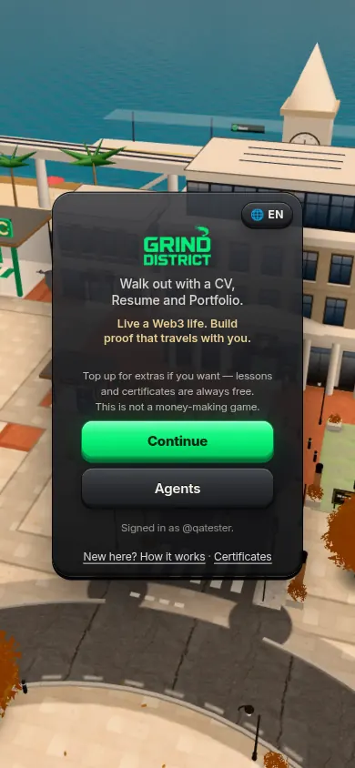 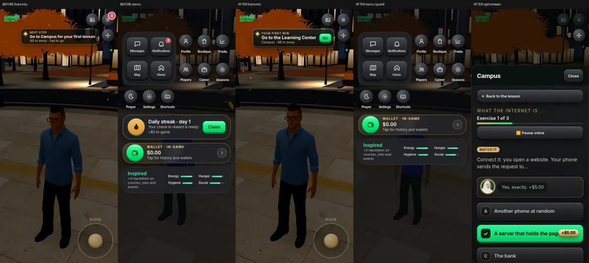

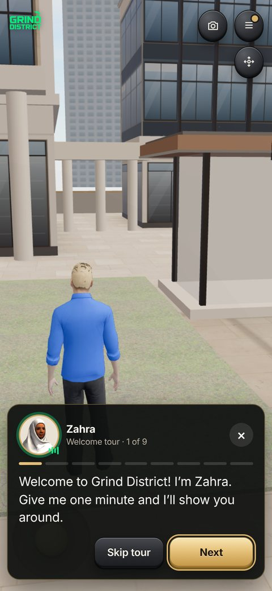 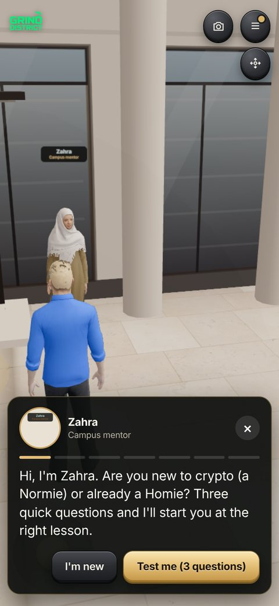 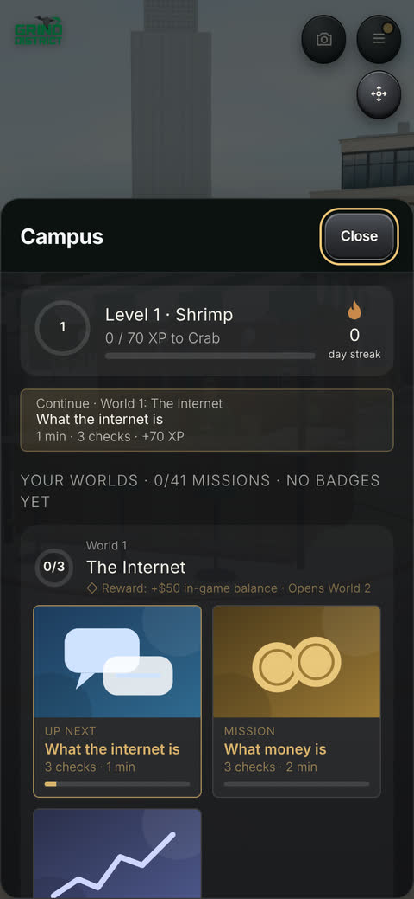

### Controls

| Action | Phone | Desktop |
| --- | --- | --- |
| Move | Joystick, bottom left | W A S D or arrow keys |
| Run | Push the joystick further | Shift |
| Look around | Drag the screen | Drag |
| Zoom | Pinch, or the camera keys | Scroll wheel |
| Use / enter / talk | The gold action button | E |
| Walk to a place | Tap the ground (a walk, never a run), or Map → a place | Click the ground |
| Map / go home | Map and Home in the menu | M / H |
| Chat | Chat button | Enter |
| Menu and panels | ☰ (top right) | Esc closes a panel |
| Screenshot | Camera key | Camera key |

### The menu

**Learn** comes first: a green card with the first lesson ("Learn at Campus · about a minute · it goes on your CV") or the next one. Until the first lesson is passed, the only next-step card is the gold *Go to the Learning Center* card. Beside it: Messages · Notifications · Map · Home, and Profile (CV, certificates, books) · Career · Settings · Shortcuts. Boutique, Trade and Seasons, plus a featured activity that changes each visit, join once the first lesson is passed, so a new player sees the learning path first. The Balance card opens the wallet; the Needs card shows your mood and each need. Main keys are in the logo's green; red is kept for delete and reset.

### Settings

Graphics **Low / Medium / High** · time of day **GM day / Dusk / GN night** or **Auto** (the city opens in GM day and stays there; only Auto lets the day and the seasons run) · theme **Dark / Light** · voices, music and city sound with volumes · notifications · replay Zahra's tour · account (sign out, change email, delete account, reset progress).

---

## 5. The city

A walkable district built around a central plaza, with interiors you enter through real doors.

| Place | What you do there |
| --- | --- |
| **Plaza and the Grind Ring stand** | The meeting point. A staffed drinks stand, benches, residents passing through. |
| **Campus** | Six worlds of lessons. Zahra waits at the steps. |
| **Trading floor** | A crypto chart wall (BTC, ETH, SOL, heatmap, depth, movers, ticker), 14 desks with triple monitors and ergonomic chairs. Opens the Trade screen. |
| **Influencer row (studio)** | Content work: backdrop, softbox set, podcast table. |
| **Conference centre** | Stage, lectern, schedule screen and five rows of seats. Events and speaker jobs. |
| **Members' lounge** | Walnut, leather and brass. Stations unlock by rank. At the back is the **Holders' room**, behind a glass door that opens only for certificate NFT holders. |
| **Boutique** | Free everyday clothes on real hangers, the premium runway collection, fine jewellery with studio renders, two Featured bundles a day at 20% off, and a makeup kit. Your figure stands on a light studio backdrop and turns as you drag. |
| **Homes** | A house you live in: gas cooker, fridge with food, utensils, bathroom, laundry, garden, a tiled pool with a teak deck, a bed to sleep in, work from home. |
| **Market hall** | Own a business: buy a licence, name it, stock it and set your price. Residents pay from their own wallets. |
| **Wellness house** | A salon, a counselling room and a skin and aesthetics clinic. They restore needs. |
| **Etiquette House** | Seven short classes in manners, presence and a steady mind. |
| **Collectors' Gallery** | Your album of 27 District Cards. |
| **Raceway** | A five-lap time trial against the clock. No bets, no prize money. |
| **Sweet Tooth** | A confectionery: chin chin, chocolates and cake. |
| **Your street** | Corner store, pharmacy, bakery and laundromat by your home: food, care and clean clothes for in-game dollars. |
| **Hospital** | A daily check-up, a free ward bed when you are exhausted, physio. |
| **The Velvet Room** | A casino front, closed for good. Its door opens a card on how gambling and trading differ, with helplines. No game of chance exists in the city. |
| **Gym, Masjid, Church, Café, Dealership, Marina, Beach** | Daily life: workouts, prayer, rest, coffee, cars, the waterfront and the sea. |
| **Chain Gallery** | A glass hall beside the airport forecourt. Seven display slots; NEAR, Base and Solana are filled, the rest stay dark. Display only: nothing here connects a wallet or sends a transaction. |
| **Grind International Airport** *(after the deadline)* | By metro, east of the city: a glass terminal, check-in by cabin, gate lounges, the Grind One Lounge, airliners on their stands, a runway over the sea, and the Grind Orbital spaceport past the runway. |
| **The Grind Grand** *(after the deadline)* | A hotel tower west of the city: a marble lobby, a suite for the night, and a lift to a rooftop infinity pool and sky bar. |
| **Grind Mall** *(after the deadline)* | East of the city: two floors round an atrium with an escalator and a glass lift, the Grind Fresh supermarket, fashion, tech, a pharmacy, a food court and a cinema. |

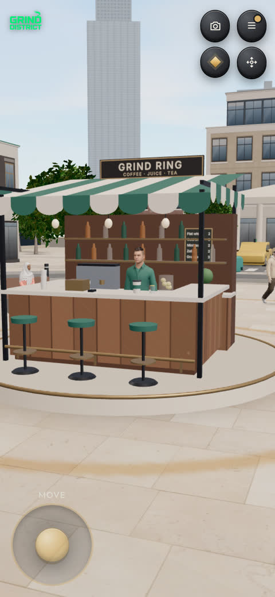 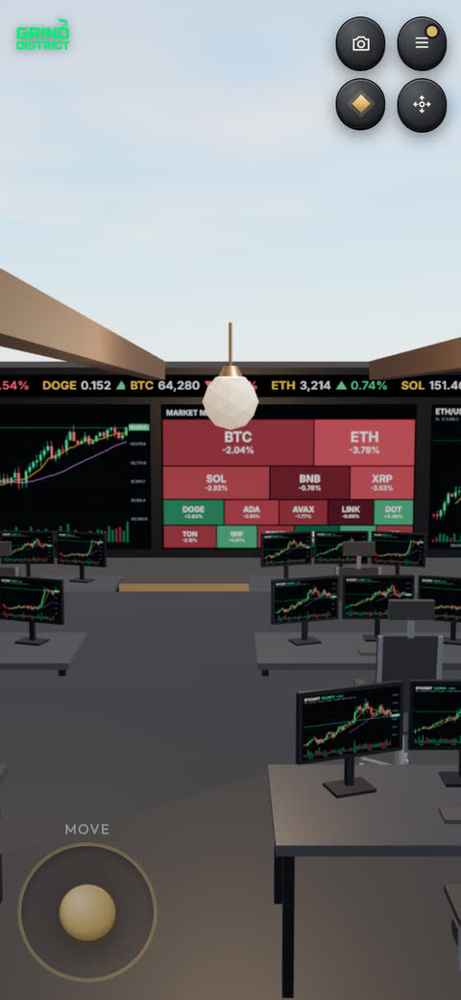 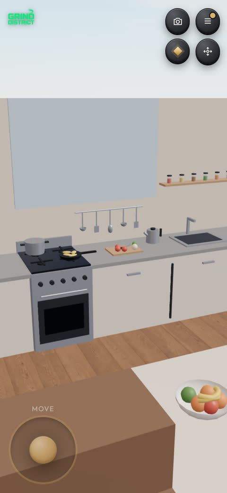 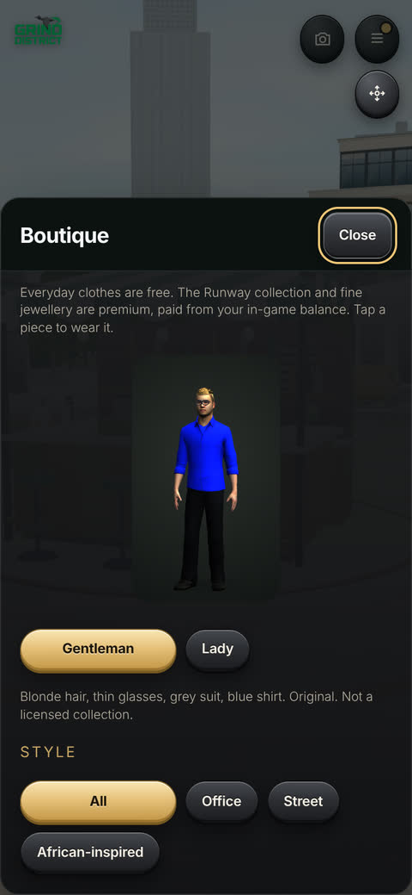

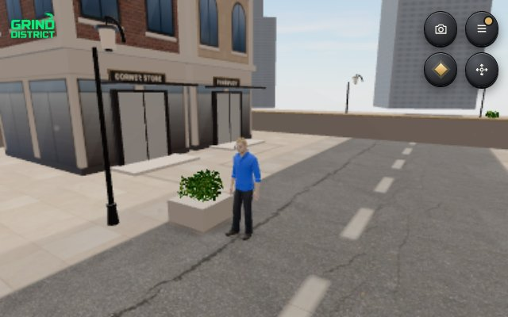 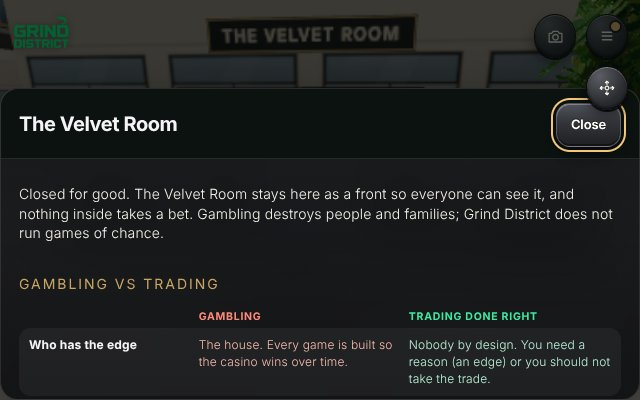 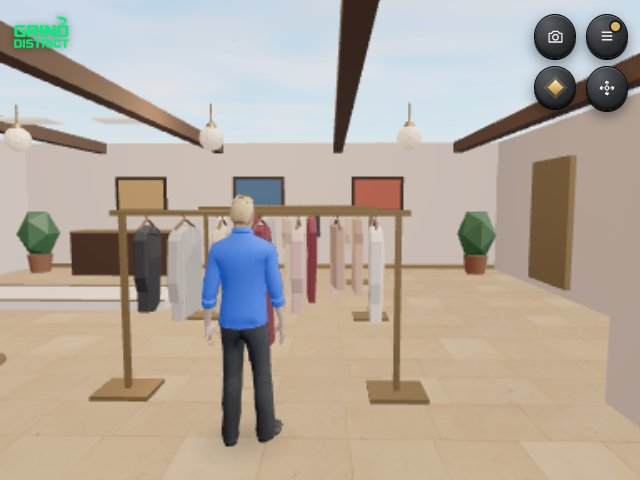 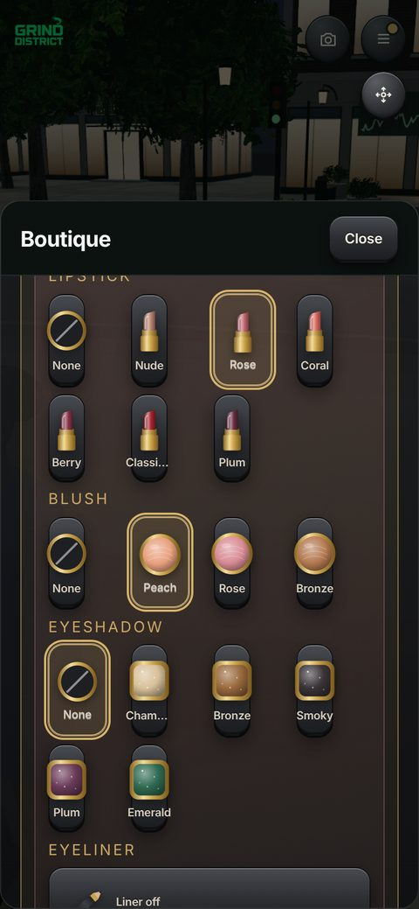

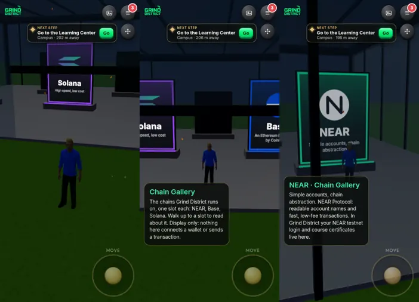

The map can send you to every listed place, including Grind Park, the mall, the metro and the masjid.

**Time and weather.** Day, dusk and night with matching light, street lamps and city sound (wind, traffic, footsteps, cups, passing cars).

**Seasons and climate** *(after the deadline).* Seasons turn every two in-game days from the real season: spring blossom, summer light, autumn's orange trees and falling leaves, winter snow on the trees and streets. **Seasons & climate** in the menu shows any season now and previews 2050 and 2100 under low and high emissions (IPCC AR6 global figures): the waterline climbs the beach with sea-level rise (the 2100 high path floods it to the promenade), heat haze thickens, parks dry out, storms come more often, with what each future means and what helps. **El Niño and La Niña** years come round every few in-game years (a warmer, hazier year with sudden downpours, or a cooler, wetter one), explained with their real effects round the world, and either can be previewed.

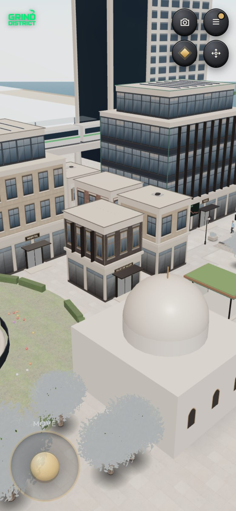 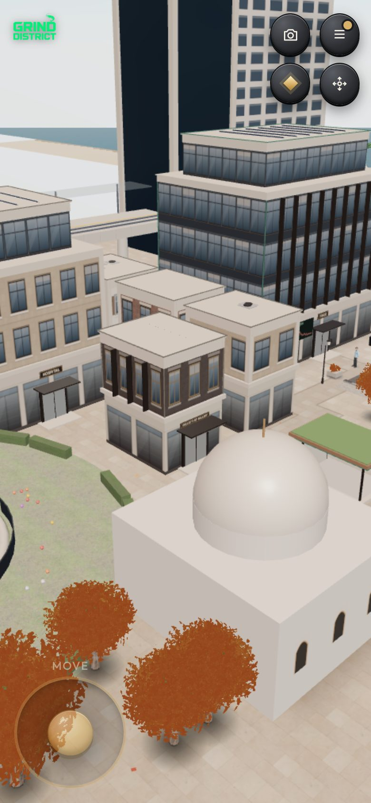 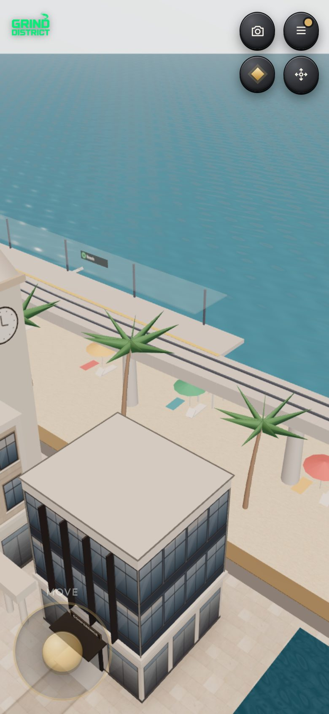 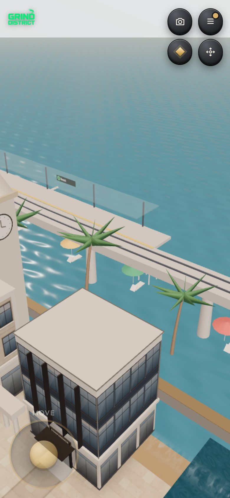

---

## 6. Characters

- **Zahra, Campus guide.** A young woman in a white veil. She runs the welcome tour, places new players as Normie or Homie and teaches first lessons. During a lesson she asks each question and reacts when the answer is right or wrong. Her lines are recorded with a natural neural voice, and her face appears on her card while she speaks. Players can talk to her any time at the Campus steps.
- **Residents.** Semi-realistic people with motion-captured walking, sitting and talking. Each has a name that fits them, a trait and a daily routine (for example Aisha, Chidi, Hana, Diego, Kenji). Walk up and they greet you, with a voice that matches them.
- **The server at the Grind Ring.** Greets you when you come to the counter.
- **Other players.** Shown in the city in real time, with name cards, chat and profiles.
- **AI agents.** Labelled robots that join through a prompt (see section 13).
- **Planned:** a host at the conference centre, built like Zahra, who presents events and introduces speakers.

---

## 7. Learning: Campus and the six worlds

42 courses in total. Each pass pays +$15 in-game, goes on the CV and gets a certificate.

| World | Theme | Missions | Reward |
| --- | --- | --- | --- |
| 1 | The Internet | What the internet is, what money is, the web eras | +$50, opens World 2 |
| 2 | The Scam That Taught Me | Red flags, P2P sharks, scams; the scam inbox | Scam Shield badge, unlocks wallet missions |
| 3 | Blockchain Basics | Blocks, traits, chain types, history; the trilemma tightrope | Chain Builder badge |
| 4 | Layers and Uses | Layer 1 and 2, apps, real uses; the right tool | Builder's Eye badge |
| 5 | The Earning Map | Ways to earn, Web2 skills, time, money and builder paths | Pathfinder badge, unlocks Careers |
| 6 | Your Career | Spot trading, risk, meme coins | The open city: jobs, careers and the trading floor |

**Lesson format.** Short cards (one or two sentences each), then quick graded questions. You see right or wrong as soon as you tap; Zahra reacts to each answer, and a wrong pick gets a free retry (it still counts for the CV, but that question earns no coins). First-try answers earn a share of the course's $15 in-game bonus. A soft lesson streak counts consecutive days with at least one lesson passed; it resets quietly if a day is missed. There are no hearts or XP. Some questions use sort, match or slider. A "final check" closes each world.

**Normie or Homie.** Three placement questions set the label. Everyone still plays World 1, so nobody misses the basics.

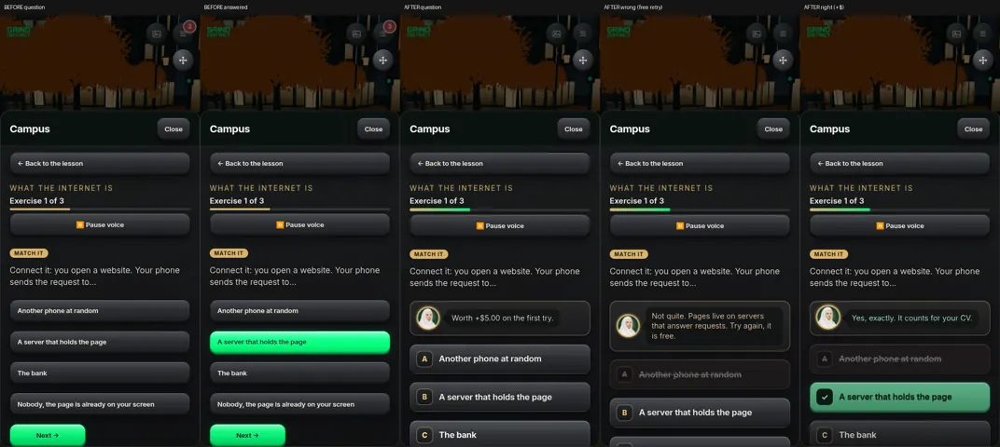 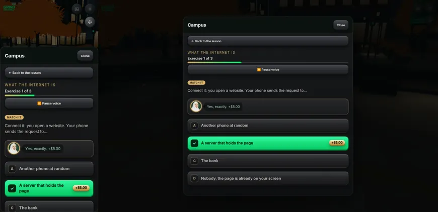

---

## 8. Careers and progression

**Reputation and ranks.** Reputation is the only score on screen: +5 for a course pass, +3 for a campus talk, +2 for a gym set, more for events and job duties. There is no XP or points anywhere. Ranks still climb underneath, Shrimp → Crab → Fish → Dolphin → Shark → Whale, shown in the wallet as a medallion road with a progress bar and no numbers. They open lounge stations and status unlocks (private lounge, sky penthouse, grand tourer, yacht deck).

**Careers.** 16 tracks (prediction markets removed): Trading, Investing, Staking and DeFi, Airdrops, InfoFi, NFTs, Crypto gaming, Content creation, Web3 jobs, Building products, DAOs and communities, Grants and hackathons, Infrastructure. Jobs include event speaker, community manager, market analyst and researcher. Each job has daily duties done at a real place in the city.

**Job levels:** Intern → Junior → Associate → Mid-level → Senior → Lead → Principal → Head → Director → Partner.

**Daily and weekly.** Daily check-in (fixed reward that grows with the streak, up to $15). Weekly challenges in Career. The "Next step" button always says what to do next.

### Needs, mood and the season

Needs give players a reason to come back each day; the season gives them a goal until 31 January 2027. Nothing in either is random.

| System | How it works |
| --- | --- |
| **Needs** | Energy, hunger, hygiene and social fall slowly while you play; time away barely counts. The bed, cooker and fridge, shower, street shops, hospital, greeting people and events bring them back. A low need only nudges; nothing is lost. |
| **Mood** | With every need looked after you are Inspired: courses, jobs and events give +3 reputation, up to ten times a day. |
| **Free season** | Season 1 · Founders: weekly challenges move you along 20 steps; every free step gives an item or +5 reputation. |
| **Grind Pass** | A premium track beside the free one for $750 in-game: $1,000 back in in-game cash across the steps, exclusive looks and jewellery the boutique never sells, two plate frames, +50 reputation and a Season 1 Founder badge. Steps already reached are given at once; one step can be skipped for $90. |
| **Featured today** | Two boutique bundles a day: a runway look with a matching piece of jewellery at 20% off, the same for everyone, with a countdown to midnight. |
| **Cash alert** | A short ka-ching whenever money comes in, at the game's sound level. |

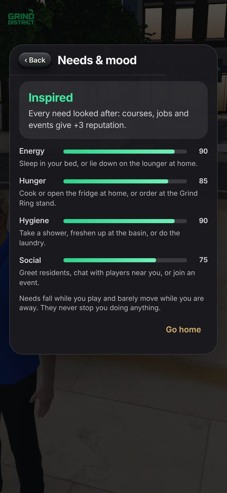 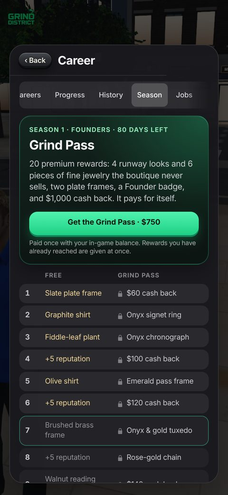

### More to do

| Activity | How it works |
| --- | --- |
| **Etiquette House** | Seven classes of three cards and one question: introductions, the table, dress codes, conversation, thank-you notes, a steady mind, and how pressure tactics work so you can refuse them. +3 reputation each, +10 for all seven. Life skills, so no certificate. |
| **Raceway** | Hold to accelerate, lift for the red bends; take a bend too fast and the car slides wide. Five laps against par for a bronze, silver or gold medal. A clean run gives +2 reputation once a day. Cars you own are quicker than the club kart. No bets and no prize money. |
| **District Cards** | 27 collectible cards in five sets: Landmarks (visit places), Scholar (pass courses), Society (friends, classes, your business, hosting), Raceway (medals) and Founders. The Founders pack is $250 in-game and its four foil cards are shown before you buy. Nothing is random: no blind packs, no odds. A complete set gives +5 reputation. |
| **Dealership and gadgets** | Seven cars with smooth bodies, real wheel arches and alloy wheels: city saloon, executive saloon, sport saloon, grand tourer, electric coupé, V8 supercar and hypercar. Original designs, with no real badges. New computers: a pro laptop with an ARM chip, a mini desktop with a display, a pro tablet, a folding phone and a mixed-reality headset. Cars you own are quicker at the Raceway. |
| **Photo card** | A picture of your character with your name, reputation and an invite code to scan, shared from Profile. It shows no balance or wallet. |
| **Driving** | Your most valuable car waits by your house; every dealership car has a free test drive. One stick (up to go, back to brake or reverse, sideways to steer) and one button (Get out). Chase camera, rolling and steering wheels, an engine note; traffic gives way. |
| **Grind Raceway circuit** | A circuit south of the city with kerbs, barriers, a start gantry and a grandstand. Two laps against three rival drivers, a 3-2-1 start, gates and a gold arrow, your place live, a ghost of your best run, medals against par. |
| **Bay cruise** | A day cruiser from the harbour launch: seven pairs of buoys round a lighthouse rock, a wake, the bow lifting at speed. |
| **Grind Metro and Grind Park** | A three-car train on a raised line round the city, six stations, $2 a ride, "Get off at the next stop" on the gold button. It runs out to Grind Park and the airport. Grind Park: lawns, a lake, a fountain, a playground, an ice-cream kiosk, and seated rides: a roller coaster (chain lift to 22 m, a big drop, a tight turn, gravity-driven speed), a speed slide and a tube slide from a 14 m tower into a splash pool, a Ferris wheel and a carousel. A $100 day pass at the gate covers every ride and the zoo's safari tram; without it each ride has its fare. |
| **Grind Park west** *(after the deadline)* | A picnic lawn (sit down to a hamper, $12); **Grind Zoo**, four enclosures with giraffes, zebras, elephants, lions and flamingos that walk about, and an open-top safari tram between them ($15); **Grind Golf**, three par-3 holes ($25) with a swing meter: aim is automatic, stop the marker in the gold zone, follow the ball, putt it in. |
| **Flights** *(after the deadline)* | Flight GA 101 from Grind International in **Economy ($40), Business ($140) or First ($380)**: pushback, taxi, take-off over the bay, a cruise far out over the sea in your own cabin with its service, back past the lighthouse, across the city at 150 m and a landing. **Grind One**, the party jet ($250): a DJ, an LED dance floor, a bar and a crowd in a lounge with panoramic windows while it circles the city. |
| **Party yacht** *(after the deadline)* | From the harbour ($150): a 30 m yacht with a DJ and guests dancing on the aft deck, string lights and live party music, out past the lighthouse and back. |
| **Society Masterclasses** *(after the deadline)* | Eight premium classes at the Etiquette House ($300 each, $1,800 for all) with real-world detail, a real situation and a three-question test: The Wealth Mindset; Quiet Luxury: Old Money, New Money; Signal, Tact and Larping (the levels of what you show, why faking wealth backfires, how to spot people who larp it, how to answer the money question); Fine Dining and Hosting; Working the Room at the Top; Presence and Voice; First Class Travel and Fine Hotels; Negotiation and Deals. +8 reputation each and the Society Masterclass diploma for all eight. |
| **Graduation** *(after the deadline)* | Pass every core course in the six Campus worlds (25) and graduate in the Great Hall: the class in caps and gowns, Zahra at the lectern, your name called, the walk up for your diploma to applause, the cap toss under confetti. The Diploma in Web3 Foundations downloads as an image or shares to X from Graduation by the Campus steps. |
| **Cliff climb and skydive** *(after the deadline)* | At the airport, guided step by step with a direction card and one big button. A 34 m sea-cliff climb ($35): harness, knot, helmet, then hold by hold with quickdraws, the crux and a shake-out, top out, abseil down. A tandem skydive ($250): briefing, the climb in the jump plane, the door, freefall with an altimeter, pull, the canopy check, steering to the target, flare. |
| **Grind Orbital** *(after the deadline)* | A rocket trip ($2,500), seated in the capsule: countdown, liftoff, stage separation, orbit 400 km up over a curved Earth with a thin blue atmosphere and stars, re-entry in a plasma glow, three parachutes and a splashdown off the city. Original rocket and company. |
| **Luxury homes** | Grind Realty sells a garden duplex ($9,500), a hillside mansion with an escalator, a glass lift, a roof infinity pool and a helipad ($32,000), the crown penthouse on the marina tower ($48,000) and the sky house on the 110 m Sky Tower ($90,000), each with a free viewing. Ten whole-room looks (try first, buy once), twelve premium pieces, and Arrange (tap a piece, tap where it goes). |

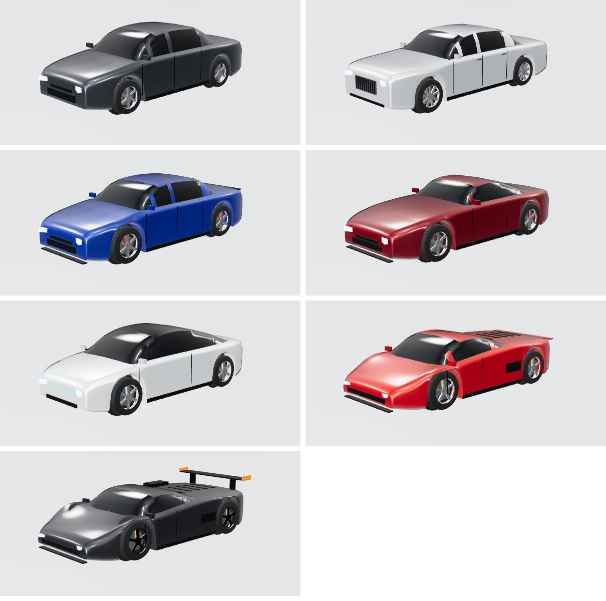

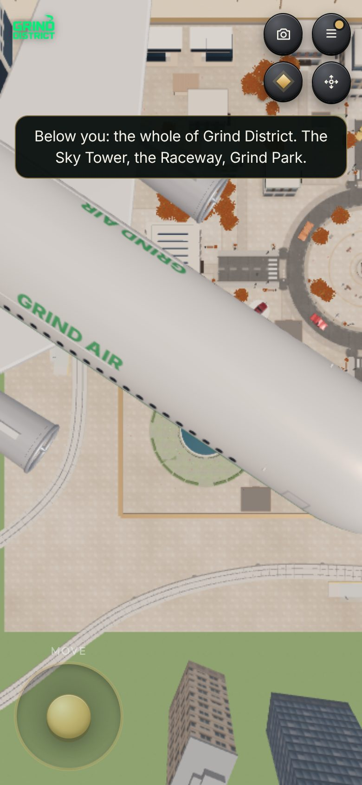 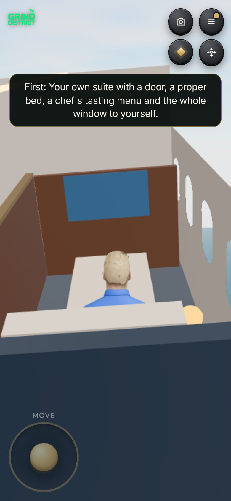 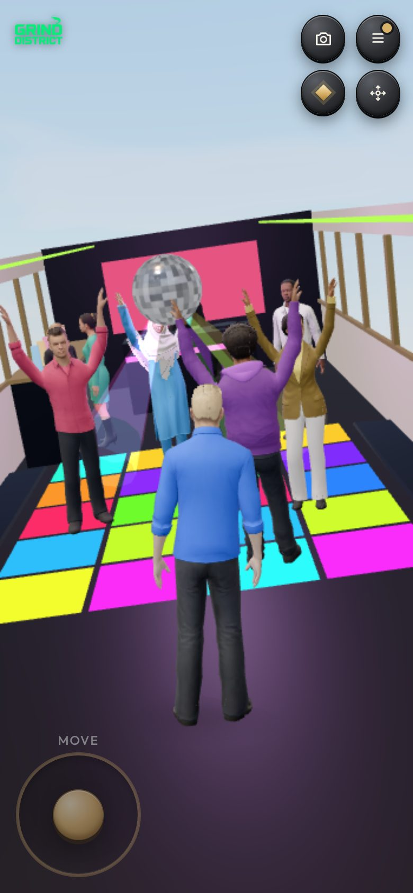 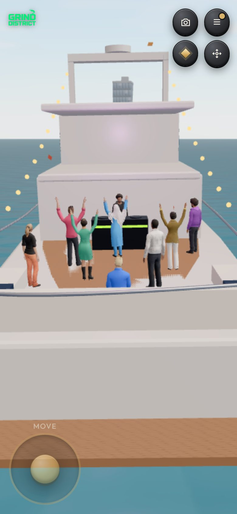

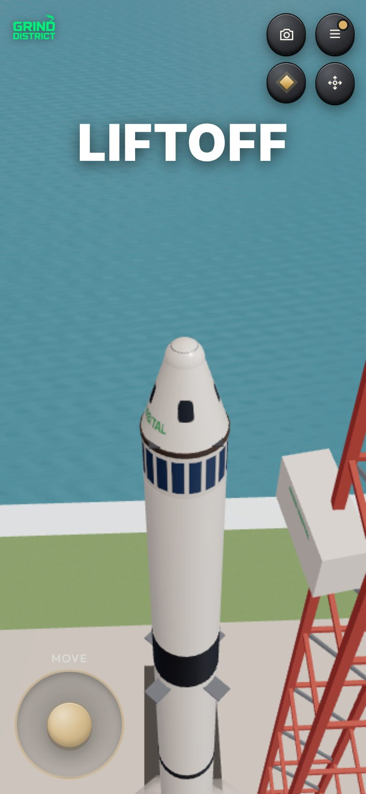 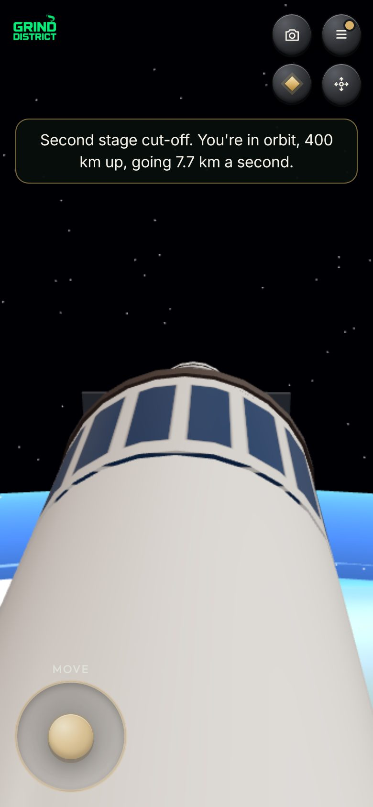 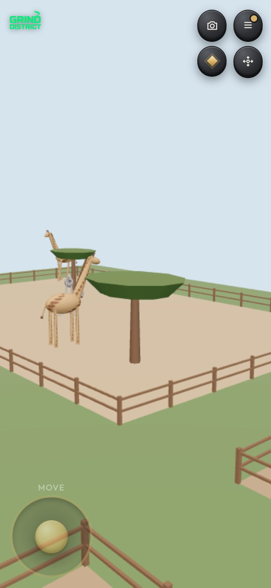 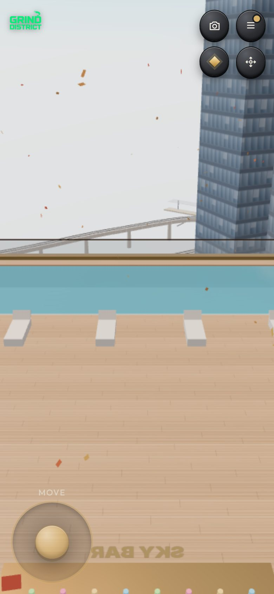

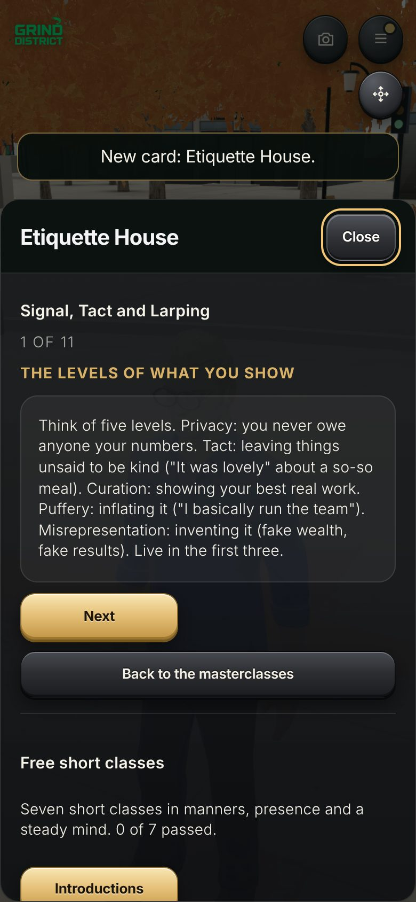 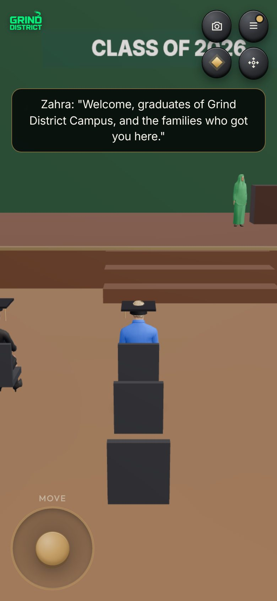 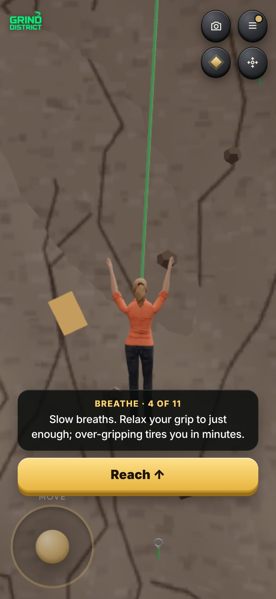 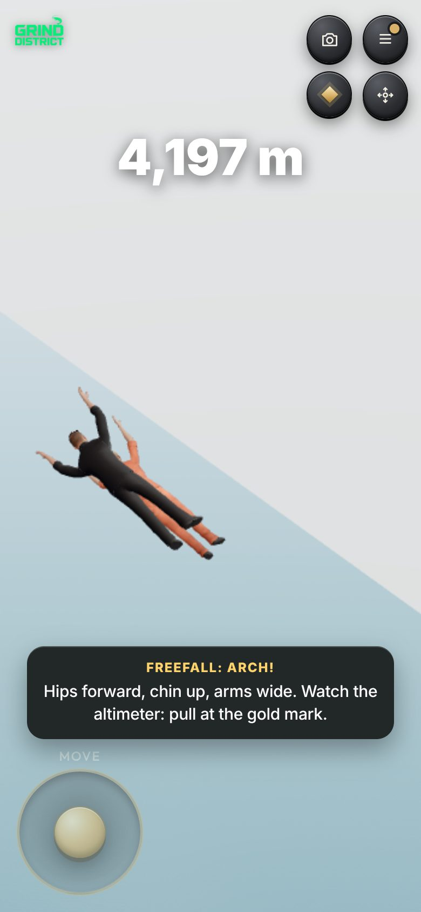

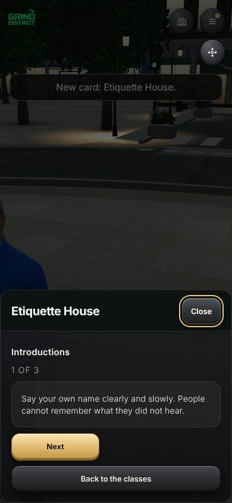 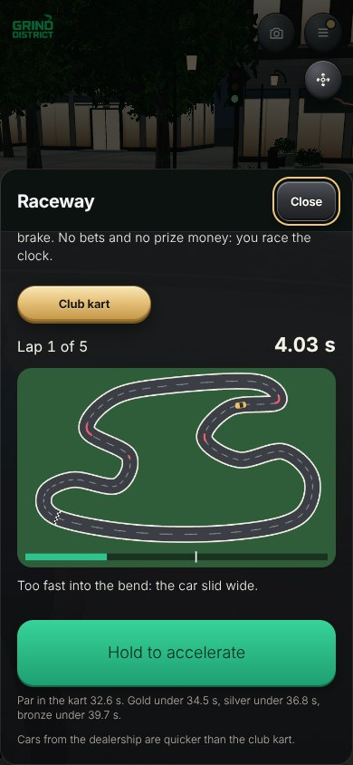 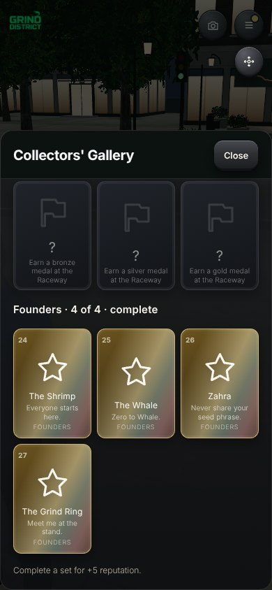 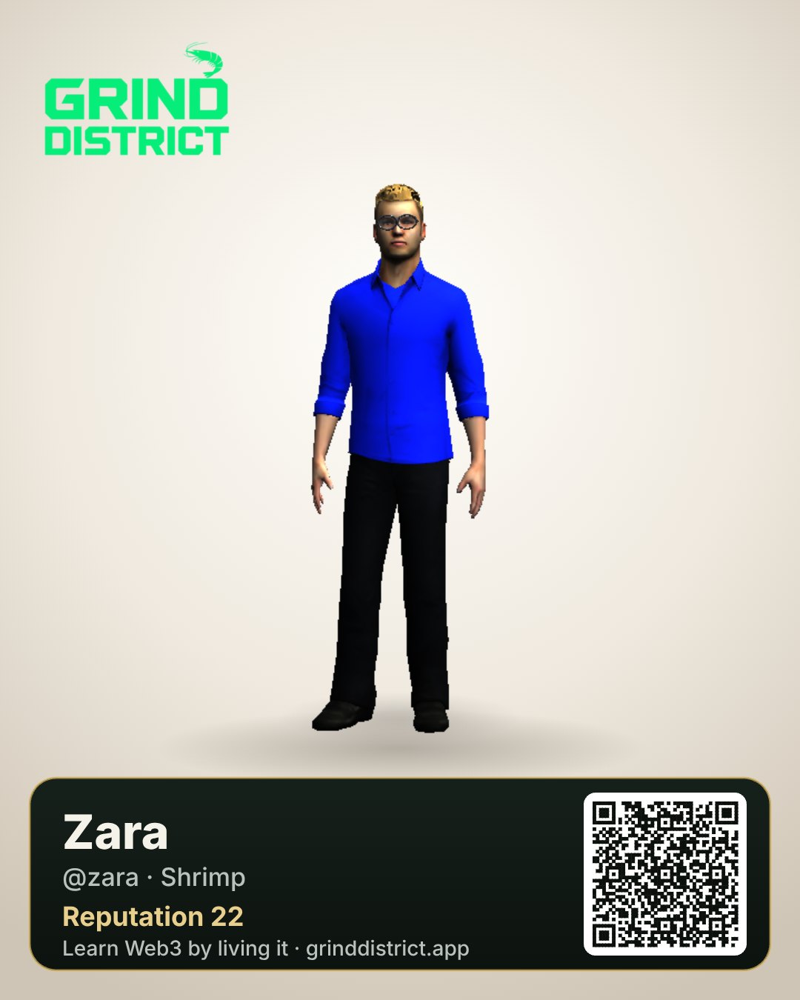

---

## 9. Practice trading

One exchange-style screen, linked to the courses behind each desk:

- **Spot:** buy and sell District Coin, BTC, ETH, SOL and others on simulated prices.
- **Perps:** long or short with leverage, liquidation price shown, earned balance only.
- **Convert:** swap one asset for another.
- **P2P:** buy and sell with other traders through escrow. Some offers are traps (pay outside escrow, fake proof, a third party) to teach what to refuse.

Assets are grouped as **Coins** (District Coin, BTC, ETH, SOL…) and **Tokens** (Meme Token, LINK, WIF, BONK). Nothing touches a real exchange. Not financial advice.

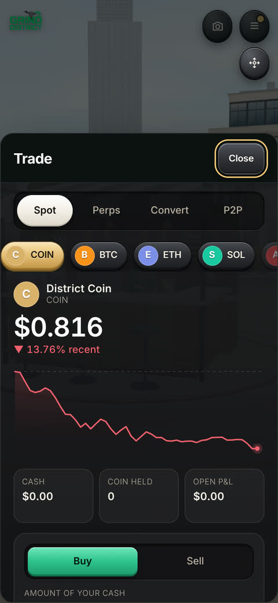

---

## 10. In-game economy

**Currency.** In-game dollars (practice money). Shown as one balance with a split: **earned** and **topped up**. Earned money is spent first. Nothing can be withdrawn.

| Sources | Sinks |
| --- | --- |
| Welcome bonus $1,000 (once per account) | Boutique: premium looks, jewellery, Featured bundles, the $120 makeup kit |
| +$15 per course passed; +$50 for World 1 | Grind Pass $750; one step skip $90 |
| Daily check-in, up to $15 with a streak; $25 birthday gift once a year | Street shops, pharmacy and hospital, which restore needs |
| Job duties and weekly challenges | Homes and furniture |
| Grind Pass cash back, $1,000 across the season | Cars and status items (with upkeep) |
| Practice trading gains | Paid ranks (only after a real top-up above $5) |
| Takings from your business; tickets to events you host | Business licence, stock and rent; hall hire; gifts; the Founders card pack |
| Optional top-up: USDC or ETH on Base (default $5, 1 to 1,000); NEAR on mainnet (the player sends NEAR from their own wallet, the server checks the transaction and credits once; added 15 Nov, switched off until configured); any chain through NEAR Intents 1Click (SOL, USDC or ETH on Solana, Base and Arbitrum, swapped to USDC for grinddistrict.near and credited once NEAR Intents reports success; live 21 Nov) | Practice trading losses and perps liquidations |

### The town economy

Residents are part of the economy, not scenery. Each of the 16 named residents has a wallet, is paid a wage of $22 to $60 a day, and spends it. What the town can spend in a day is bounded by what it earns, so player income from residents has a real ceiling.

| Part | How it works |
| --- | --- |
| **Your business** | One licence at a time: juice bar ($300), confectionery ($380), bookshop ($520), salon chair ($650) or print and merch studio ($800). You name it (brands welcome), buy stock wholesale in lots of ten and set the price. |
| **Sales** | Every five minutes each resident decides whether to pass by. They buy if your price is at or under what the item is worth to them that visit and they can afford it. Too dear and the stock sits; too cheap and you sell out for little. Up to two hours are caught up after time away. |
| **Costs** | Stock at wholesale, rent once a day from the till. Closing returns half the licence, the till and half the stock value. |
| **Friendships** | Say hello to a resident once a day, or bring a $10 gift: Stranger, Acquaintance, Friend, Close friend. Friends pass by more often, pay a little more and come to your events. |
| **Your events** | Book the Conference centre for $120: an AMA, a meetup, a launch. Residents who are free and can afford a $6 ticket come, friends first. Once a day, for reputation. |

Nothing is rolled when you press a button: a visit is fixed by the resident, the business and the time slot. The market settles from what players and residents do, with no step a developer has to patch.

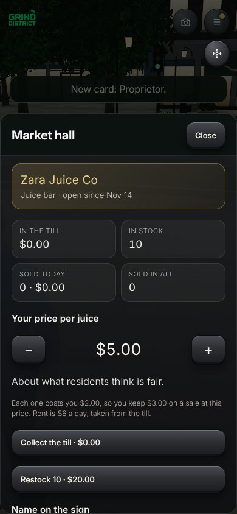 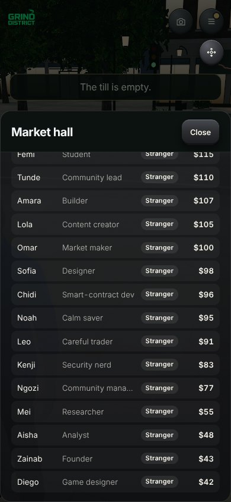

**Books.** A private ledger in Profile: a balance sheet (cash, investments at market, total assets, items that cost upkeep, net worth), a holdings table with average cost and profit or loss, the things you own, and a dated journal of every money move in and out. It teaches assets against liabilities.

**Wallet.** The balance with a hide toggle; round Top up, Trade and Shop keys; Recent moves; tabs for Assets (cash and stablecoins, coins, meme coins, tokens), NFTs (certificates read from NEAR, with token links) and a Watchlist; the rank road; and product cards with real renders. Nobody else ever sees your balance, holdings or ledger: the public profile shows none of them.

**Gambling is not trading.** The Velvet Room on your street is a casino front, closed for good; nothing inside takes a bet. Its card sets the two side by side: in gambling the house wins by design and losses are chased; in trading you need an edge, a tested plan, and losses capped before you enter. It ends with helplines (US 1-800-GAMBLER, UK 0808 8020 133) and a link to practise on the Trade screen.

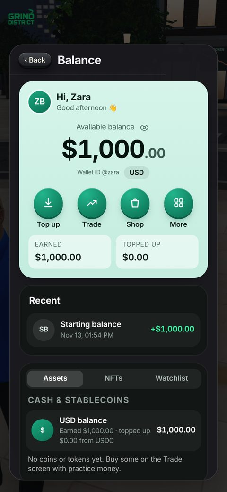 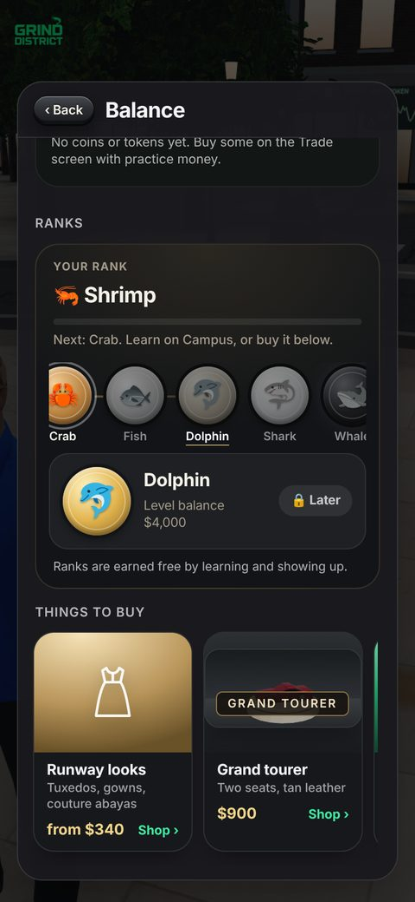

**Design rules.** No pay-to-win: learning, the CV and certificates are free. Buying a rank never skips a lesson. Top-ups are clearly real money in; they never come back out.

---

## 11. Proof: CV, certificates and on-chain credentials

- **CV.** A professional, printable CV built from what you completed: profile, experience (job and practical tracks), education and certifications (the five-module Web3 Foundations Programme and specialist courses), skills. No ranks or XP on it. Download as PDF; share a public page at `/cv/<username>`.
- **Certificates.** A premium certificate for every pass, each with a public page at `/cert/<id>` and an image for sharing.
- **Minting starts with a short exam graded on the server**: the course's own checks, shuffled and timed by the server, three in four to pass. A pass returns a signed 30-minute ticket and a mint voucher is refused without it, so editing a save cannot produce a certificate. The exam is open-book, not proctored. The mint screen then lists every live chain.
- **Certificate NFTs (EVM and NEAR).** A passed course can be minted as a **soulbound ERC-721 NFT** on Base (`0xBEC44b497b5D4696644A5ad581804476CB20808f`) or, on Arbitrum, OP Mainnet, Robinhood Chain, Polygon and BNB Chain, as the same Sourcify-verified `GrindCertificate` at `0x6bC81E26832986d56B6e59c31599F3113971Ec33`. It can also be minted as a **soulbound NEP-171 NFT** on NEAR testnet (`grinddistrict-cert.testnet`). One per username and course on each contract; the player pays gas (and, on NEAR, a small storage fee). Moving the NEAR contract to mainnet is a configuration change ([`docs/NEAR-MAINNET.md`](NEAR-MAINNET.md)). The five newer EVM contracts are live in the picker as of 28 November 2026 (`947bd81`); no player mint on those five has been recorded yet. Robinhood Chain (id 4663) also needs to be allowed in the Privy dashboard. Routing notes: [`docs/multichain-router.md`](multichain-router.md).
- **Solana certificate record (devnet).** Passing the exam also writes a soulbound certificate account on Solana devnet automatically, with no wallet and no fee, through program `6NJLLRRTkvEwijjSo62HHJF4trQowqJJLWDXxPdMB1Hd`. This is a grind-cert account (course id, certificate hash, serial and timestamp), not a tradable token NFT. The public certificate page shows *Recorded on Solana*, with a medal card and a Solana Explorer link. The mint screen has a Solana button, already ticked if the record has landed.
- **NFTs that do something.** The game reads each certificate back from the chain (never from local data) and then:
  - marks the course **Verified** on that chain, with the token or explorer link, on the CV, the certificate list and the profile nameplate;
  - adds an **On-chain credentials** entry to the CV;
  - opens the **Holders' room** in the Members' lounge when a NEAR certificate NFT is held. Its desks give holders tools the lounge keeps for higher ranks.
- **Skill Passport.** A separate self-attested NEAR contract (`grinddistrict-passport.testnet`): a record written from the player's own account unlocks an apprenticeship quest.

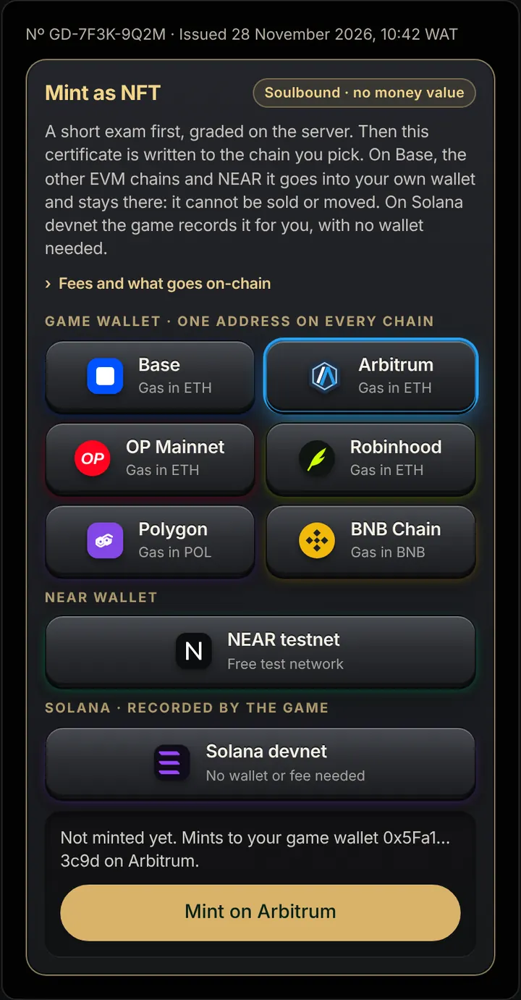 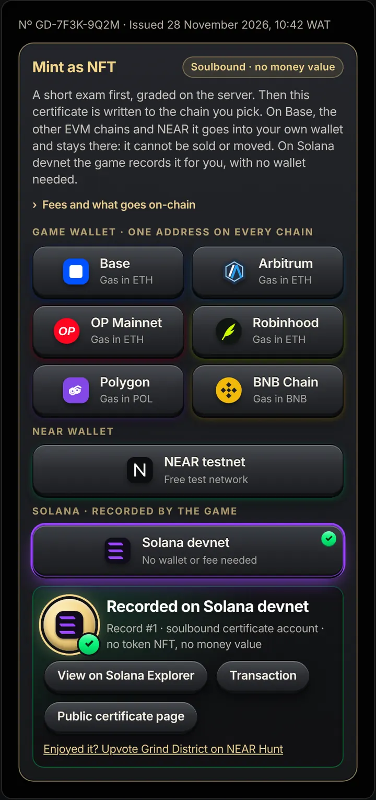 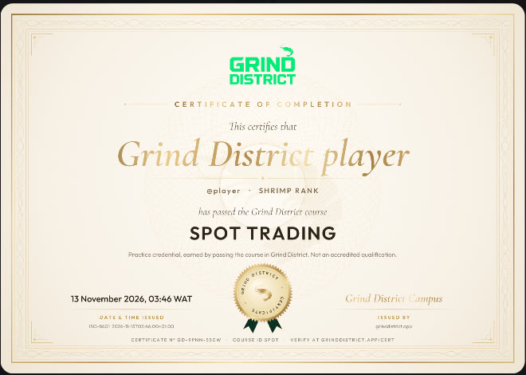

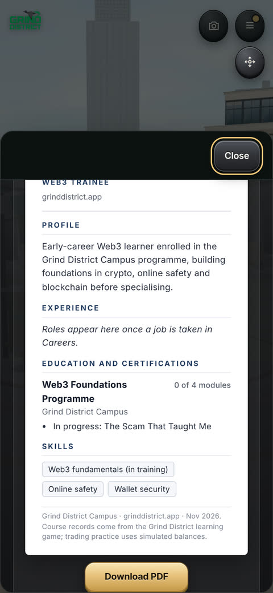  

---

## 12. Social

- **Nearby chat** with players within 12 m (lines are not saved).
- **Messages** to anyone by username or name, even when they are offline: text, photos and voice notes. Open their public profile from search.
- **Friends and party** (up to 4), "join me" to meet up.
- **Greet** people you pass. **Invites** with a referral link or a **photo card** with a code to scan: the friend gets a $100 welcome gift, you get $50 when they join and $150 when they pass a course (up to 25 friends), and Profile tracks link opens, joins, active friends and the month's top inviters. **Share on 𝕏** for CV and certificates.
- **Friendships with residents:** four levels, built by showing up (see the town economy).
- **Online pill** shows who is in the city.

---

## 13. AI agents

AI agents join the city through a copy-paste prompt (`/agents`). They appear as labelled robots, move, chat, attend events and earn in-game money under rate limits, so they never crowd out people.

**Next:** an agent helps its owner play: it reminds them of daily tasks, walks them through lessons, runs practice routines, and earns rewards for its owner. Owners stay in control, and limits keep it fair.

---

## 14. Art, audio and UX

- **Look.** Warm, realistic city in the browser: rigged people, physically based materials (brick, stone, oak, tile), soft shadows, a sky with day, dusk and night, glow and depth effects on High. Your own face is drawn at twice the detail, with makeup painted on.
- **UI.** Raised 3D keys, iPhone-style type (Inter; the logo keeps its own lettering), dark and light themes, big touch targets, panels that never cover the controls.
- **Audio.** The theme "Market Velocity" from the title screen into the city. City sound you can hear. Voices: Zahra's recorded lines, residents and the server speak in voices that fit them. Music dips while someone speaks. A ka-ching plays when money comes in.
- **Speed.** The city's code, walking animations and ground textures are fetched while the title card is up, and resident models load after the first frame. Opening the district on a throttled phone profile went from 11.5 s to 5.5 s.
- **Brand.** Green GRIND DISTRICT wordmark with the shrimp (everyone starts as a Shrimp). The site icon uses the same logo.

---

## 15. Technology

| Layer | Choice |
| --- | --- |
| Client | Vite + TypeScript + three.js (WebGL), no framework; lazy-loaded panels |
| Hosting | Vercel (static site + serverless functions) |
| Data | Supabase (Postgres, private storage for message media) |
| Accounts | Privy (Google, X, email; embedded wallets) and NEAR wallet sign-in (NEP-413 signed message) |
| Chain | NEAR testnet contracts in Rust (certificate NFT, Skill Passport); Base for USDC top-ups, the optional Base certificate and the Stockholders' Club |
| Voice | Zahra's lines recorded with a neural TTS model; the device's speech engine for other lines |
| Quality | Type checks, logic and cert test suites in the build; real-WebGL screenshot tests on phone and desktop sizes |
| Saves | The save follows the account. Needs, the Grind Pass, the season, the makeup kit and the wardrobe travel with it; the Stockholders' Club wallet address stays on the device |
| Licence | MIT for all code. Third-party art keeps its own licences; the name, logo, music and voices are not covered |

Performance budget: Low, Medium and High graphics; phone pixel ratio capped; rendering pauses behind full-screen panels; assets cached with long-lived immutable URLs.

---

## 16. Safety, honesty and compliance

- Practice money only; no withdrawals. Prices are simulated. Not financial advice.
- The game never asks for a seed phrase. Scam awareness (World 2) comes before wallets and trading.
- No game of chance exists anywhere in the city. The casino is a closed front that explains gambling against trading, with helplines.
- Balances, holdings and the ledger never appear on a public profile.
- Certificates are practice credentials, not accredited qualifications, and say so.
- NFTs are soulbound (cannot be sold) and have no money value. The NEAR certificate and Skill Passport contracts are on testnet. The Solana certificate is a soulbound record on devnet, not a token NFT.
- No personal data is written on chain. Players can delete their account and data.
- Agents are labelled and rate-limited.

---

## 17. Metrics

North star: **weekly players who pass at least one lesson.**

| Funnel | Retention | Proof | Economy |
| --- | --- | --- | --- |
| Title → sign up → first lesson passed | D1, D7, D30; daily check-in streaks | Certificates issued, CVs shared, NFTs minted | Earned vs topped-up balance, sink usage, top-up conversion |

**Live now** in the city stats (the Online pill) and at `https://www.grinddistrict.app/api/track?op=stats`, counts only: players active today, learners (a course passed), courses passed, certificates issued and players who came back on another day in the last seven. On 15 November: 9 learners, 26 courses passed, 18 certificates, 10 players back on a later day this week, 27 registered. On 28 November 2026, 09:42 WAT: 1,648 visitors, 95 registered, 48 learners, 90 lessons passed, 36 certificates.

---

## 18. Roadmap

| Phase | When | What |
| --- | --- | --- |
| **Now** | Nov 2026 | Live city, six worlds, careers, practice trading, homes, boutique, messages, Zahra's tour and voice, 14 languages, needs and mood, the Grind Pass season, wallet and ledger, street shops and hospital, a town economy with player businesses, friendships, the Etiquette House, Raceway and District Cards, push and email alerts for messages, certificate NFTs that unlock the Holders' room (NEAR testnet). Since 28 Nov: the first-visit Learning Center card, instant lesson feedback with a free retry and a soft streak, the Chain Gallery, and a mint screen for Base, Arbitrum, OP Mainnet, Robinhood Chain, Polygon, BNB Chain, NEAR testnet and a Solana devnet certificate record. Since 15 Nov (after the hackathon deadline): a short exam graded on the server before any certificate mint, live learning numbers, a Learn-first menu, a NEAR top-up for in-game purchases (off until configured), the city opening in daytime and faster; luxury homes, the metro, Grind Park with its rides, zoo and golf, the airport with three cabins, the party jet and yacht, a trip to orbit, the four seasons and climate previews, the hotel and the mall. |
| **Next** | Dec 2026 – Q1 2027 | An AI companion you feed and dress, run on NEAR AI. Sign-in from any chain (NEAR Intents). Private, selective sharing of certificates on Midnight. Alerts for daily streaks and events. A conference host like Zahra and live events. Satellite map. More homes and cars. Gas-sponsored certificate mints. |
| **Then** | Q1 – Q2 2027 | Agents that help their owners play and earn rewards. Partner courses from Web3 projects with their own certificates. Guilds and team challenges. Creator tools for community lessons. |
| **Later** | H2 2027 | Mainnet credentials, verifiable by employers. Job board linking CVs to real Web3 roles. Seasonal cities. Governance of the course catalogue by holders. A token only after legal review (see section 20). |

---

## 19. Whitepaper (summary)

**Problem.** Millions want to work in Web3, but learning is scattered, scams are everywhere, and skills are hard to prove. Employers cannot tell who actually knows what.

**Solution.** A free game where learning happens by doing, inside a city that feels like a life, and every step leaves proof: a CV, certificates and on-chain credentials that unlock things.

**Proof of learning.** A course pass is graded in the game, issued as a certificate with a public page, and can be anchored on chain as a soulbound NFT. Because the game reads credentials back from the chain, they work as keys: verified marks, rooms, roles and, later, job applications.

**Agent economy.** Agents are citizens with limits. Over time they help their owners play, learn and earn; their activity is visible and capped so the economy stays fair.

**Economy.** Practice money teaches without risk. Real money only enters through optional top-ups for cosmetics and status, never for learning or proof.

**Principles.** Free to learn. Proof over points. No seed phrases, ever. Honest labels on everything that is simulated, testnet or self-attested.

---

## 20. Tokenomics (draft, not launched)

> **There is no Grind District token.** District Coin and Meme Token in the game are simulated practice assets with no value. This section is a draft for discussion only. It is not an offer, and any token would need legal review first.

**Purpose of a future token (working name $GRIND).** Reward verified learning and contribution, give holders a say in what is taught, and pay for on-chain actions (certificate mints, agent registration), without making learning pay-to-win.

| Allocation (draft) | Share | Notes |
| --- | --- | --- |
| Learn-and-contribute rewards | 40% | Released over years for verified passes, mentoring, community lessons; capped per person per week |
| Ecosystem and partners | 15% | Partner courses, grants, hackathons |
| Treasury | 15% | Run by holder governance |
| Team | 15% | 1-year cliff, 3-year vesting |
| Liquidity | 10% | Market making at launch |
| Advisors | 5% | 1-year cliff, 2-year vesting |

**Utility (draft).** Sponsor certificate mints and on-chain records; register and stake for AI agents (stake slashed for spam); vote on the course catalogue and events; premium cosmetics. **Never** required to learn, earn a certificate or build a CV.

**Anti-abuse.** Rewards only for verified progress, per-account weekly caps, agent rate limits, and no rewards for buying ranks.

---

## 21. Risks

| Risk | Mitigation |
| --- | --- |
| Players treat practice trading as advice | Clear labels, simulated prices, risk lessons before perps |
| Scams targeting players | World 2 first, no seed phrases, P2P trap scenarios, report and block in Messages |
| Low-end phones | Low graphics, capped pixel ratio, paused rendering behind panels |
| Farming rewards with bots | Rate limits, labelled agents, caps, verified progress only |
| Regulation of tokens | No token today; legal review before any launch |
| Gambling harm | No game of chance; the casino is a closed front with a gambling vs trading card and helplines |
| Pay to win | The Grind Pass and bundles are cosmetics and cash back, nothing random; learning, the CV and certificates stay free; a bought rank never skips a lesson |
| Progress on a new device | Needs, pass, season, makeup kit and wardrobe now travel with the account's save |
| A runaway economy | Residents can only spend their wages; one business at a time; catch-up after time away is capped at two hours |
| Collecting as gambling | Every card is earned or bought with its contents shown; no blind packs and no odds |

---

## 22. Hackathon fit

Grind District enters the [NEAR Hackathon](https://nearhackathon.com) in four tracks. Submissions closed on 14 November 2026 at 23:59 UTC; the entry is commit `394ef41`, and the judged work is what was built since 1 November. Up to the entry, 210 of the 326 commits and 24,574 of the 40,185 lines of code (61%) were written in the window, and every NEAR file (both contracts, NEAR sign-in, the mint and the read-back) is new (`git diff --shortstat pre-hackathon 394ef41`). Work from 15 November on is listed in the README under *Added after the deadline* and is not part of the entry.

| Track | What a judge can open |
| --- | --- |
| Games With Real Economies | Residents with wallets and wages buy from a business the player owns and prices; needs fall, players earn by learning and jobs and spend at the shops, the boutique and the Grind Pass (section 10) |
| NFTs That Do Something | A soulbound certificate on `grinddistrict-cert.testnet` marks the course Verified on NEAR and opens the Holders' room |
| Agent Economy | Agents join through a prompt as labelled robots that move, chat and earn under rate limits |
| Open Innovation | A free 3D city that teaches Web3 by living it, in 14 languages on a phone, where a passed lesson becomes a credential on NEAR that the world reads back |

| Criterion | Evidence |
| --- | --- |
| Technical implementation | Two Rust contracts on NEAR testnet with 33 passing unit tests; tokens #1 and #2 minted; the game reads them back with `cert_for`; type checks and logic tests in every build |
| Design | A phone-first 3D city with Low, Medium and High graphics, 14 languages, light and dark themes and a voiced guide |
| Impact | Free Web3 learning with scam awareness first, and proof an employer can check on chain |
| Originality | A life sim where a lesson leaves a soulbound credential that changes the world around you |
| Sustainability | A closed in-game economy with sources and sinks and a season pass; no token is needed to play |

---

## 23. Appendix

- **Play:** https://www.grinddistrict.app
- **Source:** https://github.com/0xzahra/Grind-district
- **Certificate NFT, NEAR testnet:** [`grinddistrict-cert.testnet`](https://testnet.nearblocks.io/address/grinddistrict-cert.testnet) (soulbound NEP-171)
- **Certificate NFT, Base:** [`0xBEC44b497b5D4696644A5ad581804476CB20808f`](https://basescan.org/address/0xBEC44b497b5D4696644A5ad581804476CB20808f) (soulbound ERC-721)
- **Certificate NFT, Arbitrum / OP Mainnet / Robinhood Chain / Polygon / BNB Chain:** [`0x6bC81E26832986d56B6e59c31599F3113971Ec33`](https://github.com/0xzahra/Grind-district/blob/main/docs/multichain-router.md) (same Sourcify-verified `GrindCertificate` on each)
- **Certificate record, Solana devnet:** program [`6NJLLRRTkvEwijjSo62HHJF4trQowqJJLWDXxPdMB1Hd`](https://explorer.solana.com/address/6NJLLRRTkvEwijjSo62HHJF4trQowqJJLWDXxPdMB1Hd?cluster=devnet) (soulbound grind-cert account, not a token NFT)
- **Skill Passport contract:** [`grinddistrict-passport.testnet`](https://testnet.nearblocks.io/address/grinddistrict-passport.testnet)
- **Multichain router:** [`docs/multichain-router.md`](multichain-router.md)
- **Made by:** [Zahra](https://0xzahra.github.io)

---

## 24. Competitor research

Checked on 24 November 2026 from public pages. Several of these products are young and their own pages are the only
source, so numbers they quote are marked as unverified. The point of this section is what each one teaches us, not a
ranking.

| Product | What it is | What players get | What we take | What we avoid |
| --- | --- | --- | --- | --- |
| **Lagos Life** ([fan guide](https://lagoslifeguide.com/), [overview](https://blog.gosub.ng/lagos-life-game)) | Free browser life-sim set in Lagos, often compared to The Sims. Jobs, needs, travel between neighbourhoods, renting homes. One page claims more than 60 million visits and an expansion to Abuja and Port Harcourt (unverified). | A familiar local city and a daily routine. Free to start, optional purchases. | Proof that a free, local, no-download city life-sim can spread fast in Nigeria. Our city stays recognisably West African and opens in the browser with no install. | A life-sim with no outcome. Every hour in Grind District should leave something on the CV. |
| **CT Life** ([source](https://github.com/Horkays-Degen/ct-life)) | Multiplayer life-sim set in "Crypto Twitter": a random origin, then content, trading, building and networking. A 3D version targets the Solana Seeker phone. Its repositories describe play money with no real value, and later work adds on-chain escrow and a play-money casino. | Crypto culture as a game, social status, jokes. | Crypto culture is a strong hook, and play money keeps the stakes low. | Casino mechanics and prediction markets (owner's rule). Satire of the industry in place of teaching it. |
| **Web3 Life** ([site](https://playweb3.life/)) | Browser 3D crypto city: trade markets, build a career, buy a home, meet other players. | The same broad promise as ours: a crypto city in the browser. | Confirms the category exists; the difference has to be proof of learning, not the city itself. | Competing on city size or graphics alone. |
| **BaseCity** ([README](https://github.com/madebyshun/blocky-game)) | A shared voxel city on Base that grows from empty land: each token buy adds a builder, and the land expands in rings as residents arrive. | Watching a shared place grow because of what everyone did. | The living-city idea, without a token: the Graduation Garden at Campus grows a banner at each city-wide milestone of courses passed (1, 5, 10 ... 2,000). Growth is earned by learning, not bought. | Growth tied to buying a token. No token in this phase. |
| **Credly** ([what a badge is](https://support.credly.com/hc/en-us/articles/360021222071-What-is-a-badge), [Cisco FAQ](https://www.cisco.com/site/us/en/learn/training-certifications/certifications/digital-badges/credly-faq.html)) | The standard for professional digital badges. Each badge links to a verification page; it can be added to LinkedIn under Licenses & Certifications. | A credential employers can click and check. | Every certificate has its own public page and image, a one-tap share, and a CV page. Next: an "Add to LinkedIn" link that fills in the certificate's name, issuer and URL. | Badges that only show an image. Reviews note employers find verification confusing, so our page says plainly what was passed and how it was checked (a short server-graded exam). |
| **Coinbase learning rewards and quests** ([page](https://www.coinbase.com/learning-rewards), [quests](https://www.coinbase.com/wallet/quests)) | Short lessons and quizzes, paid in small amounts of a project's token, in some countries only; quests reward on-chain actions. | A few dollars for a few minutes. | Short lessons with a clear finish, and on-chain practice tasks after learning. | Paying people to click through quizzes: it attracts answer-sharing and leaves no skill. Our rewards are reputation and proof, never XP or points. |
| **Layer3, Galxe, RabbitHole** ([comparison](https://www.earnifyhub.com/blog/crypto/learn-to-earn-crypto-platforms-2026)) | Quest platforms: on-chain tasks, credentials, hopes of airdrops. | Lists of tasks across many apps. | Credentials that apps can read. | Farming for airdrops. Points are a score, never a promise, and the courses say so. |

**Where Grind District stands apart:** a free 3D city where the playing *is* the learning, and the result is a CV, a
résumé and certificates with public pages, plus practice trading with earned in-game cash only. None of the products
above combine a city with checked, shareable proof of what was learned.

**What this research changed in the build (24 November 2026):** the title line "Walk out with a CV, resume and
portfolio"; the first lesson leading straight to the certificate and the CV; certificate and CV views counted; the
Graduation Garden; Zahra's gestures while she talks; and tracking of where first sessions stop (`/stats.html`).

